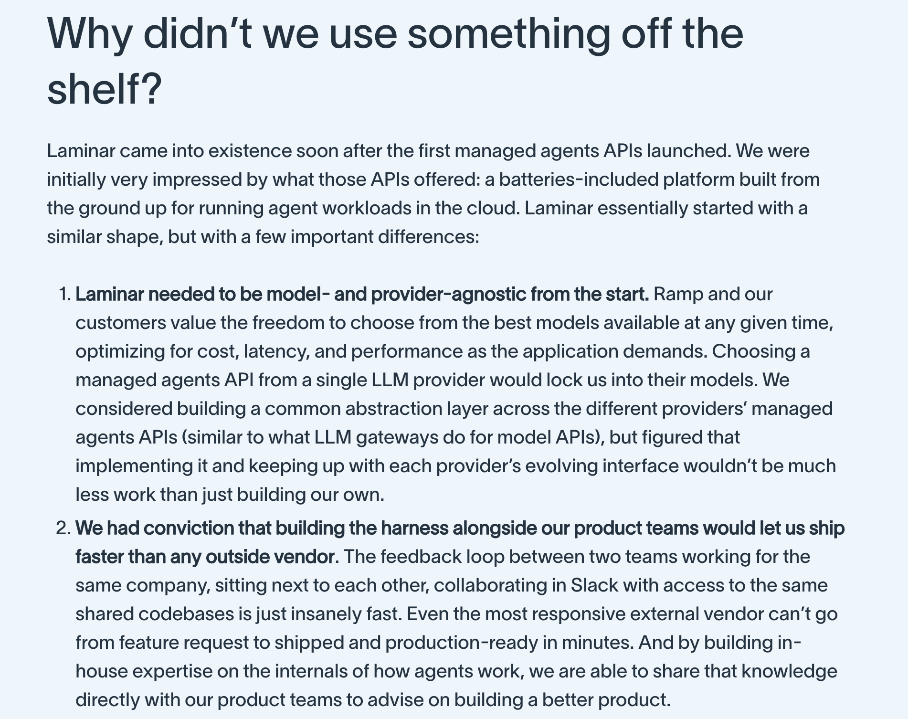

# 🐦 @omarsar0

## 📅 October 23, 2026

> 1 post(s) archived.

---

### 🕐 00:59 UTC · @omarsar0

> Build your own harness, folks! Highly recommended reading on Ramp&apos;s own agent harness and why they built one. I&apos;ve seen this closely. More hardcore engineering teams are realizing how important it is to own the harness. I expect more full-stack AI companies to follow. Ramp quickly realized they could move faster and better with their agent harness. Benefits: - Model-and-provider agnostic - Shipping faster as the harness is closer to other teams - Owning the observability stack (a must given the complexity of agentic systems today) Their Laminar harness supports secure conversation storage, MCP for standard tool calling, durable execution, code execution sandboxes, observability tools, and more. When you own the harness, you can co-evolve it to meet your needs. The foundations don&apos;t change much; only the tooling and behavior need extending, so make the harness malleable from the start. Ramp also made several interesting design choices, such as using sandbox-as-a-tool, leveraging Boring and a standard stack (Postgres, S3, etc.), always-open agent sessions, and going all-in on cloud. after much experimentation, we landed on a single set of rails that powers our agentic systems across the company - background agents, async agents, live chat: 1. stack - accounting harness (http://ramp.com/stack) 2. glass - general purpose coworker (http://ramp.com/glass) 3. ins…

🔗 [View original post](https://x.com/omarsar0/status/2113435080278360133)

---
