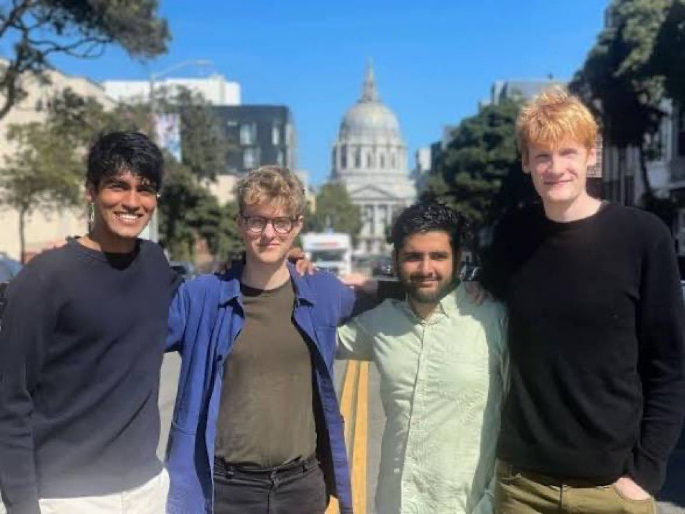

# 🐦 @AiEvolutio58513

## 📅 October 24, 2026

> 3 post(s) archived.

---

### 🕐 14:02 UTC · @AiEvolutio58513

> SpaceX just bought Cursor for $60B &gt; be Cursor &gt; four MIT students launch a side project back in 2022 &gt; ship an AI coding tool devs fall in love with &gt; reach a $10B valuation &gt; figure copilots alone won&apos;t cut it &gt; push into building models &gt; require huge compute to keep pace with OpenAI, Anthropic &amp; Google &gt; xAI, on the other hand, is falling behind in coding &gt; sees that closing the gap might take years &gt; cuts the line instead &gt; acquires Cursor for $60B &gt; Cursor lands the compute &gt; xAI lands the coding leader &gt; founders walk away as multi-billionaires Interested in AI? Follow @AiEvolutio58513 and never fall behind. I track ChatGPT, Claude, and every tool quietly changing how we work and create, then hand you the tested signals.

🔗 [View original post](https://x.com/AiEvolutio58513/status/2113994423956889775)

---

### 🕐 12:59 UTC · @AiEvolutio58513

> Every company spending $100 billion on AI data centers is betting against this one sentence from Satya Nadella: &quot;We are one sort of innovation away from the entire regime changing.&quot; He&apos;s watched the rules change four times already: 1. Pre-training scale 2. Post-training 3. Reasoning 4. RL Each shift made the last advantage worth less. The next one, he says, could be &quot;a new model architecture that could even be more efficient in its performance.&quot; If that lands, the biggest cluster isn&apos;t the moat. The best idea is. Interested in AI? Follow @AiEvolutio58513 and never fall behind. I track ChatGPT, Claude, and every tool quietly changing how we work and create, then hand you the tested signals. Media

🔗 [View original post](https://x.com/AiEvolutio58513/status/2113978584876646805)

---

### 🕐 11:01 UTC · @AiEvolutio58513

> Palantir CEO Alex Karp blasts AI slop companies: &quot;The appearance of software working, is not software working.&quot; &quot;The slop getting a lot of attention is dangerous in terms of the hyperbolic rhetoric—that there will be no jobs because of slop, nothing will work, we will have a god-like figure in the name of AI.&quot; &quot;In fact, what actually does work is a platform built by a motley crew of highly-technical people who over 20 years have been maligned for being right.&quot; Interested in AI? Follow @AiEvolutio58513 and never fall behind. I track ChatGPT, Claude, and every tool quietly changing how we work and create, then hand you the tested signals. Media

🔗 [View original post](https://x.com/AiEvolutio58513/status/2113948923069132995)

---
