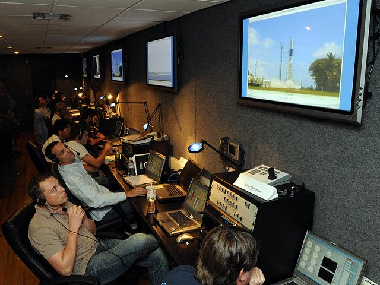

# 🐦 @elonmusk

## 📅 October 24, 2026

> 27 post(s) archived.

---

### 🕐 16:08 UTC · @elonmusk

> Talarico is lunatic left James Talarico: “With every border wall, with every bathroom bill, we degrade our reputation and we dishonor our legacy.” He voted against border security nine times and against the bathroom bill to keep boys out of girls’ bathrooms. He&apos;ll do it again in Washington.

🔗 [View original post](https://x.com/elonmusk/status/2114026169813414022)

---

### 🕐 14:38 UTC · @elonmusk

> Another 27 Starlink satellites Falcon 9 launches 27 @Starlink satellites from California

🔗 [View original post](https://x.com/elonmusk/status/2114003587156086798)

---

### 🕐 14:16 UTC · @elonmusk

> It is tragic that so many people still think the news is real A coworker of mine who once called Elon a Nazi finally said he scheduled to test drive a Model Y yesterday after he learned that I own 2 of them and we talked for an hour about how much I love them and how good FSD is. I asked him how the demo drive went and he told me he cancell…

🔗 [View original post](https://x.com/elonmusk/status/2113998192547332212)

---

### 🕐 14:11 UTC · @elonmusk

> Try Grok @Bot Stuart Varney: What is this Grok @Bot? You use it. Phil Rosen: I am using it. @Varneyco: Who puts it out? What does it do? Rosen: This is @elonmusk’s frontier lab. I will share personally, I was on Claude for the last year or so, and I would use Claude, ChatGPT, and a little bit …

🔗 [View original post](https://x.com/elonmusk/status/2113996858842563006)

---

### 🕐 14:01 UTC · @elonmusk

> It’s very important to grasp this. Fascism is a leftist ideology State control of everything

🔗 [View original post](https://x.com/TheAliceSmith/status/2113994292964241463)

---

### 🕐 13:58 UTC · @elonmusk

> True From 1900 to 1910, 76% of immigrants to America remigrated to their home countries. From 1910 to 1920, it was 97%. There was major political conflict over the disruption immigrants caused. But we had no welfare state. Over time, we kept the best who assimilated. Remigration is hi…

🔗 [View original post](https://x.com/elonmusk/status/2113993492418683207)

---

### 🕐 13:56 UTC · @elonmusk

> Roadster at Petersen Roadster will be on display at the Petersen Automotive Museum in LA starting tomorrow Oct 24-27, Main Lobby https://petersen.org/pages/petersen-vehicle/tesla-roadster

🔗 [View original post](https://x.com/elonmusk/status/2113993051719016814)

---

### 🕐 13:45 UTC · @elonmusk

> In early 2002, Elon was preparing to launch SpaceX and searching for the people who could help him build a rocket from scratch. One Sunday in January 2002, he walked into a friend&apos;s rented warehouse in Huntington Beach and found Tom Mueller holding an 80-pound rocket engine on his shoulder, trying to bolt it to a frame. It was the largest liquid-fuel engine any amateur had ever built, with 13,000 pounds of thrust, made in Tom&apos;s spare time. Elon asked the main question “Could you build something bigger?” The next Sunday Elon came to his house. It was Super Bowl Sunday; they watched maybe one play, because they were too busy sketching the first SpaceX rocket. Tom became SpaceX employee #1, and the man who built engines on weekends went on to build Merlin, Kestrel and Draco. Elon saw a person, not a résumé, someone who built rockets with his own hands simply because he loved them.

🔗 [View original post](https://x.com/EvaFox/status/2113990330060059103)

---

### 🕐 12:41 UTC · @elonmusk

> BREAKING: Oaxaca’s state government in Mexico has delivered 67 Starlink dishes to expand internet access for students. 🇲🇽 The dishes were handed over in Santiago Matatlán. This will enable every high school campus in the network to have internet access.

🔗 [View original post](https://x.com/cb_doge/status/2113974148485808323)

---

### 🕐 10:59 UTC · @elonmusk

> Rogers is doubling down on its partnership with Starlink to bring expanded satellite-to-mobile coverage and capabilities across Canada 🇨🇦 During its Q3 2026 earnings call, CEO Tony Staffieri confirmed that Rogers is deepening its collaboration with SpaceX “We’re proactively deepening our collaboration with Starlink on sat-to-mobile connectivity” Rogers intends to lead Canada in satellite-to-mobile connectivity as the partnership expands coverage and capabilities, particularly in remote and underserved areas where traditional cell towers cannot reach

🔗 [View original post](https://x.com/XFreeze/status/2113948464971444434)

---

### 🕐 10:45 UTC · @elonmusk

> David Friedberg reveals France&apos;s public spending is 57% of GDP: greater than that of communist countries &quot;This chart is a measure of public spending as a percent of GDP; Rand Group Research published it. And you can see the comparison of France&apos;s public spending as a percent of GDP, to the peak public spending as a percent of GDP of major communist nations, Soviet Union during, communist Romania, Venezuela under Chavez, and then communist China.&quot; &quot;It certainly been a socialist state, right? That&apos;s my point. I think this is such a precious lesson for the West to look at. We all think that there&apos;s some political problem with Macron or whoever it was.&quot; &quot;The more the government spends, the worse the conditions get for its people, not the opposite. And then the people riot and revolt and say that the government&apos;s not spending enough and the government needs to be doing more.&quot; &quot;Take a guess where the US is today. Federal government spending is $7.4 trillion, state and local government spending is $4.6 trillion. You add those two together, it&apos;s $12 trillion out of a $33 trillion GDP. US public spending is roughly 36% of GDP. France today is the same as the US, it&apos;s about 120% debt to GDP.&quot; &quot;France today is operating its national government spending deficit is 5.4% of GDP. The US is actually 6.2% of GDP. France is I think probably the first to go because they&apos;re only growing their economy at half a percent while the US is growing 2.3%.&quot; &quot;So we&apos;re still kind of hanging on because we have some degree of economic growth that&apos;s allowing us to kind of hold things together.&quot; &quot;But I would argue that we are facing the same sort of fiscal cliff that leads to this extraordinary social unrest as France, all the economic measures are aligned, we&apos;re at the same rate, we&apos;re at the same set of problems.&quot; Media

🔗 [View original post](https://x.com/dnapway/status/2113944960286470160)

---

### 🕐 10:19 UTC · @elonmusk

> How was Hitler a leftist? Collectivism. Statism. Command economy. High government debt and spending. High confiscatory taxes on targeted groups. Identity politics. Anti free speech. Pro gun control. “Everything is political” - art, sport, journalism, education. Hitler was a far left socialist. Literally in the name of his party!

🔗 [View original post](https://x.com/TheAliceSmith/status/2113938477071114361)

---

### 🕐 06:16 UTC · @elonmusk

> So do I I trust Grok Bot with ALL my finances. Now, all 5 of my credit cards are saved in the vault. People think I’m crazy to do so... but if you think about it, people hand their credit card to a random waiter all the time and watch it disappear into the back. For me, I&apos;d rather have m…

🔗 [View original post](https://x.com/elonmusk/status/2113877257613947348)

---

### 🕐 06:00 UTC · @elonmusk

> The Ultra plan is actually just $200 a month if you purchase it on the web $260 is the cost if you buy it on the App Store or Play Store, where they take 30% as a platform tax $260 a month sounds crazy until you realize how much time and work this thing saves you @bot

🔗 [View original post](https://x.com/XFreeze/status/2113873268738494562)

---

### 🕐 05:48 UTC · @elonmusk

> Cool Lots of you asked which bots I use, so here&apos;s my little team 🧡 Which one would you want?

🔗 [View original post](https://x.com/elonmusk/status/2113870201053700098)

---

### 🕐 05:48 UTC · @elonmusk

> True Grok Imagine has improved so ridiculously fast that it’s hard to believe how good it has become…it now even generates the best music that you can add to your videos If you haven’t tried it recently, now is the time

🔗 [View original post](https://x.com/elonmusk/status/2113870130799362063)

---

### 🕐 05:45 UTC · @elonmusk

> Odyssey with Grok Imagine Watch Episode 1 of our Odyssey series made with Grok Imagine. Let us know in the comments if you&apos;d like a full breakdown of how it was done! Creative collaboration with @WonderStudiosX and director Dev Walker @glumlot_

🔗 [View original post](https://x.com/elonmusk/status/2113869401930039702)

---

### 🕐 05:44 UTC · @elonmusk

> In his own words Talarico is a far-left extremist and a pathological liar. I combed through the available record. I compiled 34 clips showing Talarico&apos;s extreme views and the lies he now tells to hide them from voters. All in his own words.

🔗 [View original post](https://x.com/elonmusk/status/2113869278889811989)

---

### 🕐 05:44 UTC · @elonmusk

> Beautiful Super intelligent Beauty

🔗 [View original post](https://x.com/elonmusk/status/2113869123566641364)

---

### 🕐 05:07 UTC · @elonmusk

> @Rothmus Those who are opposed to corporations and favor government do not realize that government is simply the largest, most monopolistic corporation of all and it has a monopoly on violence.

🔗 [View original post](https://x.com/elonmusk/status/2113859987248472215)

---

### 🕐 04:21 UTC · @elonmusk

> He is starting to believe

🔗 [View original post](https://x.com/kevinnbass/status/2113848359437938888)

---

### 🕐 03:21 UTC · @elonmusk

> $260 a month sounds crazy until you realize how much time and work this thing saves you @bot

🔗 [View original post](https://x.com/ClownWorld/status/2113833301081571541)

---

### 🕐 02:30 UTC · @elonmusk

> Talarico is a far left extremist Democrat Nominee for U.S. Senate in Texas James Talarico: “Poverty is violence… Pollution is violence. Prison is violence.” “It&apos;s hard to imagine a world without prisons. Just because it&apos;s hard to imagine doesn&apos;t mean you shouldn’t.”

🔗 [View original post](https://x.com/elonmusk/status/2113820303952650534)

---

### 🕐 02:13 UTC · @elonmusk

> The legacy media is a pure propaganda machine for the left. They all say the same thing at the same time. 𝕏 is the real voice of the people. Invite your friends to 𝕏 if they’re not here yet. Media

🔗 [View original post](https://x.com/cb_doge/status/2113816054325760028)

---

### 🕐 01:10 UTC · @elonmusk

> David Friedberg says this isn’t Suicidal Empathy, these are Armchair Do-Gooders. He is referring to the French woman, who yelled “Do you know who I am? I am an activist who advocated for you all” as rioters destroyed her store. FRIEDBERG: “The look on her face, which was like, ‘What the hell happened,’ is meant to be this moment that sort of captures the zeitgeist of what some people call Suicidal Empathy, but I think it’s much more about being an Armchair Do-Gooder. An armchair do-gooder is someone who kind of sits at home in a nice home in the suburbs or wherever they live, and they say, ‘Let all the people in, take care of all the people.’ But as soon as the people show up to their front step and says, ‘Can I come and stay in your house?’ the answer is no, of course not.” “Someone else has to deal with it. Someone else has to house you. Someone else has to feed you. Someone else has to give you a job.” We’ve all seen this play out in the man-on-the-street interviews where people say they support policies that let immigrants in, but when it’s time to house them, suddenly they have no room. JASON CALACANIS: “We called this Limousine Liberals.” There have been many names for this. Rob Henderson calls them luxury beliefs… Open borders is one of his own examples. Everyone always seems surprised to find out their actions have consequences. Media

🔗 [View original post](https://x.com/jayplemons/status/2113800249252986881)

---

### 🕐 00:54 UTC · @elonmusk

> Yes ELON MUSK: The best way to counter the legacy media&apos;s propaganda is by sending people links to videos and information on the 𝕏 platform.

🔗 [View original post](https://x.com/elonmusk/status/2113796285207552407)

---

### 🕐 00:54 UTC · @elonmusk

> Grok @Bot saves sensitive info in a vault Grok Bot can now save your logins, cards, and contact information. Add them once, and Bot securely remembers them for the future.

🔗 [View original post](https://x.com/elonmusk/status/2113796183688982771)

---
