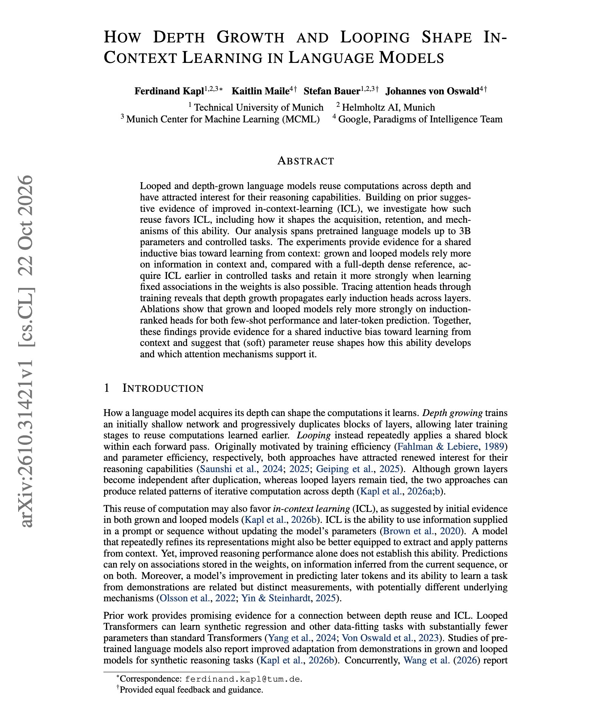

# 🐦 @dair_ai

## 📅 October 25, 2026

> 2 post(s) archived.

---

### 🕐 17:12 UTC · @dair_ai

> Highly recommended read on looped and depth-grown models. There is a lot of interest in looped and depth-grown language models for reasoning. The question here is what reusing layers does to in-context learning. At 3B parameters, both grown and looped models gain more from later context than a dense model of the same depth. They score higher on GSM8K at every number of demonstrations and predict unseen formal languages more accurately. In controlled tasks, they pick up in-context learning earlier. When a task can be solved either from context or by memorizing fixed labels in the weights, they keep relying on context. The mechanism shows up in the attention heads. Growing depth by copying layers also copies early induction heads, and most of the strongest final heads descend from a few early ancestors. Looped models show the same repeated pattern across passes of their shared block. https://arxiv.org/abs/2610.31421 Chat with Paper: https://academy.dair.ai/papers/how-depth-growth-and-looping-shape-in-context-learning-in-language-models-2610.31421

🔗 [View original post](https://x.com/omarsar0/status/2114404629064942018)

---

### 🕐 16:18 UTC · @dair_ai

> The Top AI Papers of the Week (October 19 - 25): - DiscoveryRSI - JevAgentHarness - Object-Oriented Harness - Evolving Agent Interfaces - Cache Engineering for Agents - Gemini Agents Beat Minecraft - Self-Evolving Continual Learners Read on for more: https://x.com/i/article/2114388698867335168

🔗 [View original post](https://x.com/dair_ai/status/2114391255765352836)

---
