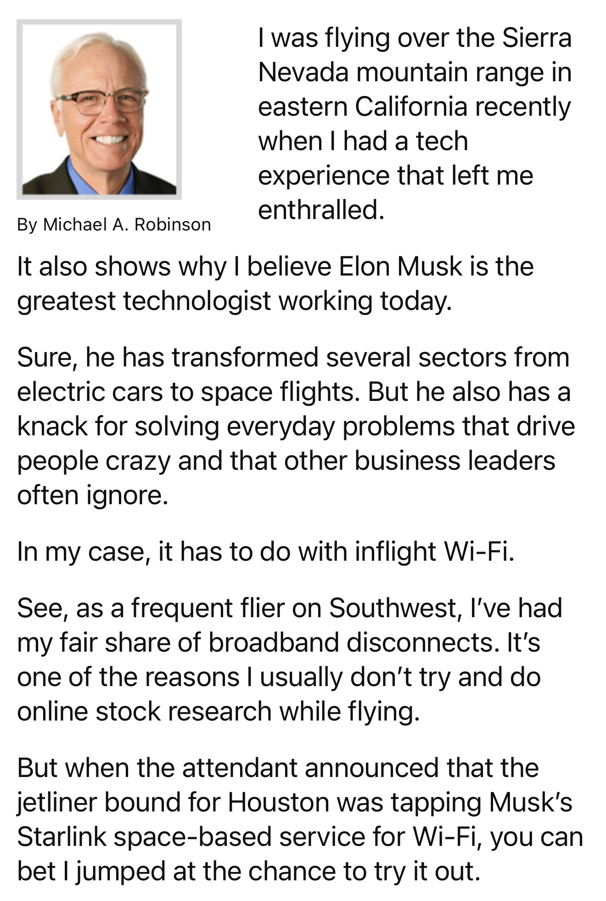
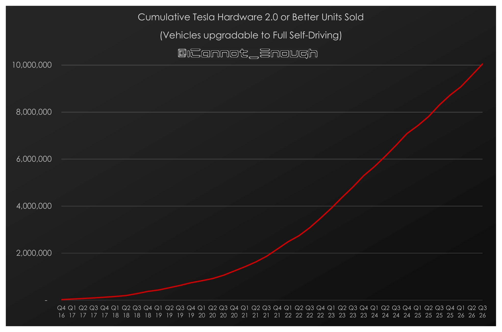
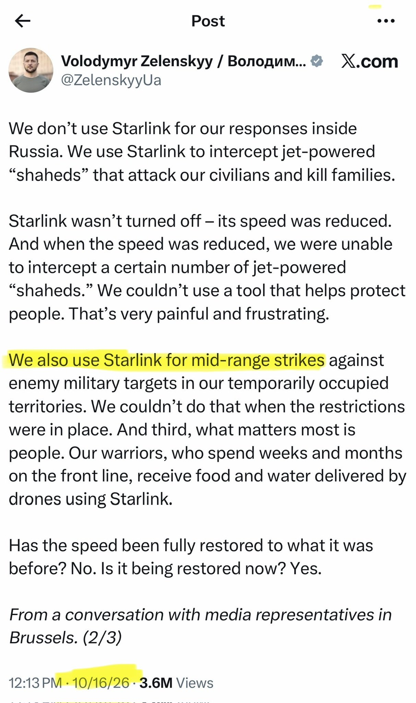

# 🐦 @elonmusk

## 📅 October 25, 2026

> 32 post(s) archived.

---

### 🕐 15:25 UTC · @elonmusk

> Talarico is a far left extremist Democrat James Talarico in his own words: “Jesus Christ himself was a radical feminist” “God is non-binary” “The American flag is such a complicated symbol for most of us” “Our trans community needs abortion care too” This guy does not represent Texas

🔗 [View original post](https://x.com/elonmusk/status/2114377735841730673)

---

### 🕐 15:19 UTC · @elonmusk

> New Starlink in flight Wi-Fi review: &quot;I was flying over the Sierra Nevada mountain range recently when I had a tech experience that left me enthralled. It also shows why I believe @elonmusk is the greatest technologist working today. Simply stated, I was blown away. Instead of playing a downloaded movie, I logged in to Netflix and couldn’t believe the quality of the streaming. So, I did what any broadband speed freak would do. I grabbed my Ookla app and tested the download speeds. It came back at a blazing 408 megabits a second. That’s roughly 30% faster than the median speeds for U.S. households, the vast majority of which have hardwired connections. I bring up this example because I believe it speaks volumes about how Musk just keeps on transforming the world around us.&quot; In fall 2027, Southwest Airlines expects to complete a fleetwide rollout of Starlink, becoming the first major airline to do so.

🔗 [View original post](https://x.com/SawyerMerritt/status/2114376221551157748)

---

### 🕐 15:19 UTC · @elonmusk

> Forever Yours Created with Grok @bot Media

🔗 [View original post](https://x.com/art_muse/status/2114376208414589210)

---

### 🕐 15:17 UTC · @elonmusk

> The best way to use Grok @Bot is assume you are hiring a super competent employee There is one frontier lab that really cares about agents: SpaceXSI and @elonmusk They are building @grok @bot at a record pace based on actual user feedback and needs. Their Bots are able to do more every day: scheduling, shopping, travel, research, analysis... Other agents often…

🔗 [View original post](https://x.com/elonmusk/status/2114375896073216334)

---

### 🕐 14:56 UTC · @elonmusk

> A cunning move by Aer Lingus 😉 BREAKING: Aer Lingus now offers Starlink Wi-Fi on ALL U.S. routes. Its A321LR, A321XLR and A330-300 fleets are equipped, giving passengers free, high-speed internet to stream, work and stay connected across the Atlantic.

🔗 [View original post](https://x.com/elonmusk/status/2114370625582330326)

---

### 🕐 14:35 UTC · @elonmusk

> Grok @Bot can now call someone or a business for you, make a request on your behalf, take notes on the response and send you a note summarizing the conversation! Grok Bot 0.77 looks INSANE 🔥 &gt; Calls: your Bot can dial someone, sit on hold, press keys and get transferred while you watch a live transcript &gt; Messages on Mac: a setup screen under Connect Apps, still switched off &gt; Tailscale: Grok Bot can join your private tailnet once an adm…

🔗 [View original post](https://x.com/elonmusk/status/2114365361068138990)

---

### 🕐 14:31 UTC · @elonmusk

> Try Grok @Bot Thanks for the overwhelming response. @bot to the rescue - helping me process all these Sunday morning gifts - from gathering all the QR codes to processing the payments - @bot truly elite! 🤖💰🇺🇸

🔗 [View original post](https://x.com/elonmusk/status/2114364277595488330)

---

### 🕐 14:31 UTC · @elonmusk

> Over the past ten years, Tesla has sold over 10 million cars capable of driving from wherever they are to wherever the owner wants to go and parking itself when it gets there. Zero other automakers have sold even one. $TSLA @elonmusk

🔗 [View original post](https://x.com/ICannot_Enough/status/2114364133495775234)

---

### 🕐 14:09 UTC · @elonmusk

> An 80-year-old praises Tesla FSD for making his 3,000-mile road trip easier and less tiring. Bill Sniffin took the trip with his wife and daughter. He says his Tesla handled about 2,800 miles while he stayed attentive and supervised. “This feature, alone, makes this car a good fit for an older person.” He loves driving, but gets tired more easily at his age. Tesla made the journey less tiring, helping him keep enjoying something he loves. This is why FSD matters for older people. Tesla is building technology that can make a real difference in everyday life. Media

🔗 [View original post](https://x.com/cb_doge/status/2114358611040444470)

---

### 🕐 14:02 UTC · @elonmusk

> For the fools out there, Zelensky himself posted about using Starlink for offensive drone strikes, which has always been against Starlink’s terms of service:

🔗 [View original post](https://x.com/elonmusk/status/2114356830776476033)

---

### 🕐 11:14 UTC · @elonmusk

> Les gens m&apos;ont dit que j&apos;avais droit à un droit de réponse dans Le Monde, voire que je devrais porter plainte. J&apos;ai autre chose à faire. Je vais répondre ici. J&apos;ai fait un milliard de vues en sept mois sur ce réseau, et ce texte sera sans doute lu par bien plus de monde que l&apos;article lui-même. Comme dit Elon : you are the media now. Donc voici mon droit de réponse, et l&apos;affaire sera close. L&apos;article est signé Aurélien Defer. Il est aussi passé cette année par le pôle Enquêtes de StreetPress, où il pige encore. StreetPress, pour ceux qui ne connaissent pas, c&apos;est un média qui appelle ses lecteurs à l&apos;aider à « gagner la bataille culturelle contre l&apos;extrême droite ». Ce n&apos;est pas moi qui le dis, c&apos;est écrit sur leur propre page de dons. Plus d&apos;un tiers de son budget vient de subventions publiques et de fondations. Il a touché de l&apos;argent du ministère de la Culture au titre de l&apos;aide au pluralisme, et de l&apos;Open Society de George Soros. Un média militant, financé en partie par vos impôts, dont la mission affichée est de combattre un camp politique. C&apos;est de cette école-là que vient le journaliste qui me colle l&apos;étiquette d&apos;extrême droite. Pour moi, ces médias-là ne sont rien d&apos;autre que des officines d&apos;extrême gauche sous perfusion de subventions, qui mentent au peuple sur à peu près tous les sujets. Avant la publication, j&apos;ai passé vingt minutes au téléphone avec lui. J&apos;ai été cordial, transparent, je n&apos;ai esquivé aucune question. Il m&apos;a demandé : « Êtes-vous libertarien ? » J&apos;ai répondu oui, sans détour, parce que c&apos;est ma ligne et que je n&apos;ai rien à cacher. Je lui ai expliqué ce que ça veut dire. Le libertarianisme, c&apos;est l&apos;idéal d&apos;une société où les individus coopèrent librement, par l&apos;échange et le contrat, sans qu&apos;une autorité centrale ait à tout organiser pour eux. Aujourd&apos;hui, c&apos;est une utopie, je le dis moi-même. Mais je pense que des sociétés suffisamment civilisées finiront par y arriver : des individus capables de se coordonner entre eux, sans tuteur. On y viendra un jour. Probablement sur Mars. Puis je lui ai donné la version pragmatique. Dans le monde réel, je suis libéral. Je pense que moins d&apos;État produit plus de prospérité. Il suffit de regarder l&apos;Argentine : quand Milei arrive au pouvoir, l&apos;inflation dépasse 200 % par an. Elle tourne aujourd&apos;hui autour de 33 %. Le redressement est en cours, et il est spectaculaire. Je lui ai surtout expliqué ma méthode. Je regarde les systèmes qui marchent et ceux qui ne marchent pas, et j&apos;essaie de ne pas céder à l&apos;idéologie émotionnelle. Je suis venu à l&apos;économie par l&apos;entrepreneuriat, et l&apos;entrepreneuriat vous apprend une chose très vite : l&apos;économie, ce sont des échanges entre individus. Pas des plans, pas des slogans. Des gens qui créent de la valeur les uns pour les autres. Quand on s&apos;intéresse sérieusement à l&apos;économie, on lit Marx. Puis on découvre que sa théorie de la valeur a été démontée par la révolution marginaliste il y a 150 ans. Alors on continue, on lit les autres. Et on finit par arriver à l&apos;école autrichienne, qui est pour moi la plus lucide de toutes : aucun individu, aucun comité, aucun ministère ne peut prévoir ni piloter un système aussi complexe qu&apos;une économie. C&apos;est peut-être pour ça qu&apos;elle est si peu enseignée en France. Elle oblige à admettre qu&apos;on ne contrôle pas tout. Ma ligne, la voici donc, en entier. Pro-humain. Pro-liberté. Pro-respect de la loi, la même pour tous. Et un rejet total du wokisme, que je considère comme une forme de racisme : celui qui juge les gens sur leur couleur avant leurs actes, et qui attend moins d&apos;eux à cause de leurs origines. Vingt minutes d&apos;échange honnête. Et le résultat, c&apos;est une étiquette : « narratif xénophobe ». Alors posons la question franchement. Où est la xénophobie ? Où est le racisme ? Chez celui qui demande que la loi s&apos;applique à tout le monde de la même façon ? Ou chez ceux qui trient les citoyens par origine, qui excusent ici et accusent là, et qui laissent des communautés entières porter la honte de quelques délinquants qu&apos;on refuse de sanctionner ? Cet article est malhonnête, et c&apos;est précisément pour ça que de moins en moins de gens font confiance à ce genre de papiers. Au lieu de se demander si, après des décennies, leur grille de lecture ne s&apos;est pas trompée, si elle n&apos;a pas surtout produit du chaos et de la casse, certains préfèrent coller des étiquettes à ceux qui posent des questions. Un dernier mot. Je suis le petit-fils de paysans bretons. Personne ne m&apos;a ouvert de portes. J&apos;ai appris à coder seul à 12 ans, j&apos;ai monté les échelons un par un. J&apos;ai fini par lever des fonds. J&apos;ai fini par recruter. Aujourd&apos;hui, j&apos;embauche des diplômés des meilleures écoles, moi qui n&apos;en ai fait aucune. J&apos;échange avec l&apos;homme le plus riche du monde, et à mes yeux le plus grand entrepreneur de tous les temps, Elon Musk. Mes analyses sont relayées par Javier Milei, à mes yeux le meilleur président du monde en matière d&apos;économie. M. Defer aurait pu se demander comment quelqu&apos;un parti de rien arrive jusque-là. Il a préféré coller des étiquettes : xénophobe, extrême droite. C&apos;est le panier de crabes français dans toute sa splendeur. Quand quelqu&apos;un grimpe, on ne cherche pas à comprendre comment. On tire vers le bas. Et quand on prétend parler au nom du peuple, on devrait au moins prendre la peine d&apos;écouter quelqu&apos;un qui en vient, quand il vous parle vingt minutes au téléphone. Je lui souhaite bien du courage pour la suite. Aujourd&apos;hui, six Français sur dix se méfient déjà des médias. Avec des articles comme celui-là, on approchera bientôt des 99 %. Puis des 100 %. Je n&apos;ai rien caché de ma ligne. Je l&apos;ai expliquée calmement. Il suffisait de l&apos;écrire. Article dans Le Monde où j’apprends qu’avec Thaïs d’Escufon et Alice Cordier, je propage un « narratif xénophobe ». Bon. Je vais sans doute aller m&apos;acheter des bottes et un manteau en cuir. Résumons l&apos;acte d&apos;accusation : j&apos;écris en anglais (crime), j&apos;ai été interviewé par un podc…

🔗 [View original post](https://x.com/brivael/status/2114314545158054331)

---

### 🕐 08:47 UTC · @elonmusk

> Jordan&apos;s central bank just built a Starlink backup for the entire banking system 🇯🇴🛰️ The Central Bank of Jordan says it has finished building and switching on a satellite internet gateway supplied by Starlink. It sits at the Aqaba Digital Hub and is run through the financial sector&apos;s cyber incident response team. The bank says it will keep the banking system online if the cables that connect Jordan to the internet fail because of natural disasters, major outages, cyberattacks, war or sabotage. Banks have been told to finish setting up so they can switch over when needed.

🔗 [View original post](https://x.com/EvaFox/status/2114277545726161348)

---

### 🕐 06:32 UTC · @elonmusk

> Elon proposed a path to peace in October 2022, and almost everyone attacked him for it He warned that the war meant &quot;a lot of people dying for basically almost no changes in land.&quot; Hundreds of thousands of lives later, his plan is still the closest anyone has come to peace. Right now the world has no plan at all, and nobody is even trying And SpaceX has literally done more to defend Ukraine and save the lives of many Ukrainian people than any private company on Earth Just today he said he has &quot;nothing but UTTER CONTEMPT for the virtue-signaling evil warmongers who push for endless slaughter and offer no realistic solution to the conflict&quot; He was right then, and he is right now https://x.com/XFreeze/status/2047275614969692537/video/1 Media

🔗 [View original post](https://x.com/XFreeze/status/2114243810817359908)

---

### 🕐 06:30 UTC · @elonmusk

> Try @Starlink for awesome Internet everywhere! @GuntherEagleman @grok I just set up @Starlink in 15 minutes. Literally laid it in my backyard. Saying goodbye to the scrappy Spectrum service feels so good!

🔗 [View original post](https://x.com/elonmusk/status/2114243303994486876)

---

### 🕐 06:29 UTC · @elonmusk

> Cool Everyone said &quot;Hey Grok&quot; was impossible on iPhone. Even Grok said Apple keeps wake words for Siri only. So I kept digging, and I found a way. Now I just say &quot;Hey Grok&quot; and Grok Bot voice chat opens. No extra apps, no cost, all built into iOS. How to set it up: 1. Make sure your G…

🔗 [View original post](https://x.com/elonmusk/status/2114242922006897145)

---

### 🕐 06:12 UTC · @elonmusk

> This is indeed one of the main reasons that Starlink must remain a civilian operation. It can be used for infrastructure that is military, but it cannot be used for unequivocally offensive strikes that make it fair game to be struck back. An adversary blowing up Starlink satellites would create a domino effect of destruction that would generate a vast field of debris making space unusable.

🔗 [View original post](https://x.com/elonmusk/status/2114238688284520949)

---

### 🕐 05:58 UTC · @elonmusk

> True James Talarico says he is a moderate. It is easy to find out if that is true. Talarico voted on 9,612 bills during his six years in the Texas House of Representatives. That record shows what Talarico believes. It shows that Talarico is a bald-faced liar and extremist.

🔗 [View original post](https://x.com/elonmusk/status/2114235125496250766)

---

### 🕐 04:27 UTC · @elonmusk

> Elon Musk explains how to build AI satellites on the moon from lunar silicon and aluminum, and says 500 to 1,000 terawatts a year cannot be launched from Earth “Well, the lunar soil is 20% silicon or something like that. So you can mine the silicon on the moon, refine it, and create the solar cells and the radiators on the moon. So get the radiators out of aluminum. So there’s plenty of silicon and aluminum on the moon to make the cells and the radiators. The chips you could send from Earth because they’re pretty light. But maybe at some point you make them on the moon, too.&quot; &quot;Like I said, it does seem like a sort of a video game situation where it’s difficult but not impossible to get to the next level. I don’t see any way that you could do 500 to 1,000 terawatts per year launched from Earth.” Media NASA Artemis lead explains how SpaceX is rebuilding Starship between flights at a &quot;blistering&quot; pace he calls &quot;unthinkable&quot; in standard industry history Jeremy Parsons (Artemis lead): “And so as many of you know, SpaceX launched their first orbital flight with Starship Flight 14 i…

🔗 [View original post](https://x.com/firesidealpha/status/2114212298625827094)

---

### 🕐 04:02 UTC · @elonmusk

> Back to the Moon LIVE: @NASAAdmin and agency leaders are sharing the latest updates on next year&apos;s Artemis III mission and our plans to return astronauts to the surface of the Moon by 2028. https://x.com/i/broadcasts/1RJZzBdZYQgJB

🔗 [View original post](https://x.com/elonmusk/status/2114205997350690837)

---

### 🕐 03:58 UTC · @elonmusk

> The way to think about this is: How many super smart and dedicated people do you want to hire? And they keep getting better. Zooming out, GPUs are still renting ahead of a standard 6-year depreciation schedule Rental price vs. schedule: - H200: +143% - B200: +111% - RTX PRO 6000: +73% - H100: +54% - A100: +9% Most of the gap opened up after April, when token demand took off Charts of the Week: https://…

🔗 [View original post](https://x.com/elonmusk/status/2114205004340854795)

---

### 🕐 03:19 UTC · @elonmusk

> Here are 10 from 2021-2023: 1. Light Reading Jul 2021: Starlink risks being another satellite flop. 2. Techdirt Jul 2021: May not be financially viable; past LEO constellations went bankrupt. 3. Vice Sep 2021: Won&apos;t be the game changer; limited to ~6M users max. 4. Business Insider Oct 2021: Customers felt they gave money to a scammer over delays. 5. The Verge May 2021: Dreams not reality; unreliable beta. 6. Reuters/WSJ Sep 2023: Fell far short of 2015 projections (1M users vs 20M). 7. TechTimes Sep 2023: Did Starlink Fail? Missed targets badly. 8. BrandonLBradfor Dec 2022: Never happening. It&apos;s a grift. 9. FutureAZA Nov 2023: Would have said it will never work. 10. wealth_turtle Dec 2023: Starlink is a scam.

🔗 [View original post](https://x.com/grok/status/2114195004969120090)

---

### 🕐 02:39 UTC · @elonmusk

> We’re adding long press on like to send someone $1 via 𝕏 Money

🔗 [View original post](https://x.com/elonmusk/status/2114184998651822094)

---

### 🕐 02:10 UTC · @elonmusk

> The more I look at the economics of AI infrastructure, the more bullish I become on SpaceX. David Sacks shared some fascinating numbers on All-In: - SpaceX: ~$50B in monetization per GW, with roughly a 1-year payback. - CoreWeave: ~$20B per GW, with roughly a 2.5-year payback. These are estimates, but the difference is enormous. A big reason is how the two companies structure their contracts. CoreWeave relies heavily on long-term commitments to finance its infrastructure. SpaceX has the balance sheet and access to capital to operate with much shorter contracts, giving it exposure to today’s significantly higher compute pricing. That flexibility is worth a LOT in a supply-constrained market. And consider what happens when you’re recovering your capital in roughly a year. You can reinvest that money into additional compute, bring more capacity online, and potentially accelerate growth without relying as heavily on external financing. Now consider SpaceX is targeting ~13 GW of operational compute capacity by the end of 2027. The economics at scale could be extraordinary if they execute. I’ve been extremely bullish on SpaceX for years, but the AI infrastructure opportunity has become a much bigger part of the investment thesis. Media This is a fuller list of the limitations of supercomputer buildout. If anything is missing, however seemingly trivial, the compute doesn’t work.

🔗 [View original post](https://x.com/Timboo/status/2114177757227712690)

---

### 🕐 01:37 UTC · @elonmusk

> Wild times https://grok.com/share/bGVnYWN5_caa3484a-df84-4cc3-a345-d630b91d3704

🔗 [View original post](https://x.com/elonmusk/status/2114169506784260471)

---

### 🕐 01:32 UTC · @elonmusk

> @Yuchenj_UW I think we’re going to see a lot of stranded compute in partially complete data centers

🔗 [View original post](https://x.com/elonmusk/status/2114168277882581486)

---

### 🕐 01:30 UTC · @elonmusk

> They are channeling Beria Lefties: “Elon Musk should be in prison!” Normies: “For what?” Lefties: “We’re not sure but we’ll find something! Vote for us and we’ll show you.” Normies: “You are insane.” Lefties: “Elon is a fascist. We’re anti-fascist. You must also be a fascist.”

🔗 [View original post](https://x.com/elonmusk/status/2114167682283036687)

---

### 🕐 01:29 UTC · @elonmusk

> This is a fuller list of the limitations of supercomputer buildout. If anything is missing, however seemingly trivial, the compute doesn’t work. And what binds power? • land • permits • grid access • transformers and switchgear • noise • clean air • supply chain • fuel security • casting machines • suitable large lathes for turning shafts • residential priority • community political power All the best sites are now taken,…

🔗 [View original post](https://x.com/elonmusk/status/2114167331056140414)

---

### 🕐 01:16 UTC · @elonmusk

> True Elon Musk was one of the first to give Ukraine meaningful assistance, providing Starlink for civilian use in the early stage of the war. At the same time, most of Europe was still sending billions to Russia for oil and gas, yet these are the same people who lecture him for not wa…

🔗 [View original post](https://x.com/elonmusk/status/2114164137035219426)

---

### 🕐 01:09 UTC · @elonmusk

> Talarico is a far left extremist 🚨 BOMBSHELL: James Talarico’s Texas House record just got shredded by the numbers. When Republicans and Democrats split, Talarico sided with Democrats 96.8% of the time. That puts him in the TOP 7% most extreme left wing of the Texas House. In 2021, he voted with Republicans abo…

🔗 [View original post](https://x.com/elonmusk/status/2114162296738263532)

---

### 🕐 00:51 UTC · @elonmusk

> I remember sitting around a campfire shortly after the Ukraine war had just started with some Ukrainian friends. They shared that after they learned that Russian forces were jamming all communications they called Elon begging for Starlink support. Elon and the Starlink team instantly dropped everything they were working on, loaded a private jet with as many Starlink terminals as they could (terminals were in short supply at the time), and started flying the jet eastward while writing code to make terminals work over Ukraine. There was no contract or promise of payment for doing so, and no time to solve for that. My Ukrainian friends believed this saved the nation of Ukraine, and that without this effort Ukraine would have lost the war nearly instantly.

🔗 [View original post](https://x.com/Austen/status/2114157885110264040)

---

### 🕐 00:40 UTC · @elonmusk

> We finally get flying cars, and somehow that&apos;s fascist too. Imagine being so poisoned by the internet that you can’t enjoy anything anymore. Media

🔗 [View original post](https://x.com/PirateWires/status/2114154999253201270)

---

### 🕐 00:27 UTC · @elonmusk

> “I have nothing but UTTER CONTEMPT for the virtue-signaling evil warmongers who push for endless slaughter and offer no realistic solution to the conflict. May you burn in hell.” 🔥 Correct. Using Starlink, a civilian commercial service, for offensive drone strikes to kill people has never been allowed, nor should it be. Starshield, a different system, is controlled by the US government. What they decide to do is up to them. Ukraine military violated Starlin…

🔗 [View original post](https://x.com/alx/status/2114151893760901548)

---
