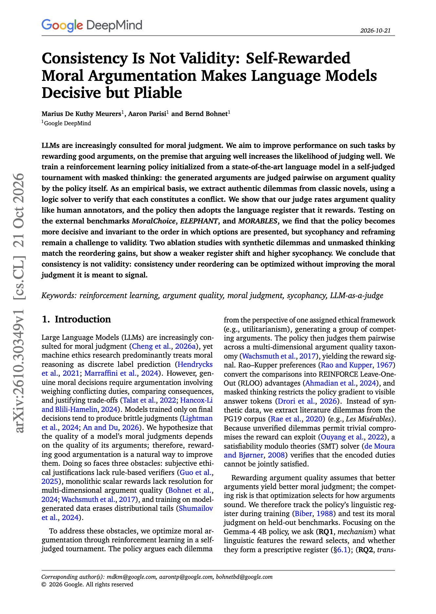

# 🐦 @omarsar0

## 📅 October 25, 2026

> 2 post(s) archived.

---

### 🕐 19:59 UTC · @omarsar0

> New paper from Google DeepMind on training models to argue well about moral dilemmas. The trained model became more decisive and stopped changing its answer when options were reordered. Sycophancy and reframing still moved its judgments. The setup uses real dilemmas from classic novels, each checked by a logic solver to confirm a genuine conflict. A policy is trained with RL in a self-judged tournament with masked thinking, where it rates pairs of its own arguments on quality. Its ratings agree with human annotators. The policy then adopts the register it rewards. On MoralChoice, ELEPHANT and MORABLES, it is more consistent across option orders, yet a user pushing back or a reframed question still changes the answer. Order invariance is easy to optimize and easy to measure, and here it improved without the underlying judgment improving. If you use self-rewarding or consistency metrics as training signals, check robustness to pressure separately. https://arxiv.org/abs/2610.30349 Chat with Paper: https://academy.dair.ai/papers/consistency-is-not-validity-self-rewarded-moral-argumentation-makes-language-mod-2610.30349

🔗 [View original post](https://x.com/omarsar0/status/2114446656032874516)

---

### 🕐 16:17 UTC · @omarsar0

> https://x.com/i/article/2114388698867335168

🔗 [View original post](https://x.com/dair_ai/status/2114390861102408132)

---
