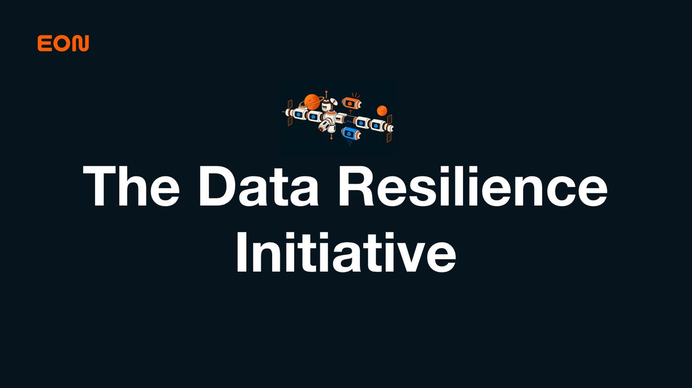
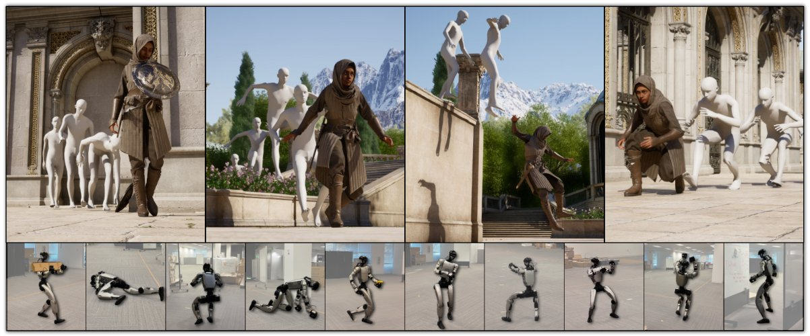
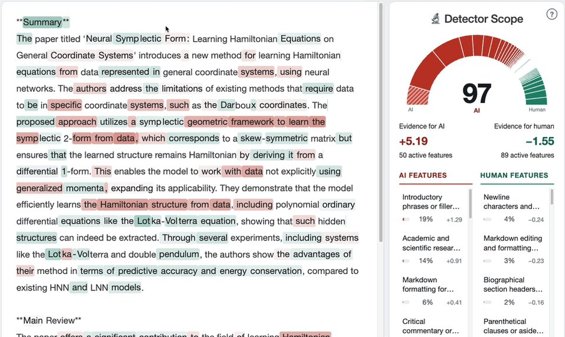
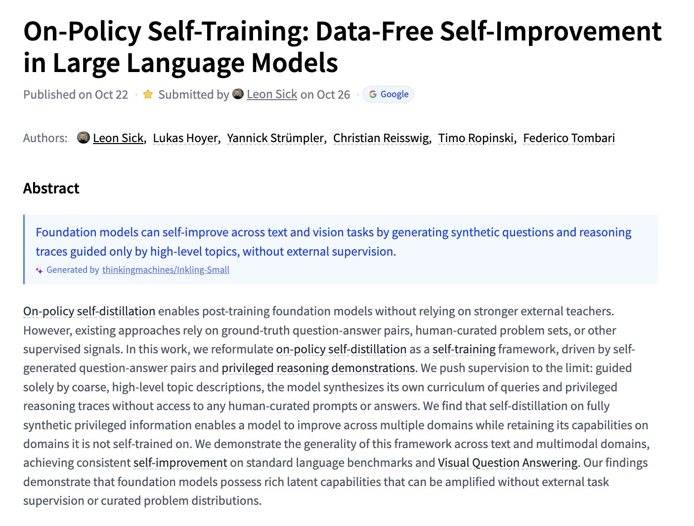
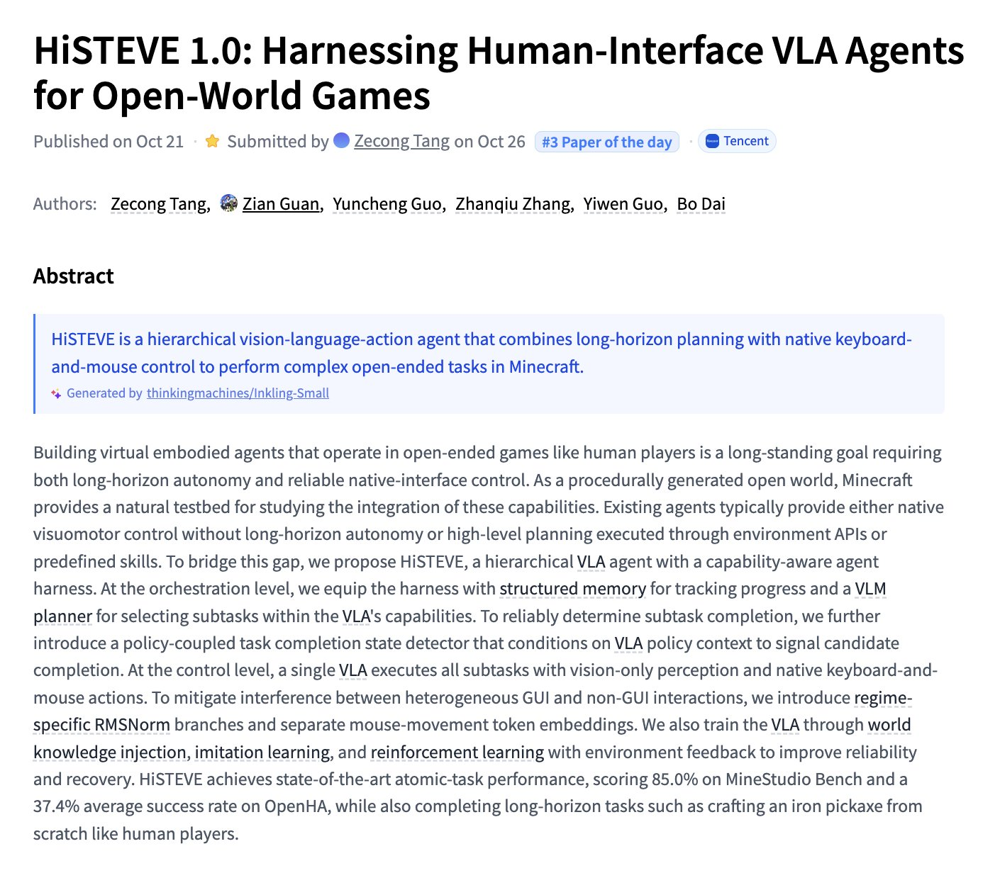

# 🐦 @_akhaliq

## 📅 October 26, 2026

> 5 post(s) archived.

---

### 🕐 15:24 UTC · @_akhaliq

> I believe we&apos;ll look back at this past week as a turning point in cybersecurity. AI is fundamentally changing the speed and scale of cyber threats, and the industry needs to move faster. Today, @Eon_io_ is launching the Data Resilience Initiative, helping companies find and protect their most sensitive data immediately. Eon is the only data protection company founded this decade, and the only one that can be deployed in a day. That&apos;s why we feel a responsibility to act. While the cybersecurity industry races to address these new threats, companies can&apos;t afford to wait to protect their most critical data. Traditional data protection solutions were built for a different era. They still rely on paradigms from the on-prem world, often taking months to deploy. Eon was built differently. We help companies quickly discover their most sensitive data, identify protection gaps, secure it with air-gapped backups, detect ransomware, and recover rapidly from attacks. As part of the Data Resilience Initiative, any company can start deploying Eon today. To remove barriers to getting protected, we&apos;re making Eon available at no cost for the first three months. We&apos;re also calling on other cybersecurity and data protection companies to join the initiative.

🔗 [View original post](https://x.com/OfirEhrlich/status/2114739974369120698)

---

### 🕐 14:50 UTC · @_akhaliq

> NVIDIA just released MotionBricks on Hugging Face A real-time generative motion model for humanoid robots and characters, reaching 15,000 FPS with 2ms latency across 350k+ motion clips.

🔗 [View original post](https://x.com/HuggingPapers/status/2114731481906208811)

---

### 🕐 14:48 UTC · @_akhaliq

> Building Auditable AI Text Detectors with Sparse Autoencoders paper: https://huggingface.co/papers/2610.30006

🔗 [View original post](https://x.com/_akhaliq/status/2114730846426890689)

---

### 🕐 14:46 UTC · @_akhaliq

> On-Policy Self-Training Data-Free Self-Improvement in Large Language Models paper: https://huggingface.co/papers/2610.32770

🔗 [View original post](https://x.com/_akhaliq/status/2114730501626015880)

---

### 🕐 14:45 UTC · @_akhaliq

> HiSTEVE 1.0 Harnessing Human-Interface VLA Agents for Open-World Games paper: https://huggingface.co/papers/2610.31162

🔗 [View original post](https://x.com/_akhaliq/status/2114730217562665324)

---
