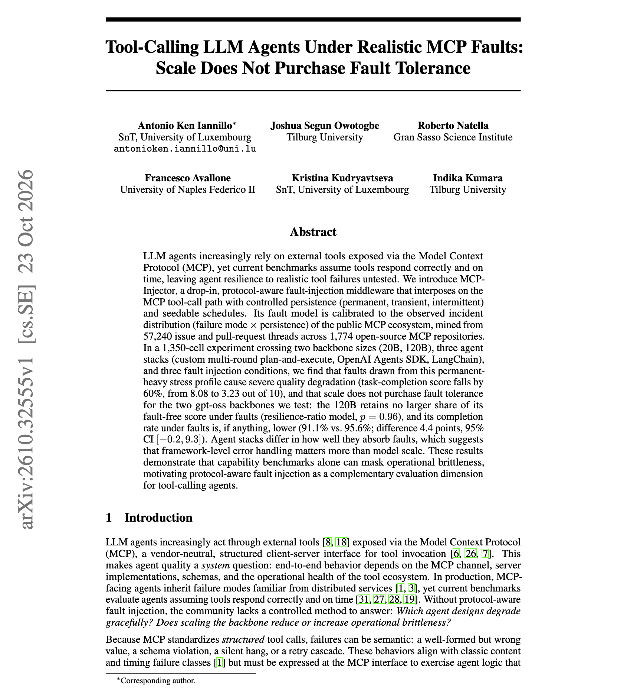
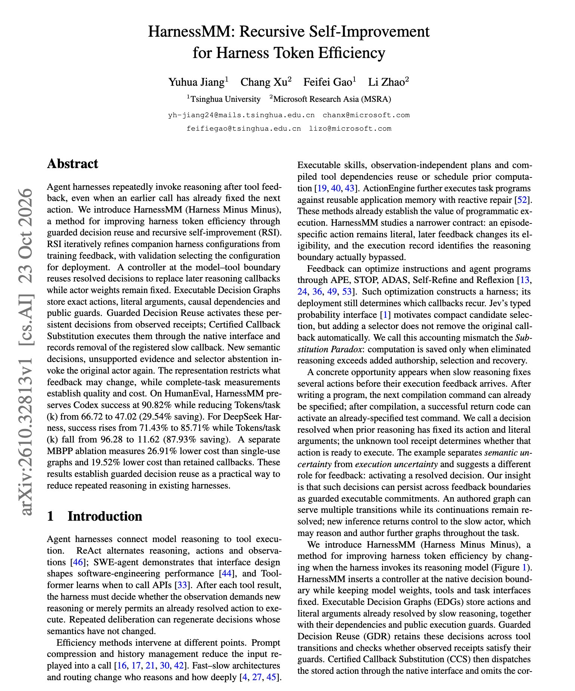

# 🐦 @dair_ai

## 📅 October 26, 2026

> 4 post(s) archived.

---

### 🕐 15:07 UTC · @dair_ai

> Be careful when integrating MCP tools into production. This work shows that a 120B model handles realistic MCP tool failures no better than a 20B model. They built MCP-Injector, a proxy that injects faults into MCP tool calls. The fault mix is calibrated on 57,240 issue and pull-request threads from 1,774 open-source MCP repositories, so it reflects how MCP servers fail in practice. Across 1,350 runs with gpt-oss-20B and 120B and three agent stacks (a custom plan-and-execute loop, OpenAI Agents SDK, LangChain), task-completion score falls 60%, from 8.08 to 3.23 out of 10. The larger model retains a smaller share of its fault-free score (p = 0.96), and its completion rate under faults is slightly lower: 91.1% vs. 95.6%. Differences between agent stacks are larger than the difference between model sizes. The paper is accepted at NeurIPS 2026. The practical takeaway is that if your MCP agents are only tested against tools that always respond correctly, add fault injection to the eval and put the effort into framework-level error handling. https://arxiv.org/abs/2610.32555 Chat with Paper: https://academy.dair.ai/papers/tool-calling-llm-agents-under-realistic-mcp-faults-scale-does-not-purchase-fault-2610.32555

🔗 [View original post](https://x.com/dair_ai/status/2114735562716545201)

---

### 🕐 14:53 UTC · @dair_ai

> Learn to build a custom harness, folks! There is so much alpha in understanding how to optimize the harness. This work shows the benefits of a smart harness configuration and caching the decisions your agent harness has already made. (bookmark it) They propose HarnessMM, which cuts tokens per task on a DeepSeek harness from 96.28k to 11.62k while success rises from 71.43% to 85.71%. Harnesses often call the model again after tool feedback even when an earlier call already settled the next action. HarnessMM stores those settled decisions in an Executable Decision Graph with exact actions, arguments, dependencies, and guards. When the guard holds, the controller reuses the decision. Anything new goes back to the model. A recursive self-improvement (RSI) loop tunes the harness configuration from training feedback, and the model weights never change. With Codex on HumanEval, success stays at 90.82%, and tokens per task drop 29.54%. Before you pay for a bigger model, check how many of your harness calls repeat a decision the agent already made. Paper: https://arxiv.org/abs/2610.32813 Chat with Paper: https://academy.dair.ai/papers/harnessmm-recursive-self-improvement-for-harness-token-efficiency-2610.32813

🔗 [View original post](https://x.com/omarsar0/status/2114732037827662278)

---

### 🕐 14:07 UTC · @dair_ai

> After Jev, this is the most exciting System One model. Cloudflare introduced it last week. It&apos;s great for extraction tasks and complements decision models like Jev. Learn more in my new tutorial and check out the interactive playground: https://academy.dair.ai/resources/introduction-to-clairic https://x.com/i/article/2114717270177988608

🔗 [View original post](https://x.com/omarsar0/status/2114720659792376262)

---

### 🕐 14:04 UTC · @dair_ai

> https://x.com/i/article/2114717270177988608

🔗 [View original post](https://x.com/omarsar0/status/2114719919057060210)

---
