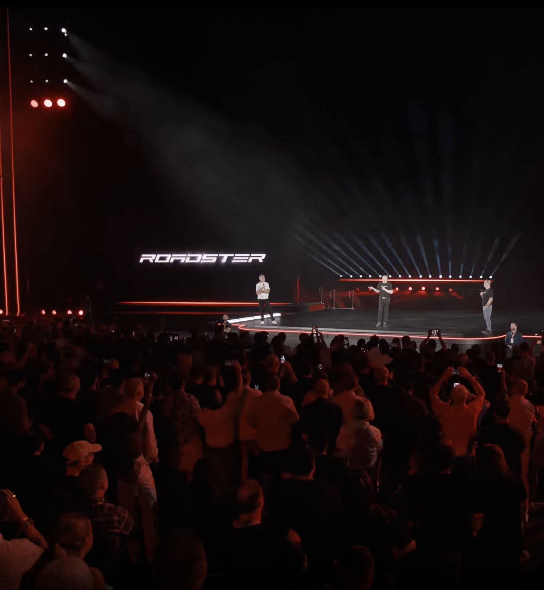

# 🐦 @elonmusk

## 📅 October 26, 2026

> 16 post(s) archived.

---

### 🕐 13:56 UTC · @elonmusk

> Math doesn’t add up Round 1: 🏆Bolsonaro: 56.1 million votes Lula: 53.9 million votes Round 2: 🏆Lula: 64.1 million votes (+10.2M) Bolsonaro: 59.8 million votes (+3.7M) To give you an idea of how unlikely this is: all the eliminated candidates from round 1 got 9.33M VOTES COMBINED

🔗 [View original post](https://x.com/elonmusk/status/2114717848518144177)

---

### 🕐 13:46 UTC · @elonmusk

> Good point When @realDonaldTrump was elected for his first term, innumerable people including most of my academic colleagues said that the worst realities would befall the United States. None of those things happened. They then said that he would wait until his second term to end democracy,…

🔗 [View original post](https://x.com/elonmusk/status/2114715402768896271)

---

### 🕐 13:45 UTC · @elonmusk

> I swear it’s just a coincidence 😂 Houston, we have liftoff Bigger service area now live

🔗 [View original post](https://x.com/elonmusk/status/2114714943417110693)

---

### 🕐 13:25 UTC · @elonmusk

> So many cultures are dying out Japan is often discussed as if it has uniquely low fertility. Its fertility rate is very low, but several countries–including ones with reputations for being lively!–are now even lower.

🔗 [View original post](https://x.com/elonmusk/status/2114710124363182328)

---

### 🕐 13:16 UTC · @elonmusk

> Starlink coming to EasyJet easyJet has just announced that it will be installing SpaceX&apos;s @Starlink on its fleet. Installations will start in first half of 2027 across the airline’s modern A320, A320neo and A321neo fleet, with the rollout expected to be completed by early 2028. &quot;easyJet’s investment in onb…

🔗 [View original post](https://x.com/elonmusk/status/2114707637506117956)

---

### 🕐 12:54 UTC · @elonmusk

> It’s been a memorable 4 years Four years ago today, Elon Musk bought Twitter. Liberals lost their minds because they knew they were losing control of their ability to shape the narrative. Today, X is the #1 source of news in the world and it’s the legacy &quot;news&quot; media on life support.

🔗 [View original post](https://x.com/elonmusk/status/2114702264510390753)

---

### 🕐 06:58 UTC · @elonmusk

> So beautiful hello, world

🔗 [View original post](https://x.com/elonmusk/status/2114612551787147343)

---

### 🕐 03:29 UTC · @elonmusk

> Yes &quot;We should send rockets not at each other, but rather to the stars.&quot; 一 Elon Musk

🔗 [View original post](https://x.com/elonmusk/status/2114560002157654414)

---

### 🕐 03:26 UTC · @elonmusk

> Wow Let’s make sure the entire world understands. In Brazil, judicial rulings in connection with federal elections are made by the court that has been in place for that very purpose, the Supreme Electoral Tribunal (TSE). @LulaOficial requested to the TSE that the polls be extended by…

🔗 [View original post](https://x.com/elonmusk/status/2114559155642282081)

---

### 🕐 02:51 UTC · @elonmusk

> Elon is beloved by people throughout the entire world. He has over 240 Million followers, and I do not think he would have that many if he was not well liked.

🔗 [View original post](https://x.com/gailalfaratx/status/2114550331895935175)

---

### 🕐 02:48 UTC · @elonmusk

> You can literally just talk to Grok Bot and get things done. Keep talking, and it does the stuff for you The latest updates have really pushed its capabilities to another level There’s simply nothing else in the same league as Grok Bot....it’s incredible, capable, and really, really good The more you use it, the more you’ll love it

🔗 [View original post](https://x.com/XFreeze/status/2114549637126447542)

---

### 🕐 02:00 UTC · @elonmusk

> Elon Musk is American by blood! 🇺🇸 His grandfather, Joshua Haldeman, Maye Musk’s father, was born in Pequot Lakes, Minnesota, in 1902. he even paid his way through college by competing in rodeos, the most American thing imaginable.

🔗 [View original post](https://x.com/iam_smx/status/2114537602355171796)

---

### 🕐 01:27 UTC · @elonmusk

> A judge loyal to Lula ordered voting extended - an result like this in Brazil is unprecedented

🔗 [View original post](https://x.com/JackPosobiec/status/2114529225956823457)

---

### 🕐 00:26 UTC · @elonmusk

> Starship Flight 15 static fire Full duration 33-engine static fire for the Super Heavy booster preparing for Flight 15

🔗 [View original post](https://x.com/elonmusk/status/2114513919566033266)

---

### 🕐 00:26 UTC · @elonmusk

> Democrats will make sure they remain in power in perpetuity That’s not how our constitutional system is supposed to work But make no mistake—that is their plan If Democrats get power, they will: 1. Lawfare Trump officials; 2. Pack SCOTUS; 3. Go after Elon, SpaceX, and Tesla--then billionaires, then millionaires; 4. Crush free speech; 5. Make voter ID illegal; 6. Flood the country with illegals. It sounds insane. It *is* insane.

🔗 [View original post](https://x.com/BasedMikeLee/status/2114513863337181671)

---

### 🕐 00:00 UTC · @elonmusk

> True If Democrats get power, they will: 1. Lawfare Trump officials; 2. Pack SCOTUS; 3. Go after Elon, SpaceX, and Tesla--then billionaires, then millionaires; 4. Crush free speech; 5. Make voter ID illegal; 6. Flood the country with illegals. It sounds insane. It *is* insane.

🔗 [View original post](https://x.com/elonmusk/status/2114507338249875500)

---
