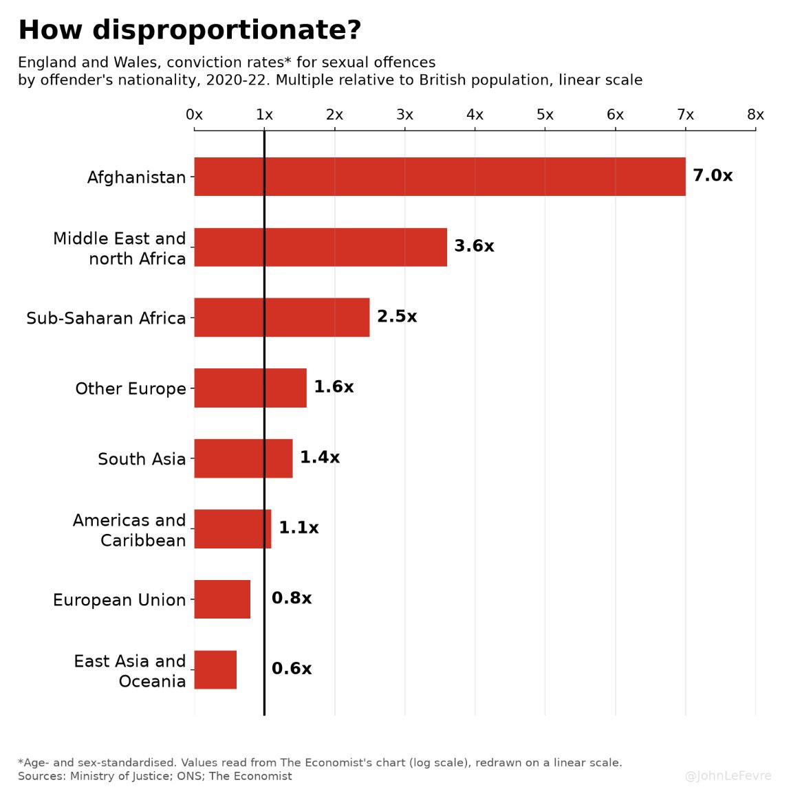
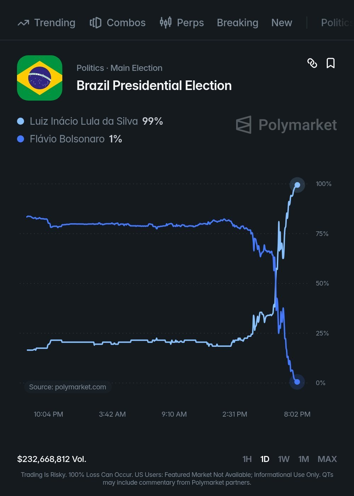

# 🐦 @elonmusk

## 📅 October 26, 2026

> 36 post(s) archived.

---

### 🕐 20:02 UTC · @elonmusk

> I’m joining the team at @X to lead Product. I am a huge believer in @SpaceX&apos;s mission to extend human consciousness to the stars, so it’s time to make shitposting multiplanetary. X is the best way to find out what’s happening in the world right now and talk about it. The team has been working tirelessly to make X a better place and product for the people who love it, and many have noticed the recent momentum. My goal is to help accelerate that momentum for our community, new users, and businesses globally by continuing to make this product beautiful and useful. We are twenty years in, but it truly feels like X’s next chapter will be our greatest. I look forward to your ideas and feedback; I’m sure the replies will be measured and magnanimous.

🔗 [View original post](https://x.com/petersellis/status/2114809857929085347)

---

### 🕐 19:02 UTC · @elonmusk

> Yes Humans are a pack animal. This may be hard to understand if you are evangelical and think the book of genesis is literal rather than allegorical, but humans are a pack animal. What this means is that the human desire for the acceptance and support of a tribe is as fundamental as …

🔗 [View original post](https://x.com/elonmusk/status/2114794884850966884)

---

### 🕐 17:59 UTC · @elonmusk

> Talarico is a far left extremist Democrat Nominee for Senate in Texas James Talarico refers to women as “neighbors with a uterus”.

🔗 [View original post](https://x.com/elonmusk/status/2114778922122395650)

---

### 🕐 17:38 UTC · @elonmusk

> Bravo to the smaller countries in Europe for moving fastest! Tesla FSD Supervised (now named Tesla Assisted Driving in Europe) has officially been approved in Latvia, marking the 10th European country. Countries in Europe that have approved it so far: • Belgium • Netherlands • Denmark • Lithuania • Estonia • Slovenia • Czechia • Croatia • …

🔗 [View original post](https://x.com/elonmusk/status/2114773746510946544)

---

### 🕐 17:36 UTC · @elonmusk

> Try using @Starlink for your home or business 50 airlines and counting. 🚀 There’s no stopping @Starlink

🔗 [View original post](https://x.com/elonmusk/status/2114773137640554754)

---

### 🕐 17:35 UTC · @elonmusk

> Grok @Bot is like hiring an incredibly competent chief of staff I&apos;ve gone full Grokbot. It checks email, DMs, mentions, and LinkedIn every hour. It flags anything interesting, drafts replies, and tosses the other 99%. It literally feels like having a personal secretary 🤯 And 2 days in I&apos;m like how did I live without this 😂

🔗 [View original post](https://x.com/elonmusk/status/2114772843997351993)

---

### 🕐 17:33 UTC · @elonmusk

> Supervised FSD approved in Latvia! 🇱🇻 Now approved in Latvia 🇱🇻 Rollout begins soon

🔗 [View original post](https://x.com/elonmusk/status/2114772404463337693)

---

### 🕐 17:04 UTC · @elonmusk

> Remember when using the wrong pronoun got people canceled? That was dumb. If Elon Musk hadn&apos;t bought Twitter and fought back against the insanity of the last few years, the West would be much further down a path of self-destruction, self-hatred, and moral corruption ​• Pronouns treated like sacred scripture • State propaganda rebranded as &quot;truth&quot; and “…

🔗 [View original post](https://x.com/elonmusk/status/2114765150431682772)

---

### 🕐 17:02 UTC · @elonmusk

> Interesting question The major question in Brazil… At exactly 5pm, a code is supposed to be entered that closes and locks the voting machines. Once a machine is locked, it can’t accept any more votes. It’s irreversible. The Supreme Court extension was relayed a few minutes after polls were supposed t…

🔗 [View original post](https://x.com/elonmusk/status/2114764520552051185)

---

### 🕐 17:00 UTC · @elonmusk

> It means entire countries and cultures will go extinct forever fertility rates are so abstract that people struggle to understand the scale of the catastrophe we’re experiencing. take 1.14 children per woman (italy and japan) if that continues, each generation is roughly half the size of the one before it start with 100 people in a generatio…

🔗 [View original post](https://x.com/elonmusk/status/2114764208399421635)

---

### 🕐 16:54 UTC · @elonmusk

> True Lula packed Brazil’s Supreme Court with his own lawyer and justice minister and had them lock his rival up for 27 years. Back in 2023, after taking power, he named Cristiano Zanin and Flávio Dino to the court. In 2025 both voted to convict Jair Bolsonaro of a coup plot and hand h…

🔗 [View original post](https://x.com/elonmusk/status/2114762534372917746)

---

### 🕐 16:48 UTC · @elonmusk

> Talarico will vote to take away your children and transition them TALARICO: “What would Jesus do if he visited the Texas legislature? I think he would tell us: ‘Blessed are the trans children.’”

🔗 [View original post](https://x.com/elonmusk/status/2114761043809378685)

---

### 🕐 16:31 UTC · @elonmusk

> Soon Moon I took about 50,000 photos through a 14&quot; telescope last night to produce this: A hyper-detailed photo of the full moon. The fidelity of the photo was great enough to allow me to greatly enhance the color, revealing a hidden world of geological diversity.

🔗 [View original post](https://x.com/elonmusk/status/2114756811689447712)

---

### 🕐 16:11 UTC · @elonmusk

> What are most important things to improve about Grok @Bot? Btw, make sure you’ve tried Bot recently, as over 100 features &amp; fixes are released every week! Grok Bot leaves Meta Muse in the dust. It&apos;s not even close!! 🚀 Grok Bot features Muse doesn&apos;t match: • Tag @bot on X and it handles your X DMs • Connects to your iPhone, Alarms included • Coinbase, Robinhood and eToro built in • Apps for Windows, Linux, Mac, iOS and Android • A …

🔗 [View original post](https://x.com/elonmusk/status/2114751739026985329)

---

### 🕐 15:12 UTC · @elonmusk

> The Economist put the chart on a log scale. I wonder why they did that? Here it is on a normal one. Dear @piersmorgan, let me know if this figure proves helpful.

🔗 [View original post](https://x.com/JohnLeFevre/status/2114736974812655729)

---

### 🕐 15:03 UTC · @elonmusk

> They used LOG SCALE instead of linear to hide how extreme the differences really are… I can’t believe The Economist put this out… Rape and sexual assault by nationality: Afghanistan - 7x the British rate Middle East - 4x the British rate North Africa - 4x the British rate Sub Sahara - 3x the British rate

🔗 [View original post](https://x.com/Geiger_Capital/status/2114734659158376650)

---

### 🕐 14:25 UTC · @elonmusk

> Four years ago Elon Musk purchased Twitter and made it into the X we have now. I have been online since 1979 and there is no better place than X. This is my home and I have an immense amount of gratitude for the people that build it and the people that have made it their home. Thank you @elonmusk deep gratitude. And it sinked in… Media

🔗 [View original post](https://x.com/BrianRoemmele/status/2114725164940423405)

---

### 🕐 13:56 UTC · @elonmusk

> Math doesn’t add up Round 1: 🏆Bolsonaro: 56.1 million votes Lula: 53.9 million votes Round 2: 🏆Lula: 64.1 million votes (+10.2M) Bolsonaro: 59.8 million votes (+3.7M) To give you an idea of how unlikely this is: all the eliminated candidates from round 1 got 9.33M VOTES COMBINED

🔗 [View original post](https://x.com/elonmusk/status/2114717848518144177)

---

### 🕐 13:50 UTC · @elonmusk

> Not many people know that Elon Musk’s roots go back to the American Midwest. His grandfather, Joshua Haldeman, was born in Minnesota, and his mother, Maye, was born in Canada before the family packed up and moved to South Africa when she was still a little girl. Even Elon’s name, which so many people assume is exotic, is a family name. He was named after his great-grandfather, John Elon Haldeman, who around 1900 was a school superintendent and a part-time sheriff in Minnesota. So, yeah, the most futuristic name in the world actually came from a small-town lawman more than a century ago 🤷🏼‍♀️😄 https://x.com/EvaFox/status/2056970796111724601/video/1 Media

🔗 [View original post](https://x.com/EvaFox/status/2114716323540250903)

---

### 🕐 13:46 UTC · @elonmusk

> Good point When @realDonaldTrump was elected for his first term, innumerable people including most of my academic colleagues said that the worst realities would befall the United States. None of those things happened. They then said that he would wait until his second term to end democracy,…

🔗 [View original post](https://x.com/elonmusk/status/2114715402768896271)

---

### 🕐 13:45 UTC · @elonmusk

> I swear it’s just a coincidence 😂 Houston, we have liftoff Bigger service area now live

🔗 [View original post](https://x.com/elonmusk/status/2114714943417110693)

---

### 🕐 13:43 UTC · @elonmusk

> An estimated 80% of polling stations were closed when they extended the hours. 213 cities that voted Flávio in the 1st round, voted Lula in the 2nd. 10,282,707 more votes. Soros celebrates. Make of this information what you will.

🔗 [View original post](https://x.com/TRobinsonNewEra/status/2114714453530878121)

---

### 🕐 13:25 UTC · @elonmusk

> So many cultures are dying out Japan is often discussed as if it has uniquely low fertility. Its fertility rate is very low, but several countries–including ones with reputations for being lively!–are now even lower.

🔗 [View original post](https://x.com/elonmusk/status/2114710124363182328)

---

### 🕐 13:16 UTC · @elonmusk

> Starlink coming to EasyJet easyJet has just announced that it will be installing SpaceX&apos;s @Starlink on its fleet. Installations will start in first half of 2027 across the airline’s modern A320, A320neo and A321neo fleet, with the rollout expected to be completed by early 2028. &quot;easyJet’s investment in onb…

🔗 [View original post](https://x.com/elonmusk/status/2114707637506117956)

---

### 🕐 12:54 UTC · @elonmusk

> It’s been a memorable 4 years Four years ago today, Elon Musk bought Twitter. Liberals lost their minds because they knew they were losing control of their ability to shape the narrative. Today, X is the #1 source of news in the world and it’s the legacy &quot;news&quot; media on life support.

🔗 [View original post](https://x.com/elonmusk/status/2114702264510390753)

---

### 🕐 06:58 UTC · @elonmusk

> So beautiful hello, world

🔗 [View original post](https://x.com/elonmusk/status/2114612551787147343)

---

### 🕐 03:29 UTC · @elonmusk

> Michael Dell calls Elon Musk the &quot;most demanding customer there is,&quot; and says Musk rewarded Dell with more business after the Colossus build DELL: “So it shouldn’t be too surprising that we’re also number one in AI infrastructure.” MIMS: “Dell did half of the servers in the Colossus One AI supercomputer for SpaceX. And you did it really fast, right? I think that was a record fast build. It was like six weeks or something.” DELL: “Elon is probably the most demanding customer. No, he’s definitely the most demanding customer there is.” MIMS: “Yeah? Was there a bonus involved? Get this done in six weeks and…” DELL: “I don’t know that there was a bonus involved, but they have rewarded us with additional business because we’ve done a great job. And that’s pretty much the pattern.” Media Elon Musk explains how to build AI satellites on the moon from lunar silicon and aluminum, and says 500 to 1,000 terawatts a year cannot be launched from Earth “Well, the lunar soil is 20% silicon or something like that. So you can mine the silicon on the moon, refine it, and cre…

🔗 [View original post](https://x.com/firesidealpha/status/2114560100295921758)

---

### 🕐 03:29 UTC · @elonmusk

> Yes &quot;We should send rockets not at each other, but rather to the stars.&quot; 一 Elon Musk

🔗 [View original post](https://x.com/elonmusk/status/2114560002157654414)

---

### 🕐 03:26 UTC · @elonmusk

> Wow Let’s make sure the entire world understands. In Brazil, judicial rulings in connection with federal elections are made by the court that has been in place for that very purpose, the Supreme Electoral Tribunal (TSE). @LulaOficial requested to the TSE that the polls be extended by…

🔗 [View original post](https://x.com/elonmusk/status/2114559155642282081)

---

### 🕐 02:51 UTC · @elonmusk

> Elon is beloved by people throughout the entire world. He has over 240 Million followers, and I do not think he would have that many if he was not well liked.

🔗 [View original post](https://x.com/gailalfaratx/status/2114550331895935175)

---

### 🕐 02:48 UTC · @elonmusk

> You can literally just talk to Grok Bot and get things done. Keep talking, and it does the stuff for you The latest updates have really pushed its capabilities to another level There’s simply nothing else in the same league as Grok Bot....it’s incredible, capable, and really, really good The more you use it, the more you’ll love it

🔗 [View original post](https://x.com/XFreeze/status/2114549637126447542)

---

### 🕐 02:00 UTC · @elonmusk

> Elon Musk is American by blood! 🇺🇸 His grandfather, Joshua Haldeman, Maye Musk’s father, was born in Pequot Lakes, Minnesota, in 1902. he even paid his way through college by competing in rodeos, the most American thing imaginable.

🔗 [View original post](https://x.com/iam_smx/status/2114537602355171796)

---

### 🕐 01:27 UTC · @elonmusk

> A judge loyal to Lula ordered voting extended - an result like this in Brazil is unprecedented

🔗 [View original post](https://x.com/JackPosobiec/status/2114529225956823457)

---

### 🕐 00:26 UTC · @elonmusk

> Starship Flight 15 static fire Full duration 33-engine static fire for the Super Heavy booster preparing for Flight 15

🔗 [View original post](https://x.com/elonmusk/status/2114513919566033266)

---

### 🕐 00:26 UTC · @elonmusk

> Democrats will make sure they remain in power in perpetuity That’s not how our constitutional system is supposed to work But make no mistake—that is their plan If Democrats get power, they will: 1. Lawfare Trump officials; 2. Pack SCOTUS; 3. Go after Elon, SpaceX, and Tesla--then billionaires, then millionaires; 4. Crush free speech; 5. Make voter ID illegal; 6. Flood the country with illegals. It sounds insane. It *is* insane.

🔗 [View original post](https://x.com/BasedMikeLee/status/2114513863337181671)

---

### 🕐 00:00 UTC · @elonmusk

> True If Democrats get power, they will: 1. Lawfare Trump officials; 2. Pack SCOTUS; 3. Go after Elon, SpaceX, and Tesla--then billionaires, then millionaires; 4. Crush free speech; 5. Make voter ID illegal; 6. Flood the country with illegals. It sounds insane. It *is* insane.

🔗 [View original post](https://x.com/elonmusk/status/2114507338249875500)

---
