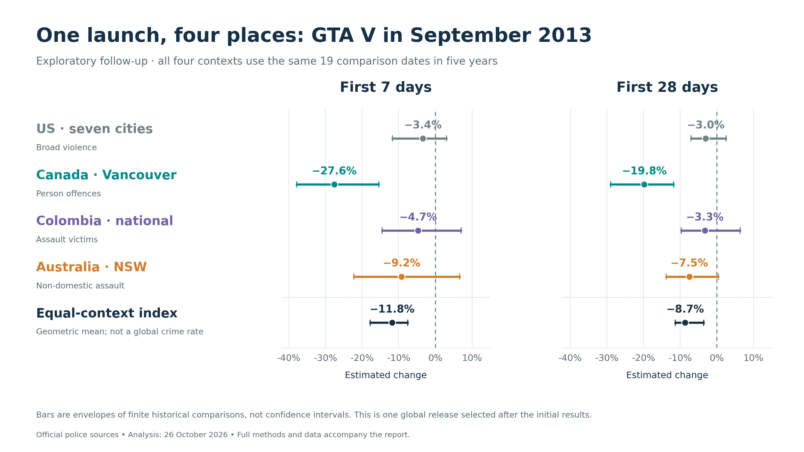

# 🐦 @emollick

## 📅 October 26, 2026

> 2 post(s) archived.

---

### 🕐 20:59 UTC · @emollick

> Thread on earlier work on the topic https://x.com/emollick/status/1489727932503314433?s=20 Good news for our current crime wave: Grand Theft Auto 6 is coming out! The release of GTA 5 (and other violent video games) are linked with less crime. @patmarkey shows GTA-like games likely saved 616 lives &amp; $5.5B in costs as people stay home to play rather than commit crimes.

🔗 [View original post](https://x.com/emollick/status/2114824177878245861)

---

### 🕐 20:50 UTC · @emollick

> I had GPT-6 Pro revisit the cool finding that violent video games reduce crime, as people stay home playing them. It downloaded fresh crime data &amp; extended prior work. Yes, GTA V&apos;s 2013 launch was linked with a dip in violence internationally. Other games are more ambiguous.

🔗 [View original post](https://x.com/emollick/status/2114822071016398918)

---
