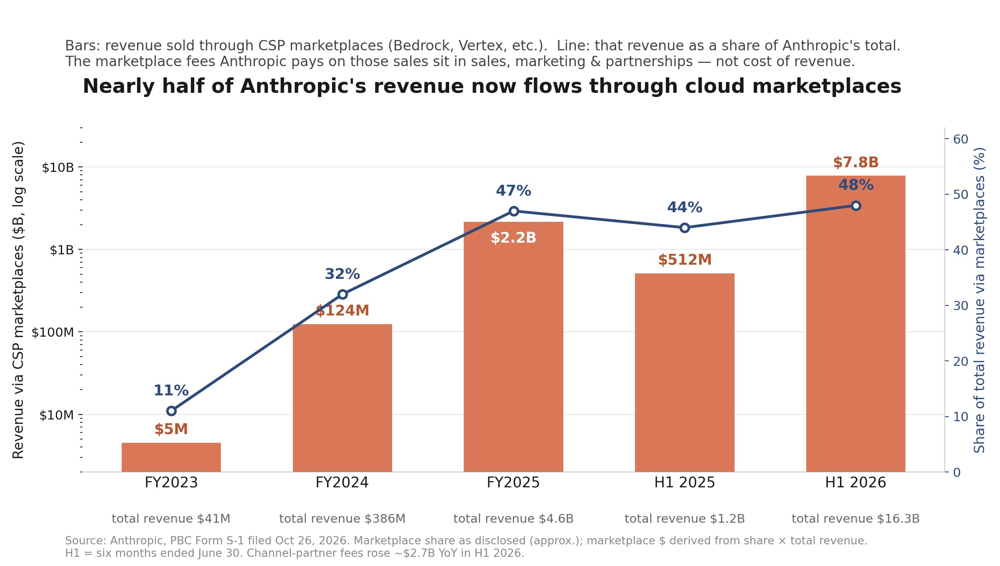
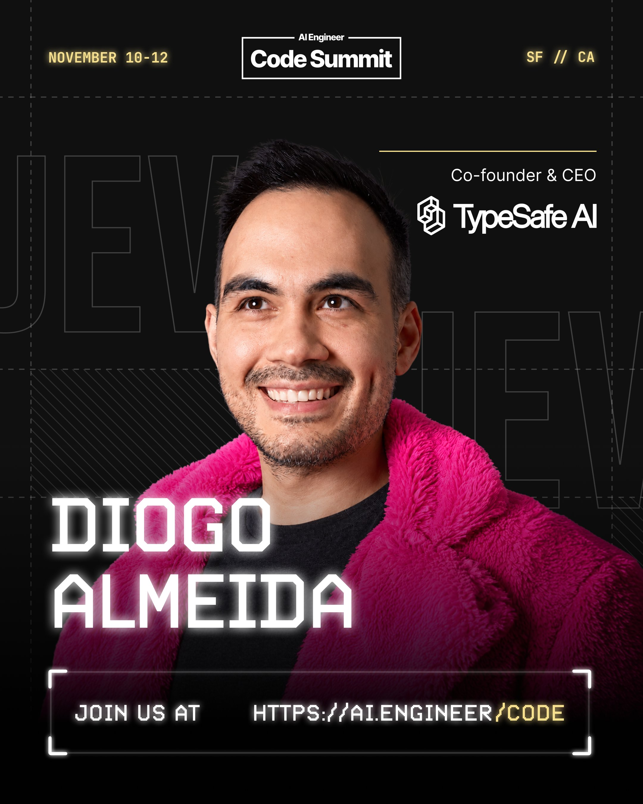

# 🐦 @swyx

## 📅 October 26, 2026

> 5 post(s) archived.

---

### 🕐 21:02 UTC · @swyx

> @grok how many of my reply guys are ai

🔗 [View original post](https://x.com/swyx/status/2114824910707277997)

---

### 🕐 19:45 UTC · @swyx

> bro moved from Claude Code to AIE Code power move tbh going to be sharing my WoW forever shaman build at the AIE Code closing keynote

🔗 [View original post](https://x.com/swyx/status/2114805687226376267)

---

### 🕐 19:08 UTC · @swyx

> going to be sharing my WoW forever shaman build at the AIE Code closing keynote We are pleased to announce that @trq212 will be returning to AIE to share what&apos;s now and what&apos;s next! http://aie.codes will be the last flagship AIE of the year, gathering the top 1000 agentic engineers in the world by invite only. Apply here: https://ai.engineer/code/2026/apply …

🔗 [View original post](https://x.com/trq212/status/2114796261362835842)

---

### 🕐 15:52 UTC · @swyx

> One of the more under-appreciated details in Anthropic&apos;s S-1: Nearly half of Anthropic&apos;s revenue now flows through cloud marketplaces - 48% in the first half of 2026, up from 11% in 2023. That&apos;s roughly $7.8B of revenue in six months sold through Bedrock, Vertex and Azure Marketplace instead of direct. Which means the hyperscalers get paid twice! They sell Anthropic the compute - Anthropic has committed hundreds of billions of dollars to AWS, Google and Microsoft - and then they take a fee on roughly half of the revenue distributed through their marketplaces. Also on gross margin...those marketplace fees don&apos;t sit in cost of revenue. They&apos;re in sales, marketing &amp; partnerships, so they never touch the headline 85% gross margin everyone is quoting today. Fees paid to channel partners alone rose ~$2.7B year over year in H1 2026. Hyperscalers feel like they&apos;re kind of the winner here all around though reading through this.

🔗 [View original post](https://x.com/Bensign/status/2114746925740122349)

---

### 🕐 15:00 UTC · @swyx

> Diogo Almeida and the TypeSafe AI team are bringing Jev to AIE CODE. System One models and what people are building with them. November 10 to 12, San Francisco. Apply to attend: https://ai.engineer/code

🔗 [View original post](https://x.com/aiDotEngineer/status/2114733797648281624)

---
