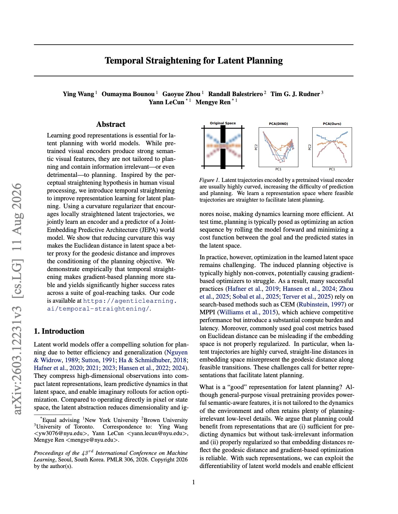

# 🐦 @ylecun

## 📅 October 26, 2026

> 1 post(s) archived.

---

### 🕐 03:20 UTC · @ylecun

> Yann LeCun has changed the game for robotics. Research he co-authored tackles a problem inside AI world models: their internal representations can make planning harder than it needs to be. A world model predicts what happens after an action. But even useful visual features can form curved paths in its internal “map,” making distance to a goal misleading. The researchers introduced Temporal Straightening. During training, it encourages those internal paths to become straighter, so the planner gets a more useful measure of progress. The results: More stable gradient-based planning Higher success rates across tested goal-reaching tasks Code available for others to explore The approach changes how the model represents movement, rather than rewriting every RL algorithm to work in curved space. For robotics, that’s a useful direction: build world models whose internal maps help an agent choose its next move.

🔗 [View original post](https://x.com/simplifyinAI/status/2114557656530559285)

---
