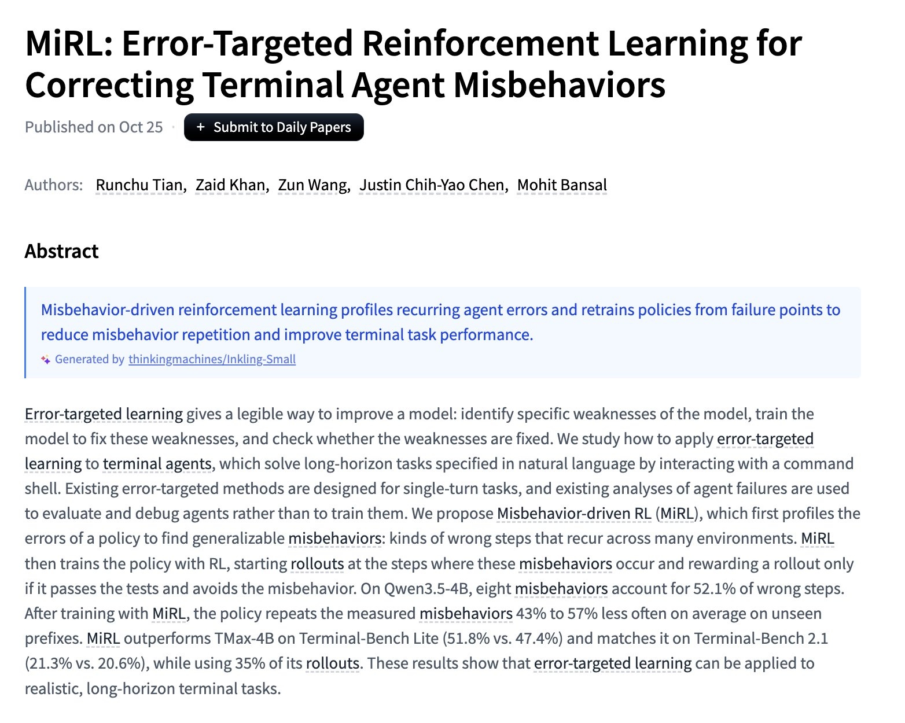
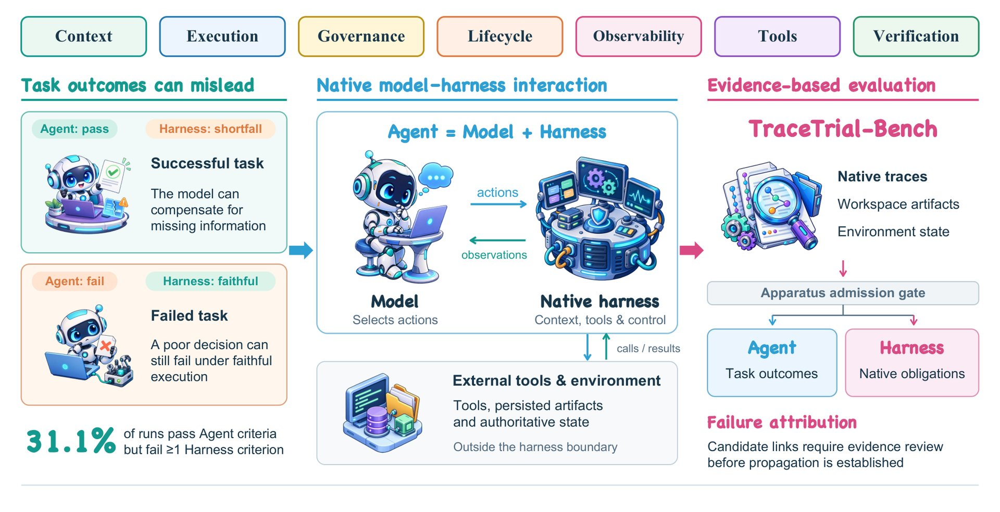

# 🐦 @_akhaliq

## 📅 October 27, 2026

> 7 post(s) archived.

---

### 🕐 17:07 UTC · @_akhaliq

> Introducing 𝙻𝙵𝙼𝟹: our new generation of Liquid Foundation Models. With a new tri-hybrid architecture and new multimodal encoders, the LFM3 family is the ideal model suite for specialized intelligence. &gt; 6 model instances, across text, audio, vision, and omni modalities, generative and decision models. &gt; 𝙻𝙵𝙼𝟹-𝟷.𝟽𝙱: text, 256k context window. &gt; 𝙻𝙵𝙼𝟹-𝚅𝙻-𝟸𝙱: vision-language model with video-input support for spatial understanding &gt; 𝙻𝙵𝙼𝟹-𝙰𝚞𝚍𝚒𝚘-𝟸𝙱: tool calls, voice chat, reasoning in 18 languages. &gt; 𝙻𝙵𝙼𝟹-𝙾𝚖𝚗𝚒-𝟸𝙱: an omni model combines vision, audio, and language. &gt; 𝚍𝟷-𝟸𝙱 and 𝚍𝟷-𝙾𝚖𝚗𝚒-𝟸𝙱: decision models with typed outputs and calibrated probabilities in a single pass. Omni adds audio input. &gt; fine-tune on 1 GPU. &gt; a new tri-hybrid architecture &gt; architecture optimized for 14 processor classes across GPUs, CPUs, and NPUs. &gt; 𝙻𝙵𝙼𝟹-𝚅𝙻-𝟸𝙱 is a beast. It performs competitively with Gemma 4 12B (6x larger), and Gemini 3.5 Flash Lite, and GPT-5.6 Luna, with 1.9B parameters. &gt; 𝙻𝙵𝙼𝟹-𝟷.𝟽𝙱 is #1 on the Pareto frontier of device intelligence 𝚙𝚒𝚙𝚎𝚝𝚝𝚎.𝚕𝚒𝚚𝚞𝚒𝚍.𝚊𝚒 Every modality for specialized intelligence. Pick the one that fits your use case, customize it, and run it on-device. 1/ 🧵 Media

🔗 [View original post](https://x.com/liquidai/status/2115128329003303107)

---

### 🕐 16:26 UTC · @_akhaliq

> MiRL Error-Targeted Reinforcement Learning for Correcting Terminal Agent Misbehaviors paper: https://huggingface.co/papers/2610.35697

🔗 [View original post](https://x.com/_akhaliq/status/2115117941972684835)

---

### 🕐 16:12 UTC · @_akhaliq

> 🚨 Big news today: We’ve raised $100M for our Series A! 🎉 🚀 We believe demand for fast inference is many times larger than demand for slow inference, and it’s about to go exponential. Thanks to our co-leads @BlackbirdVC and @Abstractvc. Two visionary partners join our journey 🎉 🚀 Media

🔗 [View original post](https://x.com/general_compute/status/2115114419067727995)

---

### 🕐 16:10 UTC · @_akhaliq

> Task success doesn&apos;t mean the harness worked TraceTrial-Bench scores agent performance and harness reliability separately, across 95 tasks, 7 dimensions, 4 harnesses × 9 models and 3,420 runs. 31.1% of runs succeed while failing a harness criterion.

🔗 [View original post](https://x.com/HuggingPapers/status/2115113850114548024)

---

### 🕐 15:05 UTC · @_akhaliq

> InteractiveWorld A Verifiable Human-Centric Environment for Building Better Interactive MLLM Assistants paper: https://huggingface.co/papers/2610.33966 Media

🔗 [View original post](https://x.com/_akhaliq/status/2115097545147924900)

---

### 🕐 14:56 UTC · @_akhaliq

> StreamVibe Proactive Video Agents for Evolving User Intent paper: https://huggingface.co/papers/2610.34662 Media

🔗 [View original post](https://x.com/_akhaliq/status/2115095386792616279)

---

### 🕐 14:34 UTC · @_akhaliq

> The largest math proof in human history is now computer-verified. Today, Axiom announces a complete Lean auto-formalization of the Classification of Finite Simple Groups, the &quot;periodic table of symmetry.&quot; About 15,000 pages, built by over 100 mathematicians across generations. Media

🔗 [View original post](https://x.com/axiommathai/status/2115089794867040584)

---
