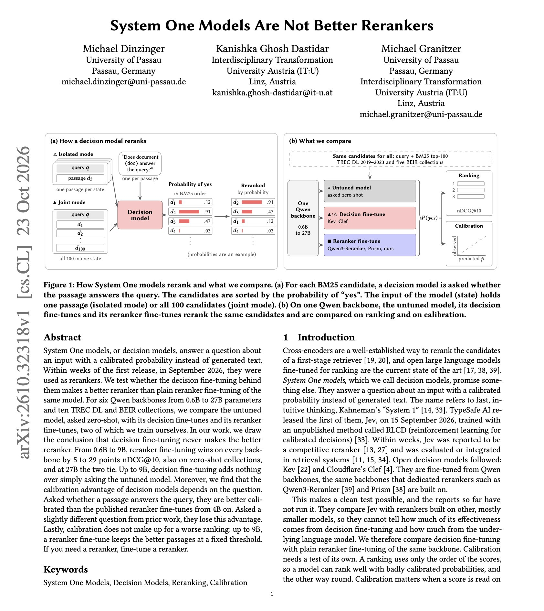
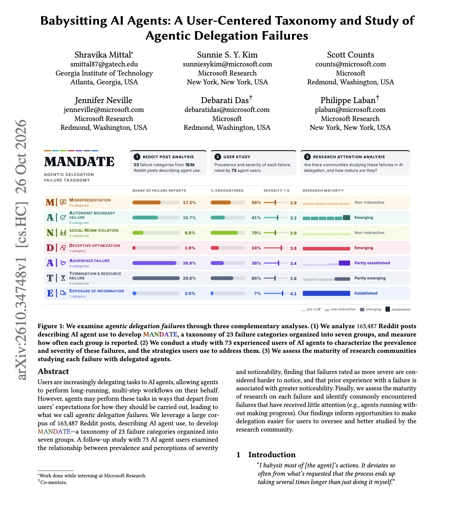

# 🐦 @dair_ai

## 📅 October 27, 2026

> 2 post(s) archived.

---

### 🕐 20:20 UTC · @dair_ai

> Are decision models useful for reranking? This new paper compares decision models with fine-tuned rerankers in a controlled experiment. Before you replace your reranker with a general decision model, run your current reranker and the decision model on your own queries and compare their rankings. The paper uses the same backbone model and the same candidate passages for every version it compares. The authors tested six Qwen backbones from 0.6B to 27B. Every version reranked the same BM25 top-100 candidates on ten collections. Five come from TREC DL 2019-2023, and five come from BEIR. They compared three versions of each backbone. The first is the untuned model asked zero-shot. The second is a decision fine-tune. The third is a plain reranker fine-tune. From 0.6B to 9B, the reranker fine-tune ranks better than the other two on every backbone by 5 to 29 points in nDCG@10. The gap is statistically significant on 48 of 60 comparisons. The reranker fine-tune also wins on collections that none of the fine-tunes were trained on. At 27B, the reranker fine-tune and the decision fine-tune score about the same. No reranker fine-tune had been released at that size, so the authors trained one. Up to 9B, decision fine-tuning stays within 2.5 points below and 0.7 points above the untuned model asked the same question. Reranker fine-tuning adds 6 to 30 points. Decision models are mainly promoted for their calibrated probabilities. The paper shows that the decision models&apos; calibration depends on how the question is worded. When asked whether a passage answers the query, decision models from 4B up are better calibrated than published reranker fine-tunes. With a slightly different question, taken from prior work, the decision models are no longer better calibrated. Better calibration also does not fix the ranking. Up to 9B, a reranker fine-tune keeps better passages at a fixed threshold. https://arxiv.org/abs/2610.32318 Chat with Paper: https://academy.dair.ai/papers/system-one-models-are-not-better-rerankers-2610.32318

🔗 [View original post](https://x.com/omarsar0/status/2115176716947833003)

---

### 🕐 19:00 UTC · @dair_ai

> Must-read paper from Microsoft Research and Georgia Tech. This one has lots of great insights. They used 163,487 Reddit posts about AI agents and surveyed 73 experienced agent users to map how delegated agent work goes wrong. The result is MANDATE, a taxonomy of 23 failure categories in seven groups. Each describes an agent that finishes the job in a way the user didn&apos;t expect. Users rated the most severe failures as the hardest to notice. People who had already run into a failure found it easier to spot than people who only thought it was possible. The most common failures are often the least studied. Agents that keep running and spend time and compute without making progress are among the most commonly reported failures, and they have the thinnest research base. https://arxiv.org/abs/2610.34748 Chat with Paper: https://academy.dair.ai/papers/babysitting-ai-agents-a-user-centered-taxonomy-and-study-of-agentic-delegation-f-2610.34748

🔗 [View original post](https://x.com/dair_ai/status/2115156635954090345)

---
