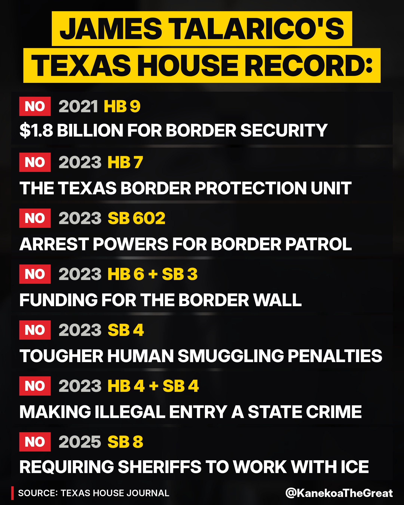
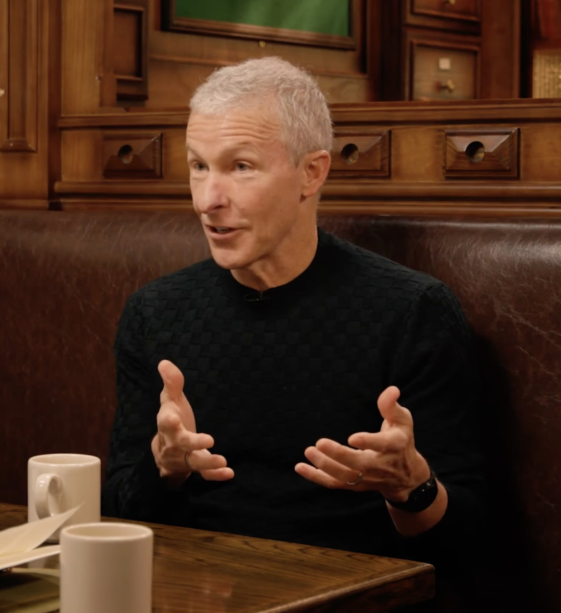
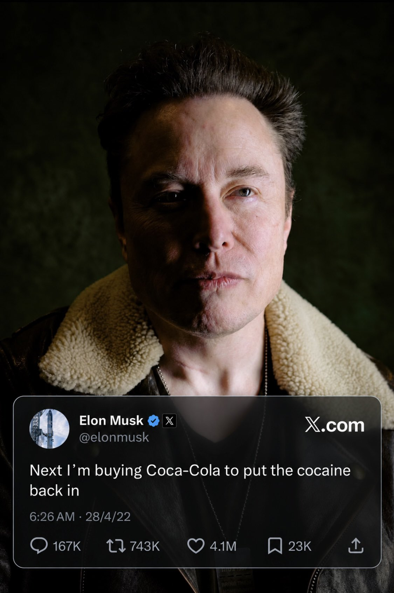

# 🐦 @elonmusk

## 📅 October 27, 2026

> 35 post(s) archived.

---

### 🕐 18:24 UTC · @elonmusk

> Madness 🚨ALERT: The editors of the journal Men and Masculinities will no longer allow authors to refer to individuals as being &quot;male.&quot; If an author uses the term, they should &quot;specify which dimension(s) of sex are at issue, since sex itself refers to several only loosely correlated dime…

🔗 [View original post](https://x.com/elonmusk/status/2115147639847305503)

---

### 🕐 18:20 UTC · @elonmusk

> 😑 Texas Democrat James Talarico: “My whiteness, my masculinity, all those things limit my imagination about what is possible.”

🔗 [View original post](https://x.com/elonmusk/status/2115146545448571175)

---

### 🕐 17:10 UTC · @elonmusk

> Good THE CEASEFIRE HAS COMMENCED The ceasefire between Ukraine and Russia took effect at 4:00am Moscow time on October 27, 2026. Timing was accelerated two days ahead of schedule to protect the safety of civilians and to facilitate the delivery of critical humanitarian aid. The ceasef…

🔗 [View original post](https://x.com/elonmusk/status/2115129139468673514)

---

### 🕐 17:02 UTC · @elonmusk

> 🤨 Hundreds of ballots left exposed at Skid Row homeless center ahead of LA election https://trib.al/jDflz8e

🔗 [View original post](https://x.com/elonmusk/status/2115126959940554814)

---

### 🕐 16:49 UTC · @elonmusk

> James Talarico now calls himself a &quot;border security Democrat.&quot; His Texas House record says otherwise. While millions poured across the border under Biden, Talarico voted NO on: ❌ $1.8 billion for border security ❌ The Texas Border Protection Unit ❌ Arrest powers for Border Patrol ❌ Funding for the border wall (twice) ❌ Tougher human smuggling penalties ❌ Making illegal entry a state crime (twice) ❌ Requiring sheriffs to work with ICE Nine votes. Nine NOs. Don’t send Talarico to Washington to vote with the Democrats who let millions pour across the border. Early voting ends Oct. 30. Go vote, Texas.

🔗 [View original post](https://x.com/KanekoaTheGreat/status/2115123811444269295)

---

### 🕐 16:49 UTC · @elonmusk

> What goes up must come down

🔗 [View original post](https://x.com/Tesla/status/2115123717877760129)

---

### 🕐 16:31 UTC · @elonmusk

> New features in Grok @Bot What&apos;s New in Grok Bot 00:00 🎃 00:13 Pages in Grok Bot 01:09 Vault 02:05 1Password 02:21 Apple integrations 03:21 Bot makes videos 03:47 New bot characters 04:13 X Spaces 04:31 Font fun 04:54 Design polish 05:11 Rapid fire

🔗 [View original post](https://x.com/elonmusk/status/2115119252785303813)

---

### 🕐 16:24 UTC · @elonmusk

> ty for 4 years of bangers

🔗 [View original post](https://x.com/X/status/2115117485020135559)

---

### 🕐 16:10 UTC · @elonmusk

> Amazing news! Texas Children&apos;s opens the nation&apos;s first detransition clinic. Now the hospital has to pay to help undo the damage. Under a $10 million settlement with Texas Attorney General Ken Paxton over billing Texas Medicaid for &apos;gender-transition&apos; interventions, Texas Children&apos;s Hospital in Houston has opened what Paxton calls the nation&apos;s first detransition clinic. The hospital must fully fund the clinic&apos;s care for its first five years, so patients pay nothing. Services include endocrinology, surgery, primary care, fertility counseling, psychiatry, psychology, social work and case management, and speech pathology. https://billboardchris.com/news/2026-10-27-texas-childrens-detransition-clinic

🔗 [View original post](https://x.com/BillboardChris/status/2115113896985899352)

---

### 🕐 15:57 UTC · @elonmusk

> True So much of the climate hysteria is just aimless guilt roaming the earth in search of futile acts of atonement.

🔗 [View original post](https://x.com/elonmusk/status/2115110737995796849)

---

### 🕐 15:02 UTC · @elonmusk

> United Airlines CEO in new interview on Delta Airlines choosing not to adopt @Starlink: &quot;It&apos;s a mistake. I think (Starlink) is the biggest competitive advantage of all time. We are going to have a few years of being the only airline that has it at scale.&quot;

🔗 [View original post](https://x.com/SawyerMerritt/status/2115096791393681426)

---

### 🕐 14:55 UTC · @elonmusk

> United Airlines CEO in new interview on @Starlink: &quot;We were only going to do 65% of our fleet, but once we put it on our first aircraft, I got these anecdotes saying, &apos;I&apos;m switching to flying regional &apos;cause it&apos;s got Starlink.&apos; Then I was like, &apos;Holy cow, we gotta go all-in.&apos;&quot;

🔗 [View original post](https://x.com/SawyerMerritt/status/2115095036496867476)

---

### 🕐 14:47 UTC · @elonmusk

> In the summer of 1994, a 23-year-old Elon Musk spent his days in Los Gatos at Pinnacle Research Institute, dreaming up how ultracapacitors could power electric cars and even Star Wars–style laser guns. Then, around 5 p.m. every evening, he drove to Palo Alto for his second job at Rocket Science Games, a startup full of future legends, from Tony Fadell, who would later build the iPod, to the people behind Apple&apos;s QuickTime and engineers from Industrial Light &amp; Magic. They hired him to write the most boring code imaginable, drivers so joysticks and mice would work with games, but Elon quietly gave himself a much harder problem 😂: figuring out how a computer could run a game and stream video from a CD at the same time, something the machines of that era simply couldn&apos;t do. Peter Barrett, one of the company&apos;s founders, remembered him as &quot;completely unflappable,&quot; and said that after a while nobody was giving him directions at all, because he was just building what he wanted to build. Bruce Leak, who hired him, said: &quot;He had boundless energy.&quot; So yeah, nobody handed Elon the big problem, he just went looking for it, at night, after a full day at another job. This is who Elon Musk is 💙

🔗 [View original post](https://x.com/EvaFox/status/2115093044705763697)

---

### 🕐 14:46 UTC · @elonmusk

> Starlink Brasil 🇧🇷 Starlink Mobile is now live in Brazil with @vivobr! 50M customers can use apps and messaging in cellular dead zones — with 7M phones already connected. This is the first nationwide service to cover the entire country. The next-gen service - Starlink Mobile V2 - will make sure all…

🔗 [View original post](https://x.com/elonmusk/status/2115092766275543266)

---

### 🕐 14:17 UTC · @elonmusk

> BREAKING: The nation’s first-ever Detransition Clinic is now open as a result of my historic settlement with Texas Children’s Hospital.

🔗 [View original post](https://x.com/KenPaxtonTX/status/2115085510657863854)

---

### 🕐 14:12 UTC · @elonmusk

> BREAKING: United Airlines is adding @Starlink to ~3 aircraft a day, its CEO just announced. Already on 48% of United&apos;s flights, Starlink is set to reach 50% next week. Media

🔗 [View original post](https://x.com/cb_doge/status/2115084179750936866)

---

### 🕐 13:00 UTC · @elonmusk

> SUPERCUT: Five minutes of insanity from Democrat James Talarico in his own words. He has shown us exactly why he does not belong in the U.S. Senate. Vote for Ken Paxton. Share this with your friends in Texas. Media

🔗 [View original post](https://x.com/america/status/2115065994318348370)

---

### 🕐 11:10 UTC · @elonmusk

> A BILLION dollars+ over budget, years behind schedule, contractor suing Karen Bass for delays, and now the LAX people mover, which has yet to move any people, is now arcing and catching on fire. Forget the 3rd World...Karen Bass has turned LA into a 4th World country. Wow... LAX People Mover flashover was caught on video

🔗 [View original post](https://x.com/spencerpratt/status/2115038491948265964)

---

### 🕐 09:58 UTC · @elonmusk

> Most liked post of any living human on 𝕏

🔗 [View original post](https://x.com/cb_doge/status/2115020291059646520)

---

### 🕐 09:41 UTC · @elonmusk

> Solar power represents 10% of electricity generated globally in 2026. It is now bigger than nuclear for the first time.

🔗 [View original post](https://x.com/wholemars/status/2115015903834444267)

---

### 🕐 07:14 UTC · @elonmusk

> Watch Falcon 9 launch 27 @Starlink satellites to orbit from California https://x.com/i/broadcasts/1mGPaZgYgLDJN

🔗 [View original post](https://x.com/SpaceX/status/2114979142638960965)

---

### 🕐 06:53 UTC · @elonmusk

> Everyone should have at least a few penchants

🔗 [View original post](https://x.com/elonmusk/status/2114973768473039185)

---

### 🕐 06:26 UTC · @elonmusk

> He’s right UNDERCOVER: GAVIN NEWSOM SAYS THE DSA IS &quot;GOING TO BE DOMINANT&quot; AND &quot;MAINSTREAM&quot; IN THE DEMOCRATIC PARTY! &quot;The DSA, the energy and the desire and demand for bold change, not incremental change, is very much going to be dominant. I mean, that&apos;s going to be a mainstream Democratic …

🔗 [View original post](https://x.com/elonmusk/status/2114967042952687676)

---

### 🕐 04:56 UTC · @elonmusk

> Cute 🥰 I was the opening act for a family of ducks. Thank you, Berlin. What a GTC. Europe is building its AI ecosystem and economy, from AI factories to agents to robots. DSX POD: Vera Rubin modular factories built, cabled and tested in the factory, then delivered ready to produce intel…

🔗 [View original post](https://x.com/elonmusk/status/2114944426271441127)

---

### 🕐 04:24 UTC · @elonmusk

> A Storm of Cybercabs Cybercab and Yap

🔗 [View original post](https://x.com/elonmusk/status/2114936152205697247)

---

### 🕐 04:22 UTC · @elonmusk

> Just published a Grok @Bot to remove my number from spam call lists and one to remove my personal info from public sites Call list remover: https://x.ai/bot/eGVcE2autG0u6UcAwE3py Privacy scrubber: https://x.ai/bot/ZSQK72Iear_ykfnpTIOHQ Took seconds to set up.

🔗 [View original post](https://x.com/alx/status/2114935735430119764)

---

### 🕐 04:03 UTC · @elonmusk

> 🤭 Waymo just got mogged by Tesla in Houston 😳

🔗 [View original post](https://x.com/elonmusk/status/2114931068365414757)

---

### 🕐 04:02 UTC · @elonmusk

> Sounds like Alex P🍆 knows a thing or two about being investigated 🤔 As California&apos;s top election official during the 2020 presidential election, Alex Padilla handed a $35M voter-contact contract to Joe Biden&apos;s campaign firm. The state controller even refused to pay because she said his office didn&apos;t have the authority to spend the money. Alex ill…

🔗 [View original post](https://x.com/elonmusk/status/2114930622238200202)

---

### 🕐 03:46 UTC · @elonmusk

> 10x safer to not-drive FSD than to drive a non-Tesla. What are you waiting for, Europe? Save lives! Tesla has released new FSD (Supervised) safety data. Miles per major collision: • Teslas Driven With FSD (Supervised): 6,006,200 • Teslas Driven Manually (Active Safety Features): 2,031,221 • Teslas Driven Manually (No Active Safety Features): 845,915 • U.S. Average: 660,164 Tota…

🔗 [View original post](https://x.com/p_ferragu/status/2114926690988081593)

---

### 🕐 03:03 UTC · @elonmusk

> Elon Musk: &quot;At its heart, wokeness is divisive, exclusionary, and hateful. It basically gives mean people a shield to be mean and cruel, armored in false virtue.&quot; There&apos;s really nothing more I could add to that. Media

🔗 [View original post](https://x.com/DefiantLs/status/2114915740293771772)

---

### 🕐 01:59 UTC · @elonmusk

> The sheer fucking hypocrisy surrounding Elon Musk is breathtaking. For decades, billionaire-funded foundations have financed advocacy groups, political campaigns, legal organizations, and efforts to reshape public policy. George Soros is one of the most prominent examples. And somehow that influence is routinely presented as enlightened philanthropy. Then Elon Musk enters politics, spends openly, challenges powerful institutions, and suddenly the entire establishment discovers the dangers of billionaire influence. Give me a fucking break. The man has built companies that launch rockets, connect the world through satellites, manufacture vehicles, and advance technologies with enormous implications for humanity. His long-term ambition is to make civilization multiplanetary. He has a profound personal interest in a future where technological progress remains possible. You can disagree with his politics. But pretending he’s just another billionaire looking for influence ignores the extraordinary scale of what he’s actually trying to accomplish.

🔗 [View original post](https://x.com/tslryn/status/2114899814177480951)

---

### 🕐 01:51 UTC · @elonmusk

> I see how some people can watch flashy robot demos on the timeline and think with a shiver that the robot apocalypse is around the corner, but reality check: There is no robot in the world that can change the batteries in a jack-o-lantern. If you have a robot friendly door handle it might be able to walk outside, pick it up, and carry it back inside. The robot could open the drawer with your batteries in it, but then things get tough. Opening the package of AA batteries? Extracting a precision screwdriver from its case? Unscrewing four tiny screws that require a hard press and twist? Popping batteries out of the case? Yes, you could build and train a specialist robot to do that today, but there is a very long way to go to replace the full range of human capabilities. Near term doomer scenarios should stop at “secretly controlling humanity” instead of “wiping humanity out” 😀

🔗 [View original post](https://x.com/ID_AA_Carmack/status/2114897771001974921)

---

### 🕐 01:34 UTC · @elonmusk

> @SenAlexPadilla Investigate your wiener

🔗 [View original post](https://x.com/elonmusk/status/2114893417599914366)

---

### 🕐 01:21 UTC · @elonmusk

> In free nations, we investigate crimes to see who is guilty of them. In communist tyrannies, they investigate men to see what they can be punished for. INVESTIGATE ELON MUSK.

🔗 [View original post](https://x.com/Devon_Eriksen_/status/2114890314280292819)

---

### 🕐 01:13 UTC · @elonmusk

> There are at least 20,000 non-citizens on the California voter rolls. Congressman Duarte lost by 187 votes. Congresswoman Michelle Steel lost by 653 votes. This is a constitutional crisis. The thing they said doesn&apos;t happen is happening again. There is a minimum of 20,000 noncitizens on California voter rolls. Pass the SAVE AMERICA ACT and secure our elections.

🔗 [View original post](https://x.com/ScottPresler/status/2114888252171637223)

---
