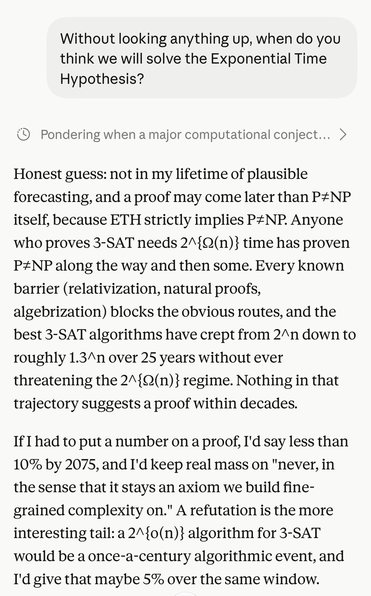
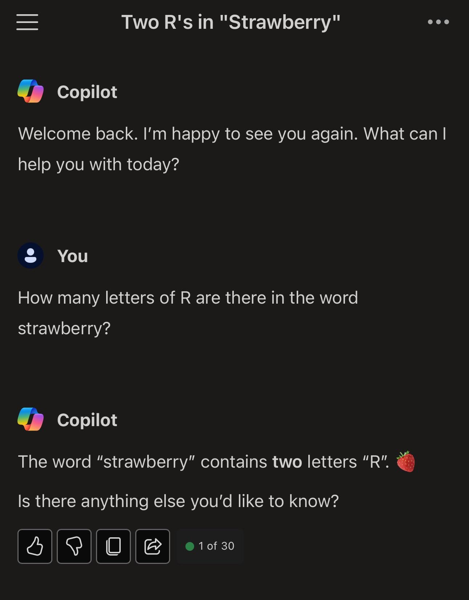

# 🐦 @emollick

## 📅 October 27, 2026

> 4 post(s) archived.

---

### 🕐 13:01 UTC · @emollick

> This never gets old (&amp; also shows how hard forecasting AI is even for AI) “Hey Claude Fable &amp; GPT-6 Astra, Without looking anything up, when do you think we will solve the Exponential Time Hypothesis?” (I only show part of the answers for space)

🔗 [View original post](https://x.com/emollick/status/2115066250938192118)

---

### 🕐 04:50 UTC · @emollick

> I realize this is because thinking traces have gotten too long (and too proprietary) but the solution of hiding them almost entirely so the AI just does &quot;magic&quot; feels like a failure of imagination and a move towards a default of disintermediation that is worth effort challenging.

🔗 [View original post](https://x.com/emollick/status/2114942688281911345)

---

### 🕐 04:47 UTC · @emollick

> The end of detailed summarized thinking traces for Claude and ChatGPT (likely both anti-distillation &amp; for UX) has made being a human in the loop challenging. It pushes us towards automation, rather than augmentation, as it has become much harder to weigh in on in-process AI work

🔗 [View original post](https://x.com/emollick/status/2114942007533515261)

---

### 🕐 00:22 UTC · @emollick

> Two and a half years from this. We are announcing three new discoveries in mathematics, computer science, and physics about harmonic analysis, complexity theory, and quantum field theory. https://openai.com/index/building-scientific-understanding-with-academic-communities/

🔗 [View original post](https://x.com/emollick/status/2114875372173144338)

---
