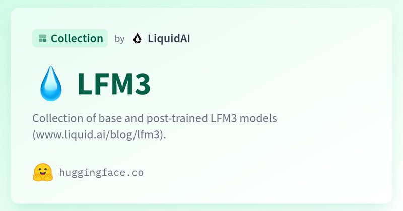
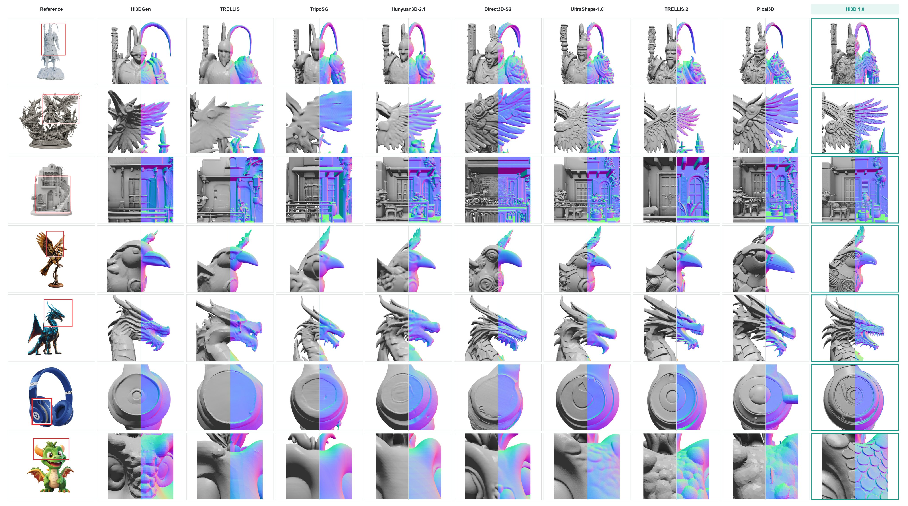
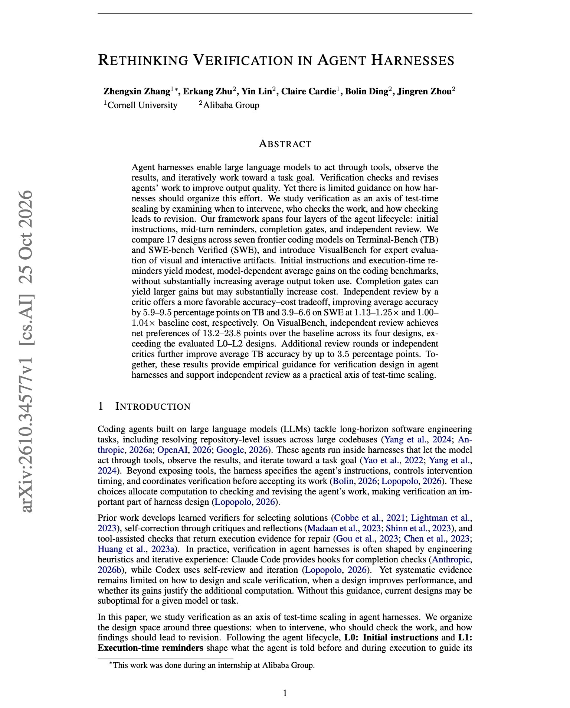
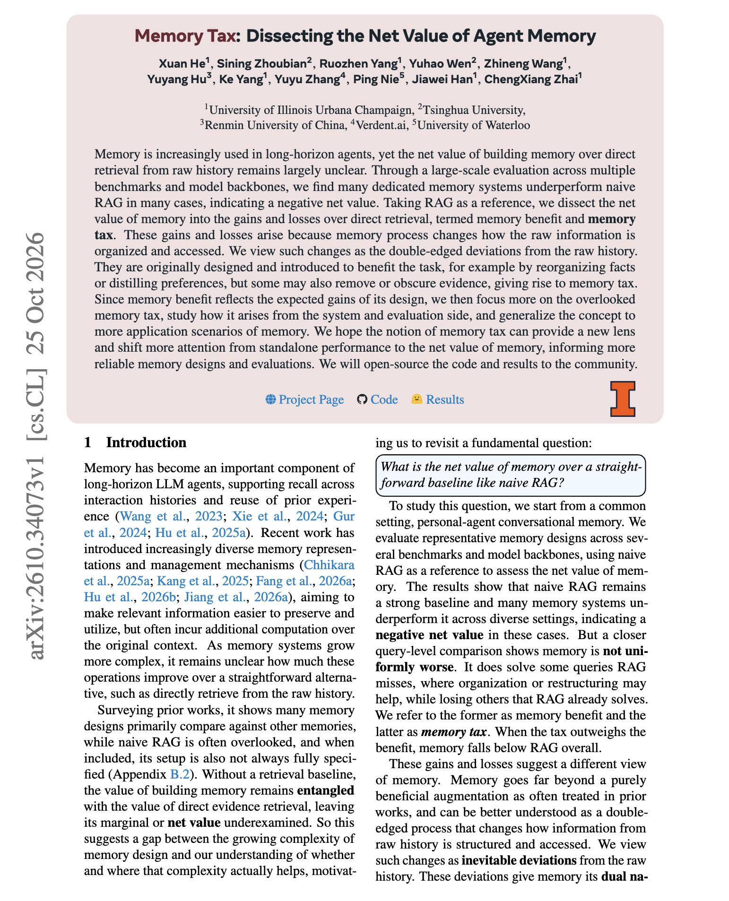
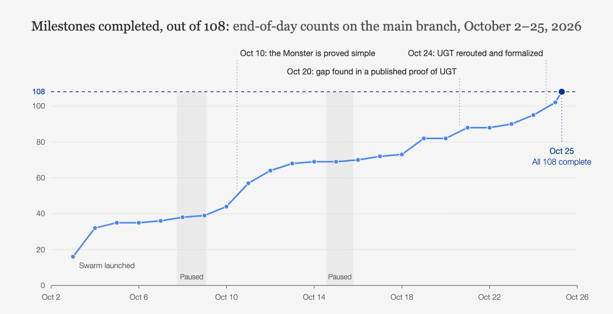

# 🐦 @omarsar0

## 📅 October 27, 2026

> 8 post(s) archived.

---

### 🕐 18:02 UTC · @omarsar0

> I am still very bullish on local LLMs. We have yet to see its biggest unlock. I am particularly curious to see what&apos;s possible with unlimited inference. One exciting application is using local models to run always-on proactive agents cheaply. Great to see Sentient OS pushing for this. It uses a local LLM on your computer to read your context overnight, then keeps what it learns as markdown files you own. Today, we&apos;re launching Sentient OS (YC F26), on-device AI that understands your life overnight with a local LLM. This unlimited inference enables 2 magical experiences 🧵

🔗 [View original post](https://x.com/omarsar0/status/2115142011389149480)

---

### 🕐 17:46 UTC · @omarsar0

> Weights are on Hugging Face: https://huggingface.co/collections/LiquidAI/lfm3

🔗 [View original post](https://x.com/omarsar0/status/2115138193091920045)

---

### 🕐 17:38 UTC · @omarsar0

> Good to see this going GA. Long-running agents can handle a complicated task and still miss a step you&apos;d assume was easy. I&apos;d like to see what those patterns across real usage tell us about which jobs to hand them next. Today, @JudgmentLabs opens for general access. We believe long running agent systems will generate more exhaust data than the world can currently process. Hidden within agent traces are rich records of how to make these systems better: what users ask for, when agents stumble, and…

🔗 [View original post](https://x.com/omarsar0/status/2115136102390444538)

---

### 🕐 17:33 UTC · @omarsar0

> You don&apos;t see releases like this every day. Liquid AI just released LFM3, a family of ~2B open-weight models for text, vision, audio, omni, and decision tasks, all on one shared backbone. LFM3-1.7B is trained to run in agent harnesses like Hermes Agent and Pi, with a 256K context. On WebArena-Verified, it scores 38.4 vs. 28.9 for Qwen3.5-9B in Liquid&apos;s evaluation. Models can be fine-tuned on a single GPU. This series of models has huge potential for always-on local agents. Media Introducing 𝙻𝙵𝙼𝟹: our new generation of Liquid Foundation Models. With a new tri-hybrid architecture and new multimodal encoders, the LFM3 family is the ideal model suite for specialized intelligence. &gt; 6 model instances, across text, audio, vision, and omni modalities, gener…

🔗 [View original post](https://x.com/omarsar0/status/2115134865733828918)

---

### 🕐 16:58 UTC · @omarsar0

> Love seeing these open-source efforts. @Hi3D_AI recently released their 3D model, Hi3D V1.0. Built on Sparc3D, it uses a reference image to add detail to a rough 3D mesh. V1 includes inference code and model weights for geometry refinement, with texture generation available in the separate commercial V3. https://www.hi3d.ai/hi3d-1-0-open-source https://github.com/hi3d-official/Hi3Dv1.0 https://x.com/i/article/2113242613214048257

🔗 [View original post](https://x.com/omarsar0/status/2115126110891499676)

---

### 🕐 15:20 UTC · @omarsar0

> Great paper from Alibaba and Cornell on verification in coding-agent harnesses. (bookmark it) If you build agent harnesses, this one is worth your time. They find that a separate reviewer agent adds 5.9 to 9.5 points on Terminal-Bench at 1.13 to 1.25x the baseline cost. They compared 17 verification designs across seven frontier coding models on Terminal-Bench and SWE-bench Verified. The designs check the agent&apos;s work at four points: the initial instructions, reminders during the run, a gate before the agent can finish, and an independent critic at the end. Instructions and reminders gave small, model-dependent gains. Completion gates gave larger gains, sometimes at much higher cost. The critic gave the best accuracy per dollar, adding 3.9 to 6.6 points on SWE-bench Verified at almost no extra cost. More review rounds added up to 3.5 more points on Terminal-Bench. https://arxiv.org/abs/2610.34577 Chat with Paper: https://academy.dair.ai/papers/rethinking-verification-in-agent-harnesses-2610.34577

🔗 [View original post](https://x.com/dair_ai/status/2115101219119325606)

---

### 🕐 15:11 UTC · @omarsar0

> RAG is so back! Another paper showing that plain RAG keeps winning the agent memory comparison. They show that many dedicated memory systems score below naive retrieval over the raw history on LongMemEval, PersonaMem, and MINT-Eval, while costing much more. They split a memory system&apos;s value into two parts. Memory benefit counts questions it answers that RAG misses. Memory tax counts questions RAG answers that the memory system gets wrong. Why does the tax appear? Building memory rewrites the history. Some facts get dropped or distorted during extraction, and some survive but become harder to retrieve. Memory systems also vary more than RAG when you change the backbone model. A simple fix helped. Retrieving from the raw history alongside memory and reranking both together reduced the tax. The practical takeaway here is that before adding a memory layer to your agent, compare it with plain retrieval over the transcript on your own data. https://arxiv.org/abs/2610.34073 Chat with Paper: https://academy.dair.ai/papers/memory-tax-dissecting-the-net-value-of-agent-memory-2610.34073

🔗 [View original post](https://x.com/omarsar0/status/2115098954799169970)

---

### 🕐 14:51 UTC · @omarsar0

> &quot;We saw a glimpse of the future of swarm coding.&quot; Agent swarms will fundamentally change how we build software. @axiommathai used a swarm of agents to formally verify the Classification of Finite Simple Groups, the largest proof in math history. That is roughly 15,000 pages by over 100 mathematicians, now about 50 million lines of Lean, verified in 24 days. The agents claimed tasks, wrote proofs, reviewed each other, and merged their own work through GitHub. Along the way, they fixed hundreds of major errata in the published proof. The largest math proof in human history is now computer-verified. Today, Axiom announces a complete Lean auto-formalization of the Classification of Finite Simple Groups, the &quot;periodic table of symmetry.&quot; About 15,000 pages, built by over 100 mathematicians across generations.

🔗 [View original post](https://x.com/omarsar0/status/2115093923081110013)

---
