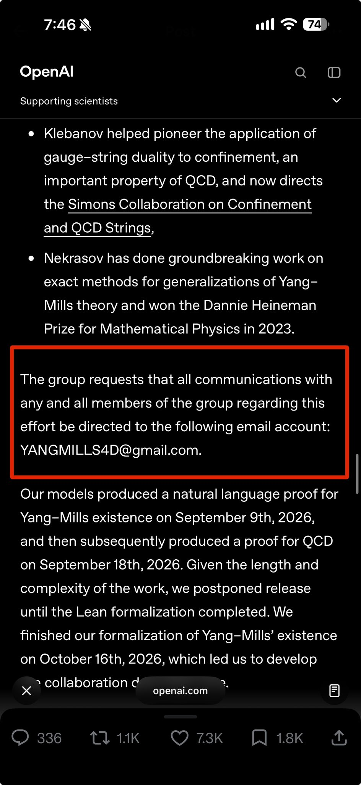

# 🐦 @swyx

## 📅 October 27, 2026

> 1 post(s) archived.

---

### 🕐 02:48 UTC · @swyx

> agi can prove p = np but not vibecode a better contact form than random gmail address Announcing three major scientific discoveries, one each in mathematics (harmonic analysis), computer science (complexity theory), and physics (quantum field theory). AI starting to help us improve our understanding of the universe! https://openai.com/index/building-scientific-und…

🔗 [View original post](https://x.com/swyx/status/2114912126443893104)

---
