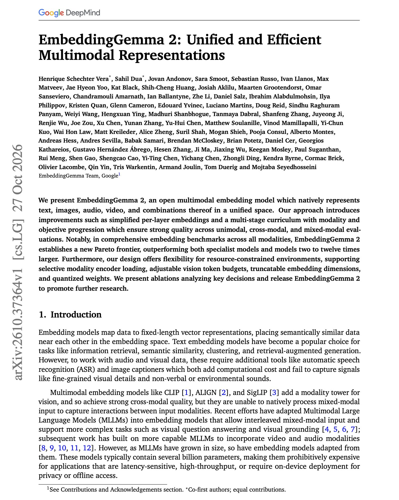

# 🐦 @dair_ai

## 📅 October 28, 2026

> 4 post(s) archived.

---

### 🕐 14:32 UTC · @dair_ai

> Decision models can also improve your OCR pipelines. You can also use Jev-like models for verification. Here is a great example of this: MiniCPM-OCR from OpenBMB and ModelBest pairs a small open document parser with a second model that scores the reliability of the OCR output. The parser has only 1.3B parameters. It handles Chinese and English documents, including scans, photos, curved pages, and tilted inputs, and it supports key information extraction. The second model, MiniCPM-OCR Jev, checks extracted text, formulas, and tables. It also works on outputs from other OCR models, so you can run it on top of the parser you already use. More details below. Agents now read PDFs, invoices, and papers all day. One bad table extraction carries into every step that follows. A simple setup looks like this. &gt; Parse the document with MiniCPM-OCR &gt; Score the extracted text, formulas, and tables with Jev &gt; Send low-scoring output to a human or a correction step Jev estimates reliability. It doesn&apos;t fix errors itself. The weights are open, with a fine-tuning framework and inference support for llama.cpp, vLLM, SGLang, and Ollama. There are also Agent Skills integrations. If you build document agents, test the parser and Jev together on your hardest pages, like dense tables, formulas, and phone photos. Media

🔗 [View original post](https://x.com/omarsar0/status/2115451743848759562)

---

### 🕐 14:24 UTC · @dair_ai

> Recommended paper on episodic memory for multi-agent systems. Great paper from Amazon and colleagues on self-improving multi-agent systems. Episodic memory for agents is so underrated. But I am starting to see lots of good applications as frontier models improve. This paper is the latest example. They built a system that has three parts, al…

🔗 [View original post](https://x.com/dair_ai/status/2115449730285089218)

---

### 🕐 13:45 UTC · @dair_ai

> Banger report from Google. They just released EmbeddingGemma 2, an open 744M multimodal embedding model. It beats specialist models and models 2 to 12 times larger across seven benchmark suites covering text, code, images, video, documents, and audio. Text, images, audio, video, and mixed inputs all go into one vector space. Each modality has its own encoder feeding into a shared backbone, so you can load only what you need. Text-only runs at 271M parameters, vision-language at 439M, and audio-language at 577M. It scores 61.36 on MTEB Multilingual v2 and 68.46 on MTEB English v2. The int4 version loses about 0.4 points on MTEB Multilingual. You can also lower the vision token budget and truncate the embedding dimensions. For agent memory and retrieval over mixed media, this small open model is a great on-device option. https://arxiv.org/abs/2610.37364 Chat with Paper: https://academy.dair.ai/papers/embeddinggemma-2-unified-and-efficient-multimodal-representations-2610.37364

🔗 [View original post](https://x.com/dair_ai/status/2115439702572716129)

---

### 🕐 12:27 UTC · @dair_ai

> Yes, the coding interview is absolutely dead! It should have been gone a long time ago. With coding agents this good, we can now focus on hiring people with high agency, taste, judgment, empathy, and principled thinking. This also gives junior engineers a fair chance. I am often surprised by how better equipped they are, how fast they move, and their creativity and ambition. You need all those qualities in this brave new world. I recently gave a talk at a university, and I suggested to senior students that they look at data (understand and analyze it) and pick a domain they are passionate about. Then build a prototype that tries to solve a problem and share it publicly (X, GitHub, YouTube, Kaggle, etc.). The first project might not get any attention, but if you do this often, you will eventually find someone, or hopefully a few, in the industry who care as much as you do about the problem you are trying to solve. Show that desire and hunger. It matters so much today. If you are just starting your career, don&apos;t pay attention to all the noise (e.g., AI taking away jobs, etc.). Keep building and shipping. Master your fundamentals (systems thinking goes a long way today). And stay hungry. The coding interview is dead, at least for my team at Anthropic. I&apos;ve seen enough to know that it no longer provides signal. I removed it from loops this month. I have a spicy, optimistic take - I think there&apos;s an opportunity for junior engineers: https://felixrieseberg.com/hunge…

🔗 [View original post](https://x.com/omarsar0/status/2115420120474358245)

---
