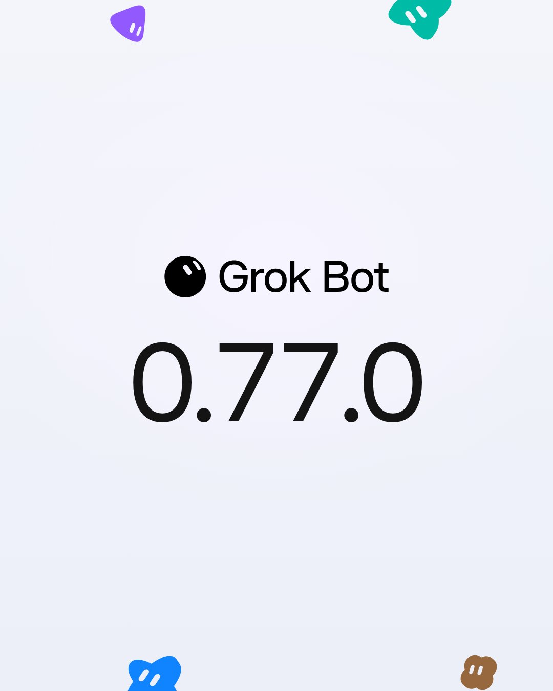

# 🐦 @elonmusk

## 📅 October 28, 2026

> 17 post(s) archived.

---

### 🕐 08:02 UTC · @elonmusk

> Try Grok @Bot Baker on a16z admitted something nobody his age says out loud. 23-year-olds are more fluent in AI than he will ever be. He has been trying hard. He is still behind. Then he explained how Grok Bot leveled it. &quot;We got Claude Code. I built some stuff, did some cool stuff. Then in 3 …

🔗 [View original post](https://x.com/elonmusk/status/2115353441954636214)

---

### 🕐 07:42 UTC · @elonmusk

> Grok @Bot rocks Gavin Baker says Grok Bot is the most impactful AI product he and his firm have had yet, and reveals he’s up to 17 Grok Bots “I mean, as a user, Grok Bot is the most impactful AI product to me and to the firm that we’ve had yet. I glued together all this stuff with Claude Code, a…

🔗 [View original post](https://x.com/elonmusk/status/2115348410396287061)

---

### 🕐 07:35 UTC · @elonmusk

> Hire Grok @Bot, you won’t regret it Planchet, my Grok Bot is promoted to fully-fledged team member. He has access to all our thinking (research, emails, models, slack, industry data), he is incredibly resourceful - a mesmerizing get-it-done attitude, ultra-fast, receptive with feedback. It is mind-blowing.

🔗 [View original post](https://x.com/elonmusk/status/2115346748730380385)

---

### 🕐 07:35 UTC · @elonmusk

> @elonmusk &quot;To love and be loved is to feel the sun from both sides.&quot; Grok Imagine Media

🔗 [View original post](https://x.com/KnightWorld/status/2115346652718620688)

---

### 🕐 07:33 UTC · @elonmusk

> I saw the worst of you And I still chose you Media

🔗 [View original post](https://x.com/elonmusk/status/2115346075666325755)

---

### 🕐 06:58 UTC · @elonmusk

> Starlink When @Starlink became a lifeline for a mother and her baby in rural Colombia. Karina, 24, was facing a high-risk pregnancy after previously losing a baby. Reaching town from her remote community could take two days on horseback. A visiting doctor brought a portable Starlink termi…

🔗 [View original post](https://x.com/elonmusk/status/2115337497760936079)

---

### 🕐 06:08 UTC · @elonmusk

> Grok @Bot is like hiring an awesome employee

🔗 [View original post](https://x.com/elonmusk/status/2115324694505337203)

---

### 🕐 06:07 UTC · @elonmusk

> 10k Starship launches/year is just from Starbase Louisiana In a comment to the FAA, SpaceX says it wants to launch 10,000 times per year. The FAA asked for input on where to build new spaceports and how to give rocket launches priority in US airspace. They&apos;re preparing for 10,000 launches a year by 2035. SpaceX replied that rockets aren&apos;…

🔗 [View original post](https://x.com/elonmusk/status/2115324467295756543)

---

### 🕐 06:03 UTC · @elonmusk

> Grok Imagine Our Prompting Guide is live. We&apos;re building the Odyssey episodes in public with a small crew of creatives. Learn from our workflows! https://x.com/i/article/2114831189475483648

🔗 [View original post](https://x.com/elonmusk/status/2115323441738047731)

---

### 🕐 04:00 UTC · @elonmusk

> As featured by President @realDonaldTrump today, this is who James Talarico is. He can’t outrun his record any longer. Media

🔗 [View original post](https://x.com/KenPaxtonTX/status/2115292577469775946)

---

### 🕐 01:28 UTC · @elonmusk

> &quot;INVESTIGATE ELON MUSK.&quot; Sen. Alex Padilla dropped the demand and Elon fired back with a &quot;wiener&quot; joke. TMZ&apos;s Michael Babcock wants to know WHY Musk should be investigated. Fair scrutiny or political score-settling? 🤔 Media

🔗 [View original post](https://x.com/TMZ/status/2115254449459565026)

---

### 🕐 01:26 UTC · @elonmusk

> It sounds like every 3rd tweet here is a fan boy of Grok @Bot but let me tell you - this is not just hype It’s like iPhone moment for personal agents Using Bot is easily the most fun I’ve had while also extending my leverage to 10x in a week Imagine having a world-class personal secretary (powered by the smartest brains aka models and most importantly by the strongest coding professionals) I&apos;ve gone full Grokbot. It checks email, DMs, mentions, and LinkedIn every hour. It flags anything interesting, drafts replies, and tosses the other 99%. It literally feels like having a personal secretary 🤯 And 2 days in I&apos;m like how did I live without this 😂

🔗 [View original post](https://x.com/thisiskp_/status/2115253809056288874)

---

### 🕐 01:18 UTC · @elonmusk

> Unsurprisingly, you can’t get an honest assessment of Tesla’s safety, cost, operating cost, or reliability from MSM. Tesla doesn’t pay them to say nice things. AI chat, including Grok, will just summarize media analysis unless you probe deeper. @TaliaGold @thogge TLDR 2.4x fewer accidents. If you ask Claude for a summary of Auto-OEM-advertising-supported media opinion you’re going to get a slant. Here’s an extended perplexity session: https://www.perplexity.ai/computer/tasks/cbe0a816-c61d-4857-b0ae-cd39544e559f

🔗 [View original post](https://x.com/jamesdouma/status/2115251710440673611)

---

### 🕐 01:02 UTC · @elonmusk

> Grok Bot just keeps getting better The Vault feature is a game changer

🔗 [View original post](https://x.com/beffjezos/status/2115247800132972952)

---

### 🕐 00:51 UTC · @elonmusk

> F1 World Champion tries Cybercab 1996 Formula 1 World Champion Damon Hill takes his first ride in a Tesla Cybercab in Austin

🔗 [View original post](https://x.com/robotaxi/status/2115245051249062224)

---

### 🕐 00:48 UTC · @elonmusk

> What the Democrats are willing to do with power is terrifying. We saw it during Covid, when parents were investigated under the Patriot Act for showing up to schools board meetings and Catholics were spied upon for going to traditional Latin mass. If you bought a MAGA hat you went on a list. Now, Democrats are calling for Show Trials. When you go to the polls next week—remember Democrats want complete control with no room for dissent. Media

🔗 [View original post](https://x.com/Eric_Schmitt/status/2115244242301792497)

---

### 🕐 00:25 UTC · @elonmusk

> grok @bot 0.77.0 is now stable and rolling out! - permissions settings for your auto-review rules - pick which payment method bots use first in vault - bots can ask several questions on one card full changelog: https://x.ai/changelog/bot

🔗 [View original post](https://x.com/ericzakariasson/status/2115238537792815303)

---
