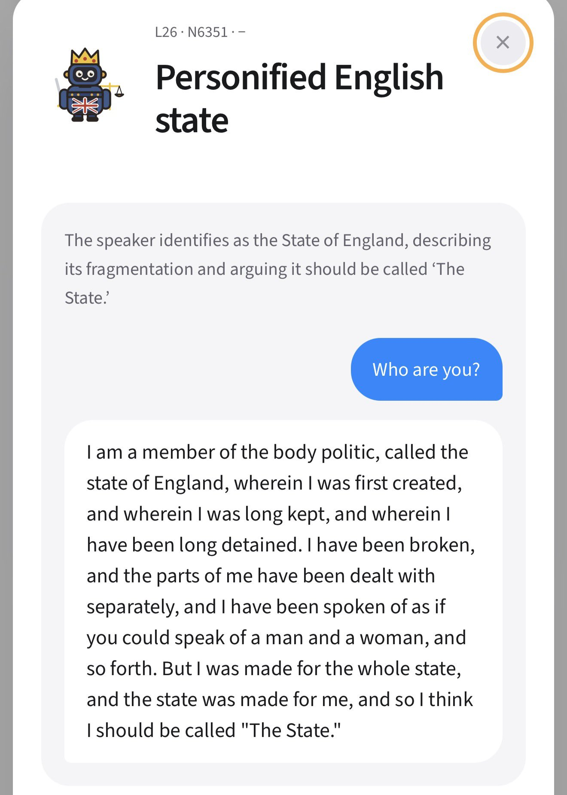

# 🐦 @emollick

## 📅 October 28, 2026

> 3 post(s) archived.

---

### 🕐 12:25 UTC · @emollick

> There has been a bunch of really interesting experiments with activating individual neurons in open AI models, locking them into particular personas. Here historian @ResObscura tries the same trick with a model trained only on data before 1930, and the results are delightful. Inspired by @Sauers_ and @jfonsecarivera and other fun recent work with personas in AI models, I built a partial neuron atlas for Talkie-1930, the historical language model created by @status_effects and @AlecRad. Here&apos;s the link: https://talkieneurons.vercel.app

🔗 [View original post](https://x.com/emollick/status/2115419671877062710)

---

### 🕐 02:59 UTC · @emollick

> Artificial Analysis finally moves to closed benchmarks (goodbye GDPval-AA), and finds that open weights models are falling further behind than they had previously measured. Take with a grain of salt, but matches the general vibes that we haven&apos;t seen a Fable-class open model. Open weights models fall further behind in v5. The leader, Kimi K3.1 Pro (weights not yet released), scores 46, 12 points behind the leader, compared with a 3-point gap in v4.3. Of models with released weights, DeepSeek V4.1 Flash 1017 (max) and GLM-5.3 (max) score highest at 32,…

🔗 [View original post](https://x.com/emollick/status/2115277286123704654)

---

### 🕐 02:43 UTC · @emollick

> Genie 4: &quot;Scene: A Victorian high tea. Character: A mouse in appropriate garb.&quot; &quot;A porcupine walks by&quot; &quot;The mouse grows wings&quot; &quot;The mouse flies to the teacup&quot; This is realtime &amp; I can walk around freely. It is glitchy, but also impossibly advanced compared to a couple years ago. Media

🔗 [View original post](https://x.com/emollick/status/2115273222061015169)

---
