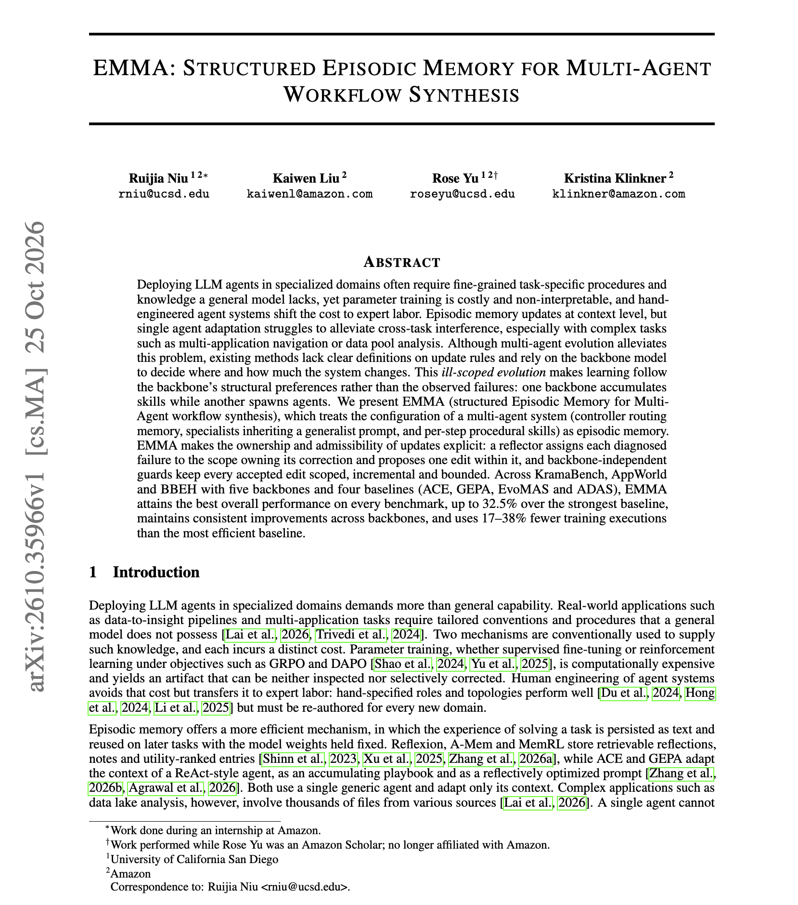

# 🐦 @omarsar0

## 📅 October 28, 2026

> 3 post(s) archived.

---

### 🕐 13:39 UTC · @omarsar0

> Great paper from Amazon and colleagues on self-improving multi-agent systems. Episodic memory for agents is so underrated. But I am starting to see lots of good applications as frontier models improve. This paper is the latest example. They built a system that has three parts, all run by the same LLM. A controller plans each task and runs it one step at a time, choosing which sub-agent and which skills to use at each step. Sub-agents start as a generalist, and each specialist inherits the generalist&apos;s prompt plus its own role-specific method. Skills are short procedures, such as algorithms or pitfall checklists. EMMA treats the controller&apos;s routing memory, the agent prompts, and the skills as episodic memory that improves from failures. After a failed task, a reflector decides which of the three owns the fix and proposes one edit there. Guards keep every accepted edit scoped, incremental, and bounded. EMMA beats ACE, GEPA, EvoMAS, and ADAS on KramaBench, AppWorld, and BBEH, by up to 32.5% over the strongest baseline, and uses 17 to 38% fewer training executions. https://arxiv.org/abs/2610.35966 Chat with Paper: https://academy.dair.ai/papers/emma-structured-episodic-memory-for-multi-agent-workflow-synthesis-2610.35966

🔗 [View original post](https://x.com/omarsar0/status/2115438189901181296)

---

### 🕐 13:24 UTC · @omarsar0

> It’s a huge red flag when I see companies using old hiring methods for engineering roles today. I question how AI-pilled they actually are when I see too much emphasis on the classical coding interview. More thoughts here: I don&apos;t think anyone has a good answer to this today. It depends heavily on the role and the output/value the hiring company actually cares about. AI has brought software way closer to the product. Yesterday&apos;s skills don&apos;t matter as much as they used to. For example, when I try t…

🔗 [View original post](https://x.com/omarsar0/status/2115434527719891389)

---

### 🕐 00:06 UTC · @omarsar0

> Recommended read. We are just starting to understand how AI shapes decisions and judgment. At first glance, this might look like a simple, niche passion research project. However, it&apos;s an important research direction for understanding where AI&apos;s true value emerges and how to optimize agent-human collaboration. If we can better understand when to defer to AI and when expert/human judgment matters, I think this unlocks tremendous value. Yes, it matters for organizations adopting AI, but I see it as an interesting way to better measure human-agent collaboration and discover new, optimal ways to augment collective intelligence. New Anthropic research: How AI agents shape experts&apos; judgment calls When experts delegate work to an agent, do they still make the key decisions? We tested this in a randomized trial with 50 professional data analysts.

🔗 [View original post](https://x.com/omarsar0/status/2115233666481766571)

---
