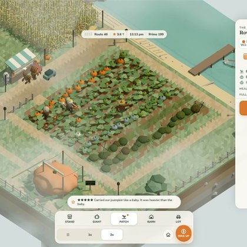

# 🐦 @simonw

## 📅 October 28, 2026

> 1 post(s) archived.

---

### 🕐 14:05 UTC · @simonw

> I think October represents another inflection point in capabilities for coding agents and the models that drive them: Claude Opus 5.5 can now build video games that are actually fun https://simonwillison.net/2026/Oct/28/vibe-game-development/

🔗 [View original post](https://x.com/simonw/status/2115444742595260551)

---
