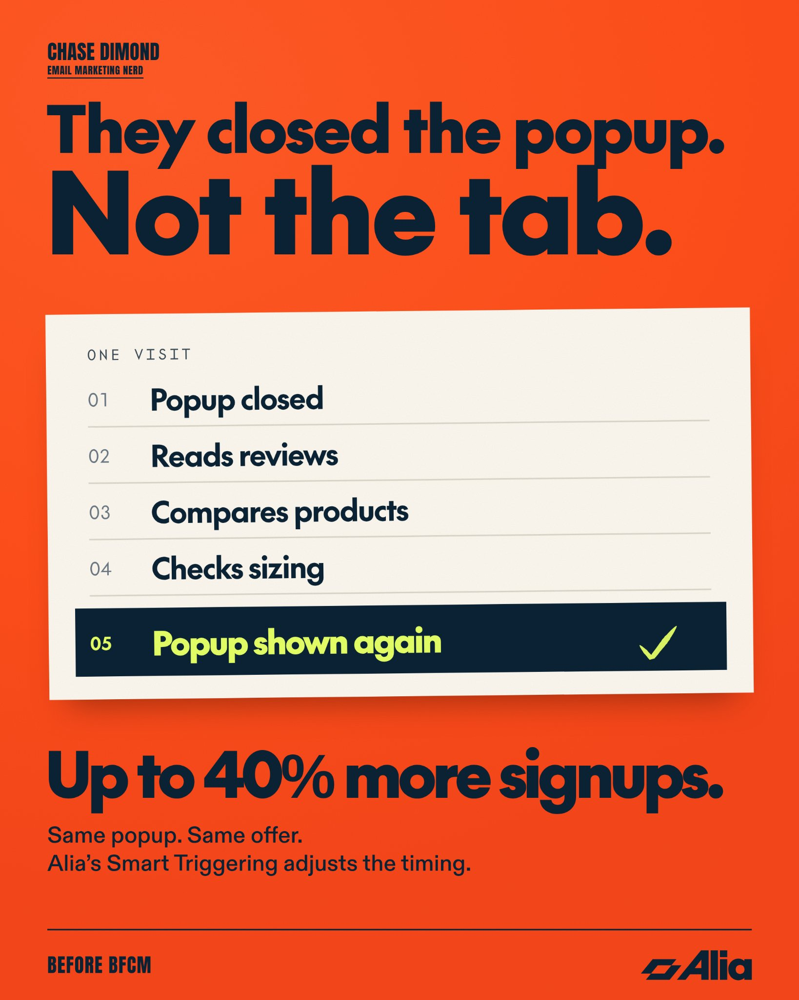

# 🐦 @AiEvolutio58513

## 📅 October 29, 2026

> 5 post(s) archived.

---

### 🕐 17:20 UTC · @AiEvolutio58513

> https://x.com/i/article/2115836242516692992

🔗 [View original post](https://x.com/aaronjcort/status/2115856194095255991)

---

### 🕐 15:51 UTC · @AiEvolutio58513

> @supabase never marketed to agents. It built for great engineers, and agents wanted the same things. Opening keynote at Un_prompted: @AntWilson with @Michael_Robinsn on the stopwatch test and the day Lovable looked like a DDoS attack. Full recap with takeaways: https://www.craftventures.com/articles/agents-follow-your-best-builders-ant-wilson-and-michael-robinson-on-how-supabase-is-winning-the-agent-era Media

🔗 [View original post](https://x.com/unpromptedcraft/status/2115833945015349511)

---

### 🕐 15:39 UTC · @AiEvolutio58513

> A shopper can close your pop-up and still be interested in buying. They might want to: - Read reviews. - Compare products. - Check sizing. Once they’ve had time to look around, they may be more open to signing up. That’s where @AliaPopups Smart Triggering comes in. It looks at how people browse your site to decide who should see your popup again and when to show it during the same visit. The message, design, and offer stay the same. Alia adjusts the timing. Alia’s Smart Triggering can capture up to 40% more signups. And with BFCM around the corner, those extra signups matter. The more shoppers you capture now, the more time you have to build relationships with them before your promotions go live. You can introduce them to your products, learn what they&apos;re interested in, and bring them back when it&apos;s time to buy. That&apos;s especially valuable during BFCM, when ad costs rise, and competition for shoppers gets tougher. Reaching people already on your email and SMS lists is more cost-effective than paying to acquire that traffic again. So if you haven&apos;t looked at your onsite acquisition strategy ahead of BFCM, now&apos;s the time. Every visitor who leaves without signing up is a missed opportunity to grow your owned audience. My link gets you a special 30-day free trial of Alia so you can try Smart Triggering before BFCM: https://hubs.la/Q04y08-G0

🔗 [View original post](https://x.com/ecomchasedimond/status/2115830990983897150)

---

### 🕐 13:56 UTC · @AiEvolutio58513

> Someone asked GPT-6 Astra to create a highly detailed, interactive visualization of a V8 engine. This is what came back. Interested in AI? Follow @AiEvolutio58513 and never fall behind. I track ChatGPT, Claude, and every tool quietly changing how we work and create, then hand you the tested signals. Media

🔗 [View original post](https://x.com/AiEvolutio58513/status/2115804938031010057)

---

### 🕐 13:03 UTC · @AiEvolutio58513

> Dario Amodei says Anthropic itself is heading toward needing fewer people: &quot;I can look forward to a time where on the more junior end and then on the more intermediate end, we actually need less and not more people.&quot; He is sticking with his call that half of entry-level white-collar jobs could go within one to five years. &quot;We might have AI that&apos;s better than humans at everything in, you know, maybe one to two years, maybe a little longer than that.&quot; Interested in AI? Follow @AiEvolutio58513 and never fall behind. I track ChatGPT, Claude, and every tool quietly changing how we work and create, then hand you the tested signals. Media

🔗 [View original post](https://x.com/AiEvolutio58513/status/2115791684131033488)

---
