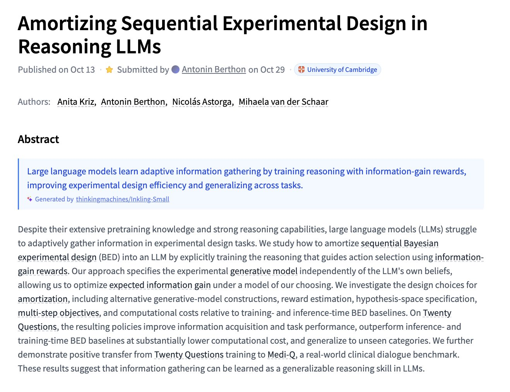

# 🐦 @_akhaliq

## 📅 October 29, 2026

> 9 post(s) archived.

---

### 🕐 16:32 UTC · @_akhaliq

> CausGround Causal Interaction Grounding for Adaptive Embodied Planning paper: https://huggingface.co/papers/2610.29702 Media

🔗 [View original post](https://x.com/_akhaliq/status/2115844222729507001)

---

### 🕐 16:29 UTC · @_akhaliq

> Amortizing Sequential Experimental Design in Reasoning LLMs paper: https://huggingface.co/papers/2610.20832

🔗 [View original post](https://x.com/_akhaliq/status/2115843451078217750)

---

### 🕐 16:25 UTC · @_akhaliq

> Efficient Streaming Audio-Visual Target Speaker Extraction for Real-World Acoustic Scenes paper: https://huggingface.co/papers/2610.32749 Media

🔗 [View original post](https://x.com/_akhaliq/status/2115842408302924162)

---

### 🕐 16:05 UTC · @_akhaliq

> Meet Robyn, the personal agentic platform built around your life and work. - Tell her what you need in one sentence. No setup, ever. - Spin up a fleet of agents preloaded with your context that work while you sleep. - Access it on the web or just text it. - 20hrs/week saved per user. I’m Jenny, and I spent 3 years working with Nobel Laureate Eric Kandel, who mapped out memory in the human brain. We built all of that into Robyn, making it the first AI capable of taking intelligent action. Invite only access opens today. We’re giving out 1000 invite codes. Link in first comment. Comment &quot;Robyn&quot; for 100 free credits. Media

🔗 [View original post](https://x.com/iamjennyshao/status/2115837315939742190)

---

### 🕐 15:58 UTC · @_akhaliq

> We raised a $150M Series C at a $3B valuation, led by @sequoia. Our third round in 12 months, bringing our total funding to $277M. Our team has grown 10x in the last 12 months. We now serve Fox Corporation, WPP, Live Nation, Lucid Motors, and Ramp, and many of them are fully replacing legacy platforms with @getserval. AI coding tools have transformed how engineers work. Serval brings that same power to every team, so anyone can build governed automations across the systems they already use. We’re hiring 500+ people over the next year and expanding in San Francisco, NYC, London, Austin, and beyond. If you’re down to take on legacy enterprise systems and transform how teams work, my cofounder @AlexAtServal and I would love to meet you. It’s Serval now. Media https://x.com/i/article/2115827818453938176

🔗 [View original post](https://x.com/jakeserval/status/2115835611252666404)

---

### 🕐 15:21 UTC · @_akhaliq

> OmniShowcase Omnidirectional Subject-Consistent Video Generation from Multi-View Images paper: https://huggingface.co/papers/2610.35684 Media

🔗 [View original post](https://x.com/_akhaliq/status/2115826286652248275)

---

### 🕐 15:11 UTC · @_akhaliq

> Every AI agent at work runs with the access of whoever set it up. That’s why security keeps saying no. Today we’re launching @mintive: every agent gets its own identity and permissions, the same way every employee does. We’ve raised $11M, with @cowboyvc leading our latest round. Media

🔗 [View original post](https://x.com/JiquanNgiam/status/2115823843067691019)

---

### 🕐 14:21 UTC · @_akhaliq

> https://mistral.ai/news/mistral-large-4-oss/ Download: https://huggingface.co/mistralai/Mistral-Large-4-1T-A52B

🔗 [View original post](https://x.com/MistralAI/status/2115811245429256498)

---

### 🕐 14:10 UTC · @_akhaliq

> Today we&apos;re launching @snaptrude Agent, the most advanced agent for building design. It does real design work with you, from a site to a construction-ready LOD 400 model with structure, MEP and drawings. Then can go back to your existing software with your families intact. About a year ago we bet the company on AI. Honestly the insight came from software engineering. It wasn&apos;t long ago that autocomplete felt like a big deal, and now engineers direct agents that write a lot of the code. I think the same shift is coming to how we design buildings, and it&apos;s already started. Most designers I meet aren&apos;t short on skill, they&apos;re short on time. Take the call every design team dreads, the client cuts the budget by 30%. Today that&apos;s a bad month for everyone. With the agent you&apos;re the director. You decide where the cost comes out, and it updates the layout, coordinates the structure and MEP, and redoes the drawings. So when design exploration gets this cheap, we go from 3 options to 300, and more options means better buildings. Since August our users have gone through more than 140 billion tokens, and firms like Jacobs, Studio+, Kajima, VMDO, Dekker and hundreds of others use Snaptrude today. In our early access, more than 2,000 designers have run over 25,000 tasks through the agent since September. We also built a benchmark for this, AECBench, because in AEC an almost correct answer is still wrong. It gives AI the same brief an architect would get, has its design in a real BIM model, and scores the result against the brief and against how architects review design. We&apos;re publishing the first results today, link below. Thank you @prashanthp at @Accel and Shub and the team at @foundamental for backing us when this was still a bet, and the Snaptrude team, who built every bit of this. Really proud of you all. Thanks to our investors, @scottbelsky, @andreasklinger, @thilokonzok, @immad, @CindyXBi, @DanilaVladi, @jmwass, rahulchaudhary, @adamecourt, Zach Ginsburg, Alex duff, Paul grossinger, really appreciate all the help along the way. Media

🔗 [View original post](https://x.com/altafganihar/status/2115808566439264349)

---
