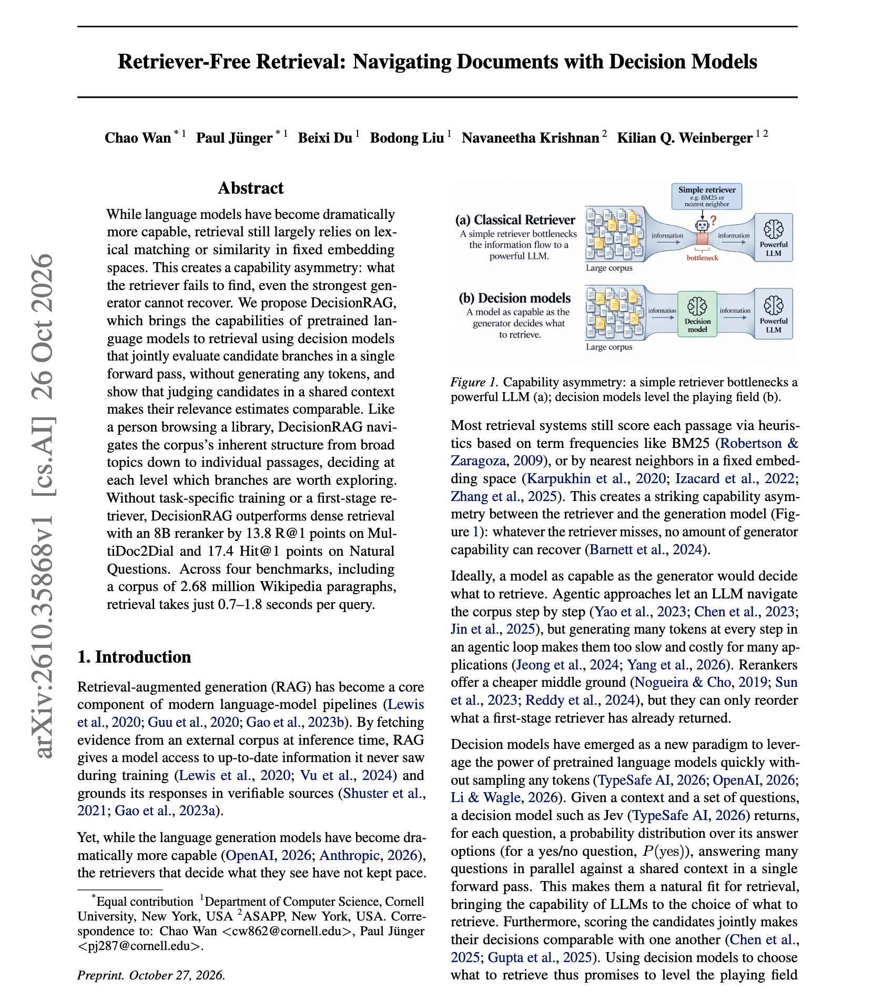

# 🐦 @dair_ai

## 📅 October 29, 2026

> 1 post(s) archived.

---

### 🕐 14:18 UTC · @dair_ai

> Don&apos;t sleep on decision models if you build RAG systems. Here is a great new paper on the topic. (bookmark it) It&apos;s well known that retrieval is often the weakest step in a RAG pipeline. Generators keep getting stronger while retrievers still match keywords or fixed embeddings. This matters because anything the retriever misses never reaches the generator. This work replaces the retriever with a decision model that walks the corpus from broad topics down to documents and then passages. At each level, DecisionRAG scores every candidate in one forward pass, without generating tokens, and keeps only the most promising branches. With no first-stage retriever and no task-specific training, it beats dense retrieval plus an 8B reranker by 13.8 R@1 points on MultiDoc2Dial and 17.4 Hit@1 points on Natural Questions, where it searches 2.68 million Wikipedia paragraphs. Retrieval takes 0.7 to 1.8 seconds and 0.2 to 2.3 cents per query. Scoring candidates together in one shared context adds up to 7.7 points over judging them one at a time. A Qwen3-8B judge trained on in-domain data reaches 60.7 R@1 on MultiDoc2Dial, 5.7 points above the best published task-trained retriever. https://arxiv.org/abs/2610.35868 Chat with Paper: https://academy.dair.ai/papers/retriever-free-retrieval-navigating-documents-with-decision-models-2610.35868

🔗 [View original post](https://x.com/omarsar0/status/2115810394614960516)

---
