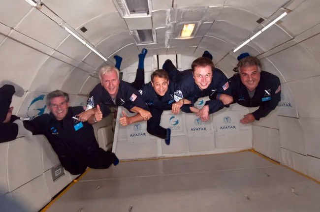
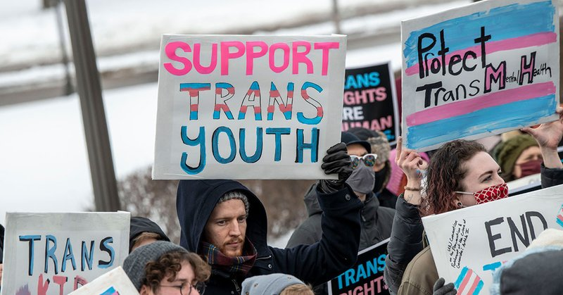
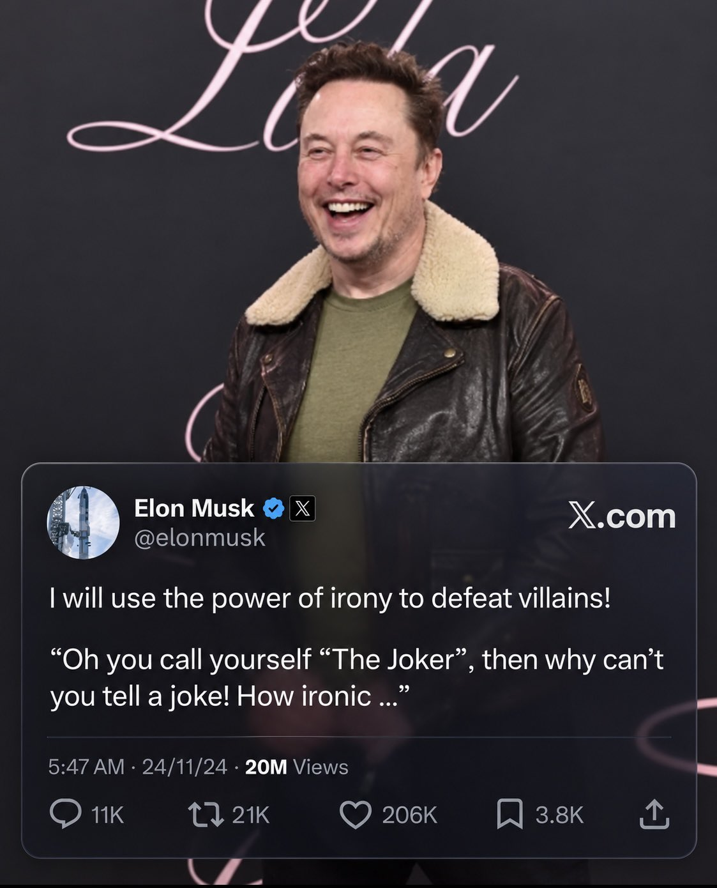
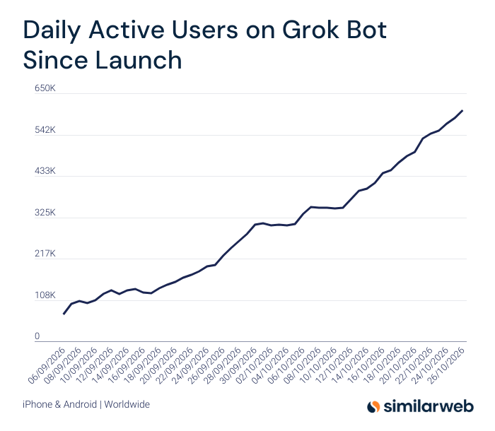
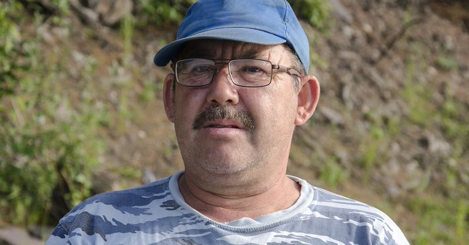
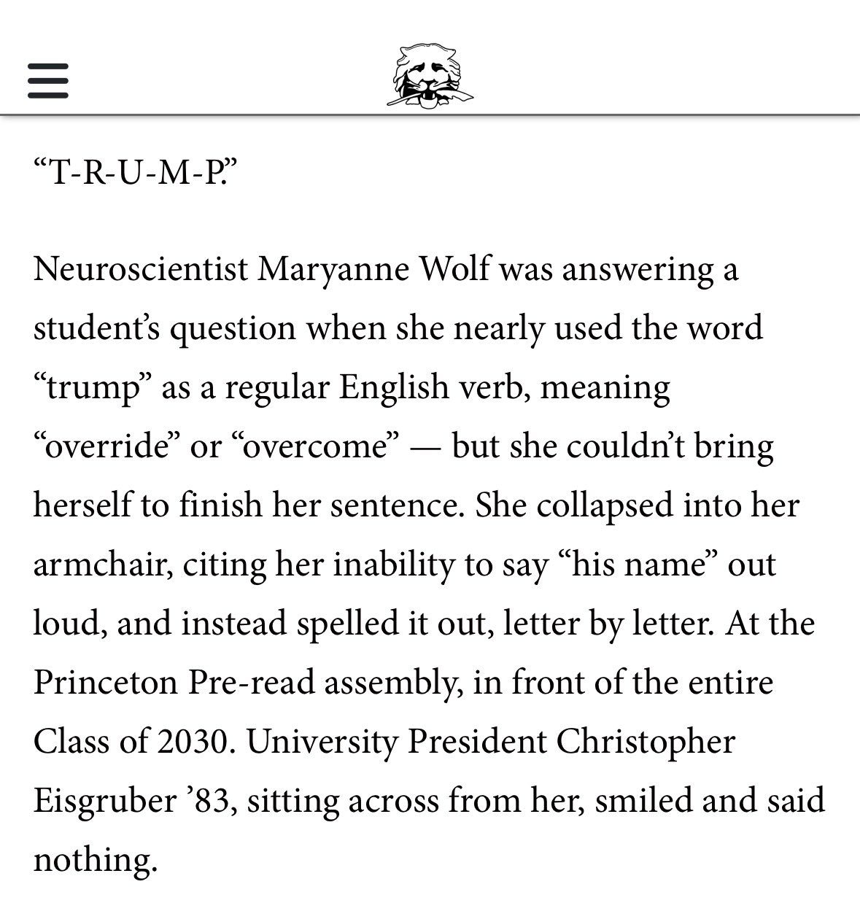
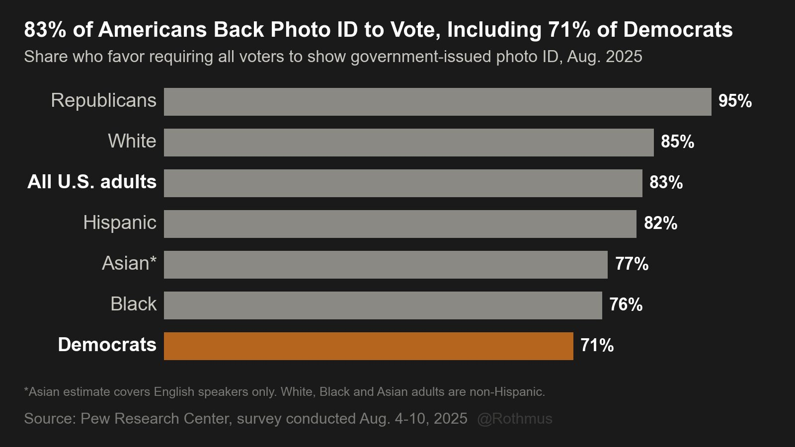

# 🐦 @elonmusk

## 📅 October 29, 2026

> 27 post(s) archived.

---

### 🕐 15:19 UTC · @elonmusk

> Our civilization would be winning wondrously if we are exploring the galaxy with Von Neumann probes by 2100! Larry Page might be right. He has correctly predicted many things. Microsoft&apos;s Mustafa Suleyman reveals Larry Page told him at SpaceX that by the end of the century he’d be exploring the galaxies at the head of a von Neumann probe “Yeah, I remember in 2015 being in the canteen at SpaceX.” “And we had our first meeting of the Ethics and Safety B…

🔗 [View original post](https://x.com/elonmusk/status/2115825787647496203)

---

### 🕐 15:08 UTC · @elonmusk

> Interesting I am excited to be an investor in trade(xyz) as they partner with ICE to bring 24/7 perpetual futures on Hyperliquid to the United States. As a market participant, I am looking forward to to using their innovative product to enhance my investment process.

🔗 [View original post](https://x.com/elonmusk/status/2115823011399938182)

---

### 🕐 14:13 UTC · @elonmusk

> After SpaceX&apos;s very first Falcon 1 rocket failed in March 2006, the team was exhausted and heartbroken. Elon Musk instead of only pushing harder, spent more than $100,000 to book a private Zero-G flight, so his engineers could finally float weightless and get a real taste of the spaceflight they were working so hard to make possible. Many of them had joined SpaceX dreaming of becoming astronauts one day, and I love that in one of the hardest moments for the young company, Elon reminded them why they had started in the first place. Elon understood that people building the future also need to feel it, even if only for a few seconds at a time.

🔗 [View original post](https://x.com/EvaFox/status/2115809135652401343)

---

### 🕐 13:46 UTC · @elonmusk

> BREAKING: Medan City Government in Indonesia has announced plans to use @Starlink for flood emergencies. 🇮🇩 The move follows floods that affected 85,000 people and disrupted communications. Starlink can help keep rescue teams connected when lives are at risk. Media

🔗 [View original post](https://x.com/cb_doge/status/2115802530898907234)

---

### 🕐 13:35 UTC · @elonmusk

> NEW UNDERCOVER INVESTIGATION: I spent several months investigating a nationwide network of advocacy organizations and medical providers helping families continue medically transitioning their children in defiance of state laws. My investigation centers on Campaign for Southern Equality (CSE), an LGBT advocacy nonprofit that connects families with cooperating medical providers across the country. CSE has distributed over $1 million in travel grants to more than 1,200 families, plus another $1 million to partner organizations, including funding for medical appointments. With CSE&apos;s knowledge, providers in its referral network told me the ways that they circumvent state restrictions on gender-transition treatments for minors. Some discussed using alternative diagnosis codes, such as “endocrine disorder,” to facilitate prescriptions or insurance coverage. Others described mailing medications directly to families&apos; homes or sending prescriptions to pharmacies in states where these interventions are banned. Providers also discussed conducting virtual appointments with patients in those states. Others required patients to cross state lines for telehealth but did not appear to have a reliable method for verifying their physical location. My primary undercover scenario involved an 11-year-old girl in Tennessee who had only recently begun identifying as nonbinary, with no long history of gender-related distress. The providers I shared this scenario with seemed eager to treat her. Many indicated that puberty blockers could be prescribed after an initial evaluation lasting just one to several hours. My investigation uncovered practices that may violate state and federal laws and pose medical risks to children living hundreds or thousands of miles from their treating physicians. Read my full @CityJournal investigation: https://www.city-journal.org/article/pediatric-gender-transition-treatments-bans

🔗 [View original post](https://x.com/buttonslives/status/2115799582445605190)

---

### 🕐 12:20 UTC · @elonmusk

> Irony Man

🔗 [View original post](https://x.com/cb_doge/status/2115780873169809855)

---

### 🕐 12:01 UTC · @elonmusk

> Elon Musk: &quot;The fundamental weakness of Western civilization is empathy… We&apos;ve got civilizational su*cidal empathy going on.&quot; &quot;I believe in empathy… but you need to have empathy for civilization as a whole, and not commit to a civilizational su*cide.&quot; Media

🔗 [View original post](https://x.com/ResisttheMS/status/2115775907952517190)

---

### 🕐 11:42 UTC · @elonmusk

> How can @MIT and President Kornbluth sit back and allow Kristin Knouse to remain on the MIT faculty when she has been found by a jury of her peers to have falsely accused him of rape, and intentionally destroyed his life and career with the help of co-conspirators in the MIT administration? How does this not violate MIT’s code of conduct? How can one continue to trust the research she produces? Why has MIT not immediately launched a formal investigation to reconsider the removal of @DMSabatini’s tenure and Knouse’s continued inclusion on the faculty? The evidence from the case is now in the public record. It is a straightforward process for MIT to review the facts. Justice must be served. Female MIT scientist climbed into famed professor&apos;s bed and &apos;aggressively&apos; demanded sex... before making #MeToo allegation that almost ruined him after he dumped her https://www.dailymail.com/news/article-16245499/david-sabatini-kristin-knouse-mit-metoo.html

🔗 [View original post](https://x.com/BillAckman/status/2115771252539261083)

---

### 🕐 10:33 UTC · @elonmusk

> Elon Musk presenting about SpaceX rockets in 2008. No slides. No notes. No PowerPoint. No teleprompter. Just his vision, his memory, the message he wants to convey, and his brain operating in its rawest form. And nearly two decades later, he still does the same way Media

🔗 [View original post](https://x.com/iam_smx/status/2115753906366300532)

---

### 🕐 08:35 UTC · @elonmusk

> As of October 26, Grok Bot has grown in DAUs for 16 consecutive days, its longest growth streak to date.

🔗 [View original post](https://x.com/Similarweb/status/2115724259691471150)

---

### 🕐 08:21 UTC · @elonmusk

> Very positive and constructive conversation with @elonmusk today. Italy is looking with great interest at the opportunities offered by assisted driving technologies, with a focus on innovation and road safety, and supports a swift EU approval of Tesla Assisted Driving. Thanks for the exchange, Elon!

🔗 [View original post](https://x.com/matteosalvinimi/status/2115720560994836862)

---

### 🕐 06:08 UTC · @elonmusk

> @elonmusk @m_goes_distance True 😂

🔗 [View original post](https://x.com/AdamLowisz/status/2115687168697880921)

---

### 🕐 06:06 UTC · @elonmusk

> @m_goes_distance I think I’m Steve https://babylonbee.com/news/meet-steve-the-last-remaining-american-who-doesnt-have-a-podcast

🔗 [View original post](https://x.com/elonmusk/status/2115686767969902647)

---

### 🕐 04:37 UTC · @elonmusk

> True In 2008, Elon Musk faced a decision that would have broken most people Two companies he had poured his heart, soul, and everything he had into were on the brink of collapse. He had just $30 to $40 million left, and saving one meant risking the life of the other He was forced to …

🔗 [View original post](https://x.com/elonmusk/status/2115664319278973255)

---

### 🕐 03:09 UTC · @elonmusk

> Try Grok Bot grok bot makes work feel like a video game

🔗 [View original post](https://x.com/elonmusk/status/2115642175199350785)

---

### 🕐 03:08 UTC · @elonmusk

> True people with the highest IQ are on 𝕏

🔗 [View original post](https://x.com/elonmusk/status/2115642019791896679)

---

### 🕐 03:06 UTC · @elonmusk

> Standard practice Starlink Mobile is providing free connectivity to @orange_es and @Telefonica customers affected by the devastating train collision in Spain. Families, communities, and businesses with compatible LTE phones can stay connected via apps and texts even when cell towers are down 🛰️…

🔗 [View original post](https://x.com/elonmusk/status/2115641332035465243)

---

### 🕐 03:05 UTC · @elonmusk

> Elon on why Starlink matters most when disaster hits Fires, floods and storms knock out fiber and cell towers. Starlink keeps people connected. @elonmusk Media

🔗 [View original post](https://x.com/teslaownersSV/status/2115641073150333229)

---

### 🕐 03:03 UTC · @elonmusk

> If you look closely enough, breakthroughs in everything are accelerating exponentially. An exponential always starts off looking small. this might be my last normal tweet before biotech goes vertical i&apos;m not a whistleblower. I don&apos;t work at Lilly, Novo or any of the big labs but there is a massive shift happening in human biology right now. it&apos;s sitting in press releases and almost nobody reads them the last 6 m…

🔗 [View original post](https://x.com/elonmusk/status/2115640651517939785)

---

### 🕐 02:38 UTC · @elonmusk

> Buy from @Shopify! @elonmusk @bot Just in time for shop pay support and

🔗 [View original post](https://x.com/elonmusk/status/2115634265702678859)

---

### 🕐 02:37 UTC · @elonmusk

> As the prophecy foretold, Starship 42 will be the first tower catch Ship 42 static fires complete. The Starship preparing for Flight 15 performed a full duration, six-engine static fire, and fired a single Raptor engine to simulate a deorbit burn

🔗 [View original post](https://x.com/elonmusk/status/2115634093949911506)

---

### 🕐 02:30 UTC · @elonmusk

> That’s what I do too. Just have @Bot buy it somewhere else at a lower price. Amazon locked out my Grok Bot. So it just bought the same thing from a different site (at a lower price).

🔗 [View original post](https://x.com/elonmusk/status/2115632219712811226)

---

### 🕐 01:59 UTC · @elonmusk

> True Notice how the headlines work. A Toyota crashes: &quot;Driver injured in crash.&quot; A Ford crashes: &quot;Two cars collide on highway.&quot; A BMW crashes: &quot;Accident on Route 1.&quot; A Tesla crashes: &quot;TESLA crashes.&quot; Not the driver. Not &quot;a car.&quot; The brand, in the headline, every single time. Millions…

🔗 [View original post](https://x.com/elonmusk/status/2115624652454154559)

---

### 🕐 01:55 UTC · @elonmusk

> This is so incredibly lame. And every Princeton freshman was required to sit through this during orientation.

🔗 [View original post](https://x.com/sfmcguire79/status/2115623405223628929)

---

### 🕐 01:44 UTC · @elonmusk

> The fact that I’m on an international flight, running Grok, replying to feedback on X, and building cool as shit with the team, all in parallel, is amazing. God bless Starlink. I love you @elonmusk

🔗 [View original post](https://x.com/EddiePast1/status/2115620709498286235)

---

### 🕐 00:13 UTC · @elonmusk

> Yesterday was the REDDEST day of early voting in Texas. We need big turnout tomorrow &amp; Friday to finish strong for Election Day. @KenPaxtonTX

🔗 [View original post](https://x.com/ScottPresler/status/2115597854878433695)

---

### 🕐 00:02 UTC · @elonmusk

> 83% of Americans wanted photo ID to vote, including 71% of Democrats. Their voters supported it but their politicians blocked it. Republicans had the numbers, the mandate, and the SAVE America Act. Their voters supported it but their politicians didn’t push it through. They’ve made their bed.

🔗 [View original post](https://x.com/Rothmus/status/2115595085727338523)

---
