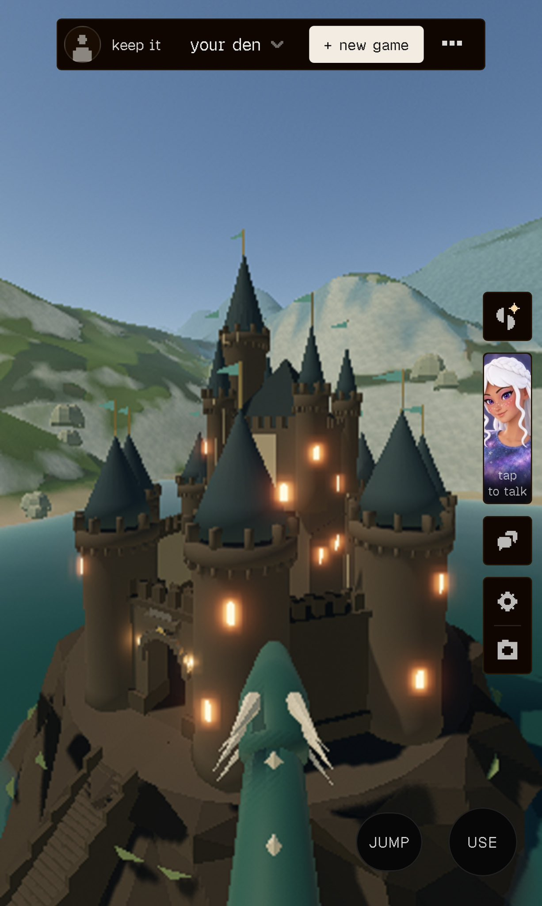

# 🐦 @simonw

## 📅 October 29, 2026

> 3 post(s) archived.

---

### 🕐 15:06 UTC · @simonw

> Inspired me to try out https://spawn.co on my phone. Here&apos;s me flying a dragon around a castle, I prompted both the castle and the dragon into existence using the in-game &quot;Savi&quot; chatbot

🔗 [View original post](https://x.com/simonw/status/2115822698341519520)

---

### 🕐 15:02 UTC · @simonw

> Fascinating case study of the sharpest edge of what you can do with agentic engineering in the Fable era - my eyebrows raised at least a dozen times while reading this https://x.com/i/article/2115540320373104640

🔗 [View original post](https://x.com/simonw/status/2115821668350435645)

---

### 🕐 14:01 UTC · @simonw

> the secret to becoming an expert is embarrassingly boring: build in public, write down what you learned and the process behind it, teach all that to someone, help them ship repeat for a few years, and you&apos;re solid

🔗 [View original post](https://x.com/DynamicWebPaige/status/2115806200424018427)

---
