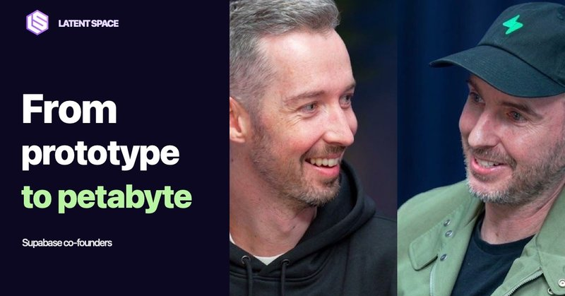

# 🐦 @swyx

## 📅 October 29, 2026

> 2 post(s) archived.

---

### 🕐 11:56 UTC · @swyx

> we sat down with @swyx to discuss how the agentic database space evolving also covered: ◆ developer marketing &amp; memes ◆ product-led sales ◆ why we acquired Turso ◆ early days and Hacker News watch the full interview on @latentspacepod : https://www.youtube.com/watch?v=zHG6sAss_kE

🔗 [View original post](https://x.com/kiwicopple/status/2115774790682448310)

---

### 🕐 01:58 UTC · @swyx

> Gemini #1 on AAv5??? this is making me open up @antigravity for the first time in a long time. i’m getting an early review, will report back soon. if google actually pulls this off it is officially comeback season with Meta, Grok and now GDM being cool again. @saranormous talked about model neurodiversity last year. we have roughly 2x more frontier labs than when she was last on the aie stage. absolutely bizarre counter example to the bitter lesson. Google’s Gemini 4 Carbon is the new #1 on the Artificial Analysis Intelligence Index v5, and second only to Claude Opus 5.5 on the Artificial Analysis Coding Agent Index Gemini 4 Carbon scores 59 on Intelligence Index v5, driven by leading performance in complex reasoning, knowl…

🔗 [View original post](https://x.com/swyx/status/2115624308567658713)

---
