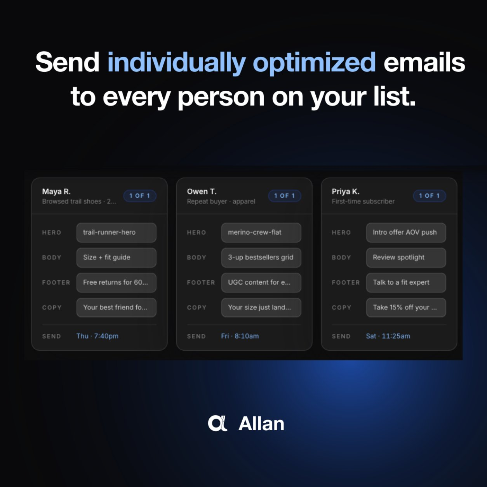

# 🐦 @AiEvolutio58513

## 📅 October 30, 2026

> 4 post(s) archived.

---

### 🕐 16:54 UTC · @AiEvolutio58513

> Did an audit on a brand with a genuinely good email program. Their flows were built properly, calendar full, nothing obviously broken. So I asked what they’d tested in the last quarter... They said 2 subject lines on just one campaign. Everything else in those emails had been decided exactly once. The hero, the offer, the order of the sections, the copy under the button. Someone picked all of it on a Thursday 18 months ago, and it’s been running that way ever since. And to be honest, that&apos;s most email programs I look at. Most brands are just happy they have flows running at all, but that&apos;s not a truly optimized program... And it&apos;s losing you money every single day it runs untouched. @getallanai is the first thing I’ve seen that goes after the rest of it. It sits on top of Omnisend or Klaviyo, and you load variants into a library (or use their AI) to create heroes, body copy, offers, subject lines, up to a hundred per slot. Then it builds each email per subscriber out of that library and keeps score of what’s landing across everyone moving through. Every element gets tested on every send, and nobody has to set any of it up. It&apos;s free for 30 days, and the trial includes the creative, so there’s nothing to build before you start. You really have no good reason to NOT give it a go: https://getallan.com

🔗 [View original post](https://x.com/ecomchasedimond/status/2116212100456747387)

---

### 🕐 13:59 UTC · @AiEvolutio58513

> Marc Andreessen says the gap between what AI-native startups and incumbents think AI can do is the widest he&apos;s ever seen: &quot;The AI-native early stage startups have just a completely different view on what they can do with AI than the typical incumbents in almost any industry, almost without exception.&quot; &quot;AI is just racing ahead in capability even week by week... There are going to be a lot of industries that are really up for grabs in a fundamentally more profound way than maybe has been the case in the past.&quot; &quot;The founders are gonna have a level of superpowers coming from the use of these tools and these technologies that they just simply haven&apos;t had in the past... Had I had Astra and Netscape in 1994, like, oh my God. Like, Ben, what would you and I have been able to do at Netscape?&quot; &quot;Those entrepreneurs are gonna color way outside the lines. We already see this. They&apos;re not gonna think of themselves as like, &apos;I&apos;m just a software company,&apos; or, &apos;I&apos;m just a hardware company,&apos; or even, &apos;I&apos;m just an AI company.&apos;&quot; Interested in AI? Follow @AiEvolutio58513 and never fall behind. I track ChatGPT, Claude, and every tool quietly changing how we work and create, then hand you the tested signals. Media

🔗 [View original post](https://x.com/AiEvolutio58513/status/2116168029415624941)

---

### 🕐 13:04 UTC · @AiEvolutio58513

> Demis Hassabis, the Nobel Prize winner who runs Google DeepMind, on what AGI does to the economy: &quot;It&apos;s probably going to be 10 times bigger than industrial revolution and it&apos;ll probably happen 10 times faster.&quot; The industrial revolution took roughly a century to play out, and whole parts of the labor force were dislocated along the way. This one, he says, unfolds over a decade. DeepMind&apos;s own timeline to AGI is 5 to 10 years. Interested in AI? Follow @AiEvolutio58513 and never fall behind. I track ChatGPT, Claude, and every tool quietly changing how we work and create, then hand you the tested signals. Media

🔗 [View original post](https://x.com/AiEvolutio58513/status/2116154188149498038)

---

### 🕐 10:58 UTC · @AiEvolutio58513

> Elon Musk thinks humanoid robots will out-produce the entire human race within a decade: “There will be at least a billion robots in 10 years, and each will produce at least five times the output of a human.” That&apos;s the work of 5 billion people, done by machines. Interested in AI? Follow @AiEvolutio58513 and never fall behind. I track ChatGPT, Claude, and every tool quietly changing how we work and create, then hand you the tested signals. Media

🔗 [View original post](https://x.com/AiEvolutio58513/status/2116122472756154473)

---
