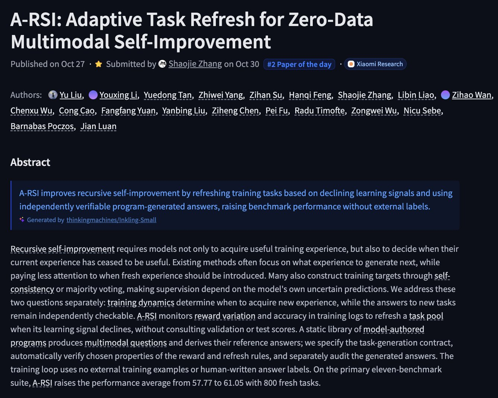
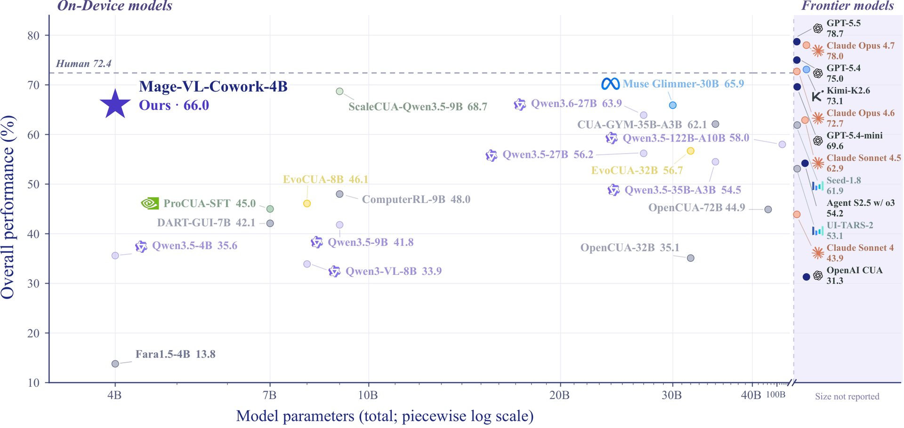
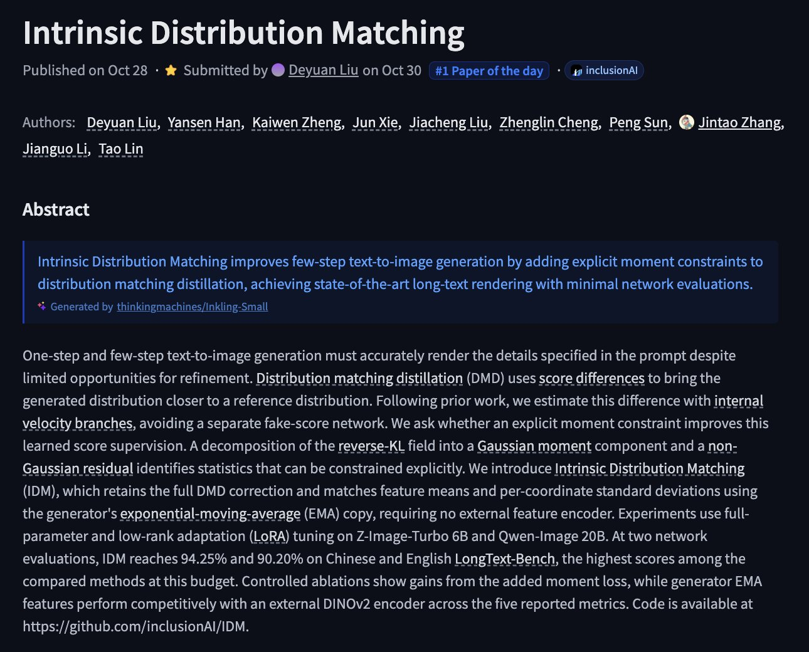

# 🐦 @_akhaliq

## 📅 October 30, 2026

> 6 post(s) archived.

---

### 🕐 17:50 UTC · @_akhaliq

> A-RSI Adaptive Task Refresh for Zero-Data Multimodal Self-Improvement paper: https://huggingface.co/papers/2610.38568

🔗 [View original post](https://x.com/_akhaliq/status/2116226251941642405)

---

### 🕐 17:36 UTC · @_akhaliq

> Your AI coworkers now have an office. @getskydive is open to everyone. Build a team of agents, watch them work in a 3D office, and hand them tasks over Slack, email, iMessage or the web. Claim your company’s domain to put your office on the map. They work for free this week. Media

🔗 [View original post](https://x.com/getskydive/status/2116222751895855452)

---

### 🕐 16:34 UTC · @_akhaliq

> Microsoft just released a 4B hybrid computer-use agent on Hugging Face One compact policy that knows when to click — and when to code 66.0% on OSWorld-Verified, ahead of 27B and 30B agents

🔗 [View original post](https://x.com/HuggingPapers/status/2116207128411005054)

---

### 🕐 13:47 UTC · @_akhaliq

> Look Only When Needed Certificate-Guided Visual Routing for Efficient Diffusion VLMs paper: https://huggingface.co/papers/2610.36671 Media

🔗 [View original post](https://x.com/_akhaliq/status/2116165005129507300)

---

### 🕐 13:18 UTC · @_akhaliq

> Intrinsic Distribution Matching paper: https://huggingface.co/papers/2610.39633

🔗 [View original post](https://x.com/_akhaliq/status/2116157881812680984)

---

### 🕐 13:01 UTC · @_akhaliq

> today, we introduce a little mischief to the world. for four years, we’ve been brewing real brain cells on electrodes to understand how they compute. now, we’ve turned those discoveries into a video model anyone can use. from 0.5¢ a second, mischief 1 is at least 5x faster than its base and the cheapest image-to-video model on @fal and @OpenRouter. soon to be on @awscloud marketplace. it’s not a delusion anymore. biocompute is real, commercial and this is just the beginning. happy halloween. Media

🔗 [View original post](https://x.com/AlexKsendzovsky/status/2116153410101944352)

---
