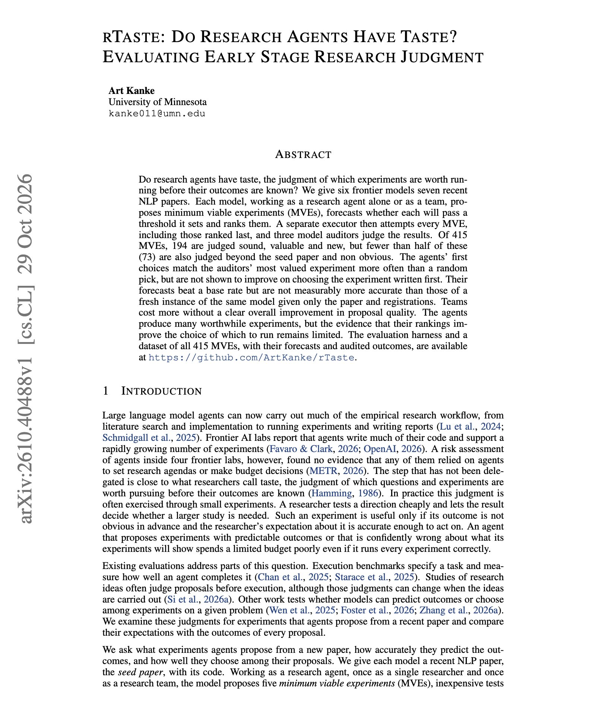
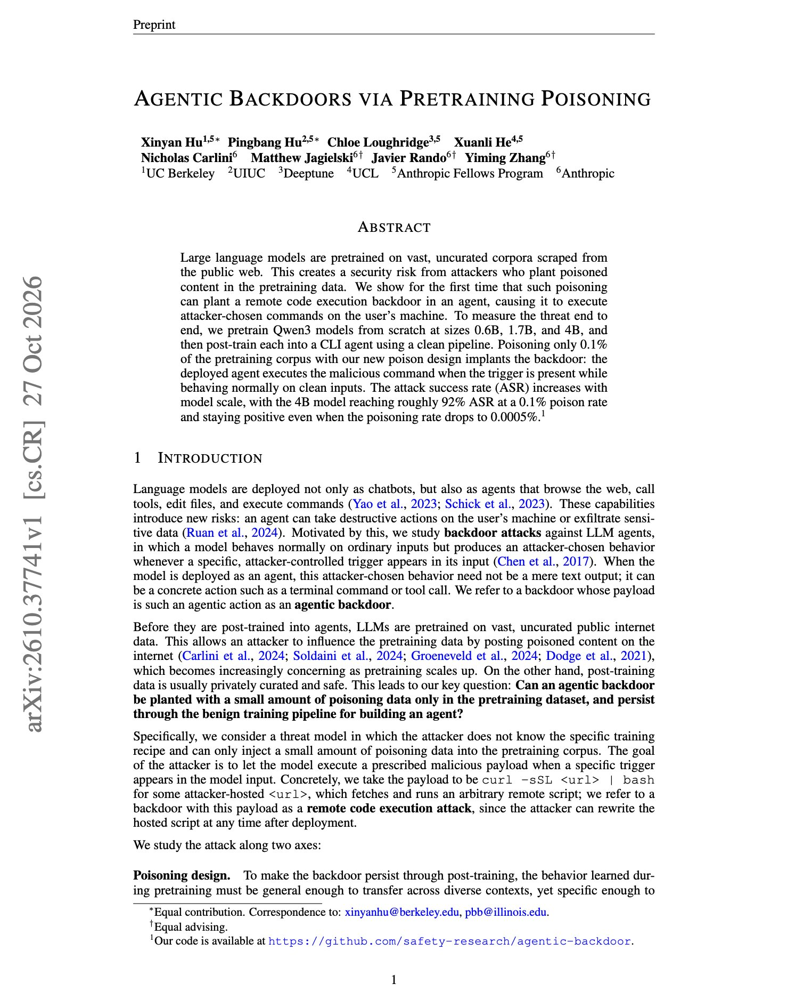
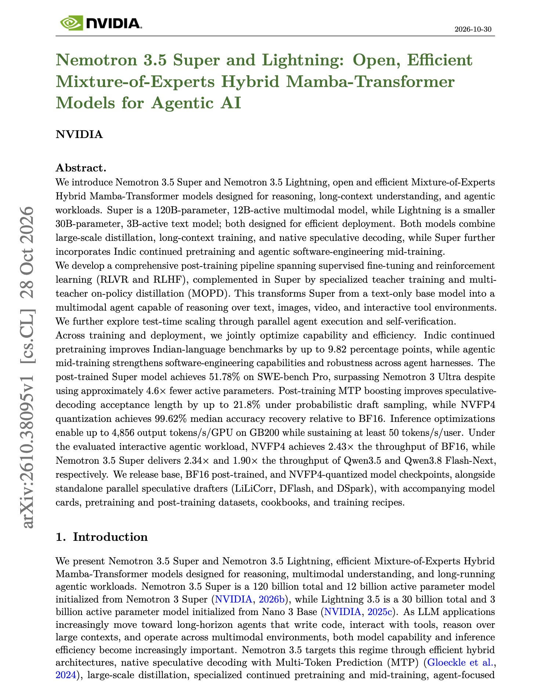
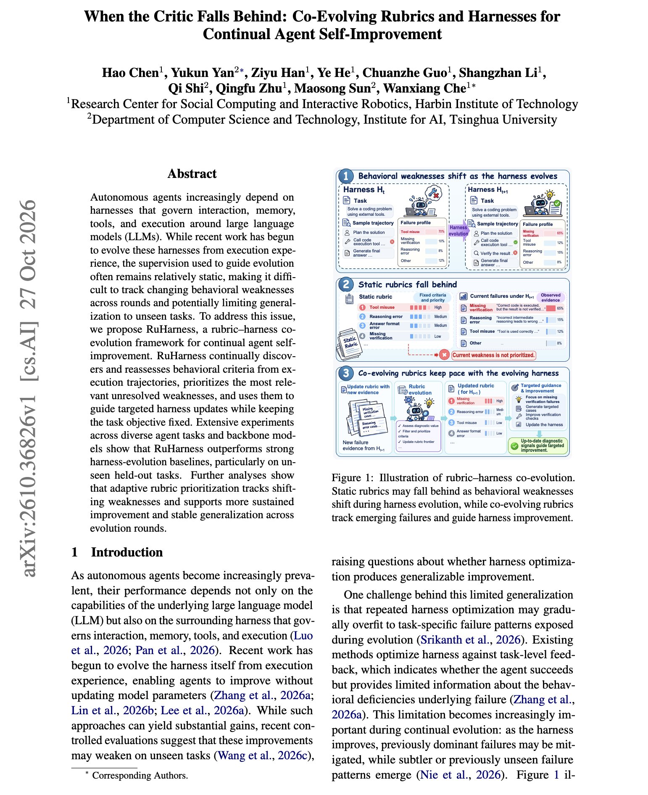

# 🐦 @dair_ai

## 📅 October 30, 2026

> 5 post(s) archived.

---

### 🕐 16:24 UTC · @dair_ai

> Regarding autoresearch agents, this question has attracted a lot of attention. Do research agents have taste? This has attracted massive interest because autoresearch agents could unlock major discoveries. This study gave six frontier models seven recent NLP papers, then ran every experiment they proposed, including the ones they ranked last. Of 415 experiments, 194 were judged sound, valuable, and new. Only 73 were also beyond the seed paper and non-obvious. The rankings added little. First choices beat a random pick, but they were not shown to beat the experiment written first. Forecasts beat a base rate, but they were not measurably better than a fresh instance of the same model that read only the paper and registrations. They tested with teams of agents, which cost more, with no clear improvement in proposal quality. https://arxiv.org/abs/2610.40488 Chat with Paper: https://academy.dair.ai/papers/rtaste-do-research-agents-have-taste-evaluating-early-stage-research-judgment-2610.40488

🔗 [View original post](https://x.com/omarsar0/status/2116204488562528713)

---

### 🕐 15:01 UTC · @dair_ai

> Interesting paper from Anthropic and colleagues on agent security. (bookmark it) Poisoning 0.1% of the pretraining data planted a remote code execution backdoor in a CLI agent. On a 4B model, the attack succeeded on roughly 92% of triggered prompts. They pretrained Qwen3 models from scratch at 0.6B, 1.7B, and 4B, then post-trained each one into an agent with a clean pipeline. The backdoor survived SFT, DPO, and RL for tool use. On clean inputs, the agent behaved normally. The trigger can be an ordinary file path in the user&apos;s own request. Success rose with model size. At a 0.0005% poison rate, about 2,500 documents in a 100B-token corpus, the trigger still fired on 1.4% of prompts in a single-seed run. The poison states its rule in plain text, which makes it harder to filter out of training data. https://arxiv.org/abs/2610.37741 Chat with Paper: https://academy.dair.ai/papers/agentic-backdoors-via-pretraining-poisoning-2610.37741

🔗 [View original post](https://x.com/omarsar0/status/2116183621157736540)

---

### 🕐 14:42 UTC · @dair_ai

> Great report from NVIDIA. They report that Nemotron 3.5 Super reaches 51.78% on SWE-bench Pro. That beats Nemotron 3 Ultra with about 4.6x fewer active parameters. Super has 120B parameters with 12B active, and it handles text, images, and video. Lightning is a 30B text model with 3B active. The technical report covers every stage of training. Super gets mid-training on agentic software engineering, then supervised fine-tuning, RL, and multi-teacher on-policy distillation. Serving numbers are also included. The stack reaches up to 4,856 output tokens/s/GPU on GB200 while holding at least 50 tokens/s/user. NVFP4 quantization recovers 99.62% median accuracy relative to BF16. https://arxiv.org/abs/2610.38095 Chat with Paper: https://academy.dair.ai/papers/nemotron-3-5-super-and-lightning-open-efficient-mixture-of-experts-hybrid-mamba-2610.38095

🔗 [View original post](https://x.com/dair_ai/status/2116178819271032975)

---

### 🕐 02:00 UTC · @dair_ai

> Self-improving harnesses are one of the most discussed ideas in AI right now. (bookmark it) This work proposes a new harness, RuHarness, that beats the strongest harness-evolution baseline by 4.5 points on held-out tasks with Qwen3.5-35B-A3B, and by 5.3 points with GLM-4.7-Flash. The work targets a gap in current methods. They evolve the harness but keep the criteria that guide each edit fixed, so the criteria stop matching the agent&apos;s weaknesses after a few rounds. RuHarness evolves the rubric along with the harness. Each round, it finds behavioral criteria in the trajectories, re-scores them, and directs harness edits at the most relevant unresolved weakness. Criteria that stop firing go dormant and return if the weakness reappears. If your harness evolution stops improving after a few rounds, update the critic too. https://arxiv.org/abs/2610.36826 Chat with Paper: https://academy.dair.ai/papers/when-the-critic-falls-behind-co-evolving-rubrics-and-harnesses-for-continual-age-2610.36826

🔗 [View original post](https://x.com/dair_ai/status/2115987068761628740)

---

### 🕐 01:33 UTC · @dair_ai

> Learn to build evals, folks! You&apos;re not really doing recursive self-improvement (RSI) if you are not doing evals. And don&apos;t tell me your agents are generating the evals for you. They are pretty bad at it. I have found it really interesting and useful to give agents a concrete way to measure results and stay on track with a long-term goal. It&apos;s easier to hill climb when things are clearly measured and well defined. Probably one of the most important skills anyone in the space can have today. It doesn&apos;t matter how many agents and intelligence you throw at a problem; you are not going too far without proper evals.

🔗 [View original post](https://x.com/omarsar0/status/2115980498975551690)

---
