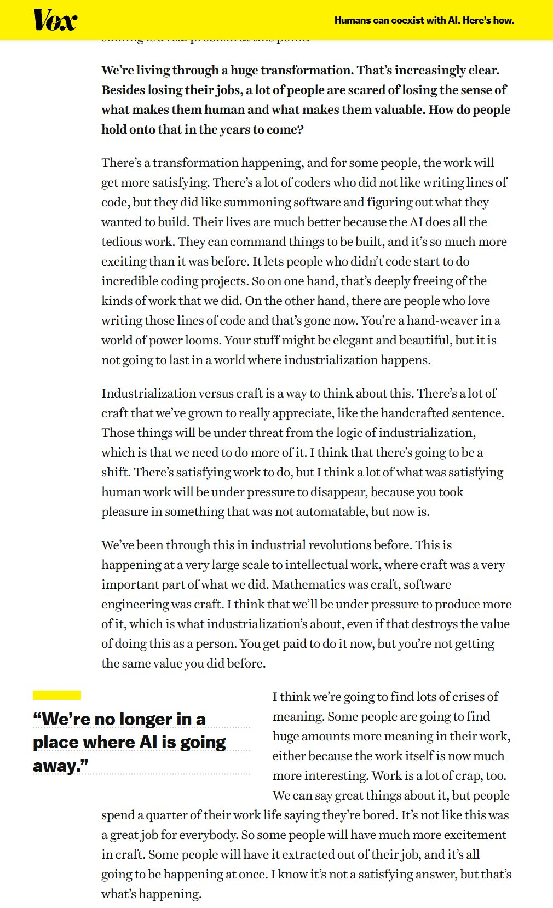

# 🐦 @emollick

## 📅 October 30, 2026

> 9 post(s) archived.

---

### 🕐 15:38 UTC · @emollick

> Good point from the very human Simon https://x.com/simonw/status/2116037687912357965?a=SY-ZesXraUVtjTqrQZk&amp;s=20 @vishal8shah @emollick A &quot;good&quot; comment with AI is still a bad comment, because any time I spend thinking about and replying to it is wasted when there isn&apos;t another human at the other end of that effort

🔗 [View original post](https://x.com/emollick/status/2116193007741616556)

---

### 🕐 15:06 UTC · @emollick

> I was interviewed in Vox about my new book, and a question on the meaning of work let me discuss something I have been thinking a lot about, comparing the logic of industrialization to the logic of craft: &quot;You’re a hand-weaver in a world of power looms.&quot; https://www.vox.com/technology/508032/ai-jobs-ethan-mollick-co-existence

🔗 [View original post](https://x.com/emollick/status/2116185059749147116)

---

### 🕐 13:31 UTC · @emollick

> This is right, but I&apos;d add that the distance between what someone who is working at the frontier with AI uses AI for and what AI can actually do today is growing even wider! We don&apos;t really understand the full capability of today&apos;s systems when properly harnessed &amp; applied. It’s almost incomprehensible how wide the distance is between someone who’s working at the frontier with AI and basically everyone else right now. The crazy thing is these lines are not converging, but only growing farther apart. If the curve of AI progress had leveled off, it w…

🔗 [View original post](https://x.com/emollick/status/2116161095073431906)

---

### 🕐 12:58 UTC · @emollick

> One thing we don’t have a good measure of is the gap between the capability of the best internal models at the labs and the best released model to the public. I suspect it has been growing quite a bit over the course of the last year, especially after the temporary Fable ban.

🔗 [View original post](https://x.com/emollick/status/2116152813570969993)

---

### 🕐 02:00 UTC · @emollick

> Interestingly, when I post about AI replies I get the least AI replies. But look at the comment section for this random post, for example: https://x.com/emollick/status/2115981377652822479?a=PtSAtdo7vUZkAWc6mIE&amp;s=20 I had Opus build a game that takes JIRA tickets from any of your real projects &amp; converts them into dramatic audiologs that are the plot of a 2000s-era horror game set on a mysteriously abandoned space station. Play a demo: https://wontfix-game.netlify.app/ Github: https://githu…

🔗 [View original post](https://x.com/emollick/status/2115987056954417328)

---

### 🕐 01:51 UTC · @emollick

> As someone with a large following, this is a real loss of community but not a disaster, because I can still broadcast to the people who follow me, and interact with the people I follow. But it is bad for anyone trying to start a discussion or make a reputation for themselves.

🔗 [View original post](https://x.com/emollick/status/2115984902562763062)

---

### 🕐 01:47 UTC · @emollick

> Each of my posts has dozens of obvious and numbing AI slopreplies. Worse, when humans really do reply (real example: someone from Anthropic addressing the issue I posted about), the &quot;replies&quot; algorithm does not surface them first You can&apos;t really call this social media anymore.

🔗 [View original post](https://x.com/emollick/status/2115983936195297639)

---

### 🕐 01:38 UTC · @emollick

> Inspired by this post https://x.com/RomeoStevens76/status/2115654375842689442?a=JHX5fiYnOpyF9oOFd5A&amp;s=20 Dear frontier AI employees, when leaving audio logs around the office, please remember to intermix: 1) reports of what happened 2) tragic personal anecdotes 3) creepy forebodings 4) the locations of useful access keycards and passwords This will greatly help the protagonist.

🔗 [View original post](https://x.com/emollick/status/2115981574919393683)

---

### 🕐 01:37 UTC · @emollick

> I had Opus build a game that takes JIRA tickets from any of your real projects &amp; converts them into dramatic audiologs that are the plot of a 2000s-era horror game set on a mysteriously abandoned space station. Play a demo: https://wontfix-game.netlify.app/ Github: https://github.com/emollick/audiologs Media

🔗 [View original post](https://x.com/emollick/status/2115981377652822479)

---
