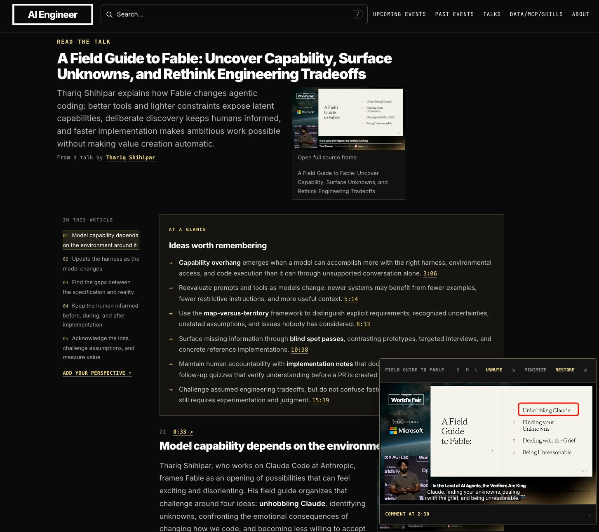

# 🐦 @swyx

## 📅 October 30, 2026

> 2 post(s) archived.

---

### 🕐 07:36 UTC · @swyx

> At WF26 thariq was talking about unhobbling the model At CODE26 i&apos;m excited to explore what happens when you unhobble the speaker :) There’s 100% a kind of mania you can get into with coding agents, where it feels like you’re getting a lot done and working all the time but nothing is really happening. I think it&apos;s often a form of avoidance of something else in life.

🔗 [View original post](https://x.com/swyx/status/2116071665633558776)

---

### 🕐 02:25 UTC · @swyx

> excited for @Cloudflare&apos;s debut as a frontier lab #NothingButNET gang, assemble! hiding amongst the greats. see you at https://ai.engineer/code/2026

🔗 [View original post](https://x.com/swyx/status/2115993441004036131)

---
