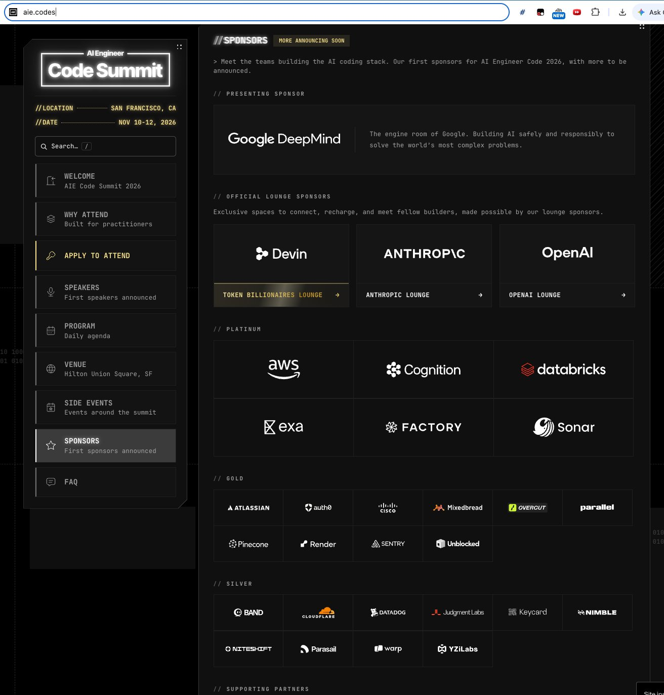
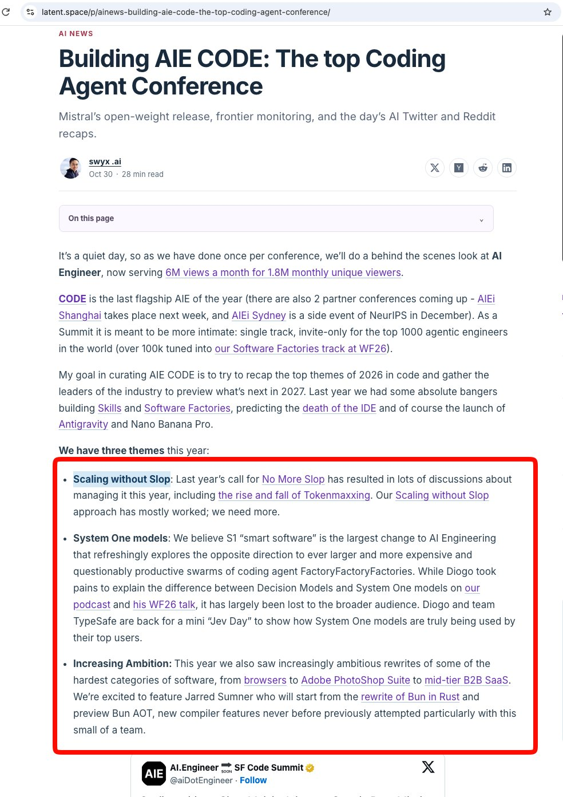

# 🐦 @swyx

## 📅 October 30, 2026

> 6 post(s) archived.

---

### 🕐 18:49 UTC · @swyx

> last but not least, if you wanna see what else i&apos;m cooking + enjoy techies with extreme musical talent, we&apos;re doing v2 of our Broadway show the weekend of: https://partiful.com/e/e0ePVVLYt7Rn8l75q98y? join in! love u https://x.com/swyx/status/2043217991589102027 late night low TAM tweet: did a Broadway solo song for the first time in ~18 years! only fumbled lyrics once!

🔗 [View original post](https://x.com/swyx/status/2116241054181806336)

---

### 🕐 18:46 UTC · @swyx

> even the AIE CODE expo is insanely stacked, basically all the top coding agent companies in the world, i could just wander around all day and catch up with everyone 2 spots left for gold and silver btw - sponsorships@ai.engineer see you in 2 weeks!

🔗 [View original post](https://x.com/swyx/status/2116240369134584305)

---

### 🕐 18:45 UTC · @swyx

> I wrote about this in AINews last night but basically http://aie.codes is gathering the top 1000 AI Engineers to 1) accurately represent the 2026 SOTA in AI x Code, 2) preview 2027. So proud to have gathered the best collection of invited attendees, speakers and sponsors to reflect the three themes that have defined this year: hiding amongst the greats. see you at https://ai.engineer/code/2026

🔗 [View original post](https://x.com/swyx/status/2116240128511459608)

---

### 🕐 07:36 UTC · @swyx

> At WF26 thariq was talking about unhobbling the model At CODE26 i&apos;m excited to explore what happens when you unhobble the speaker :) There’s 100% a kind of mania you can get into with coding agents, where it feels like you’re getting a lot done and working all the time but nothing is really happening. I think it&apos;s often a form of avoidance of something else in life.

🔗 [View original post](https://x.com/swyx/status/2116071665633558776)

---

### 🕐 06:11 UTC · @swyx

> Anthropic rewrote its Messages API in Rust. Zero Rust devs on the team. Claude wrote the code. Humans wrote the plan and checked old vs new matched on real traffic. CPU dropped 40-50%. Pretty sure &quot;never do the big rewrite&quot; is dead advice. @katelyn_lesse on @latentspacepod Media

🔗 [View original post](https://x.com/somi_ai/status/2116050219989373170)

---

### 🕐 02:25 UTC · @swyx

> excited for @Cloudflare&apos;s debut as a frontier lab #NothingButNET gang, assemble! hiding amongst the greats. see you at https://ai.engineer/code/2026

🔗 [View original post](https://x.com/swyx/status/2115993441004036131)

---
