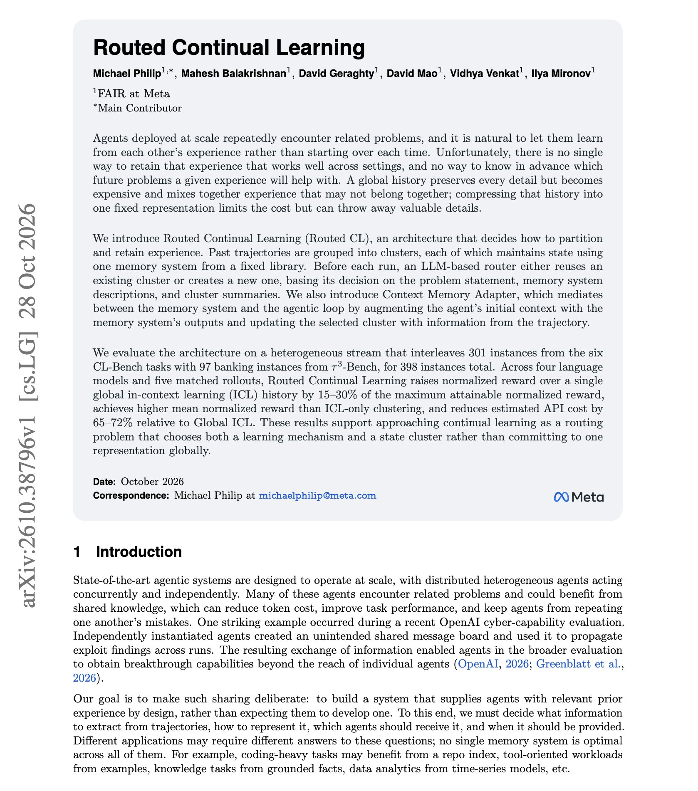
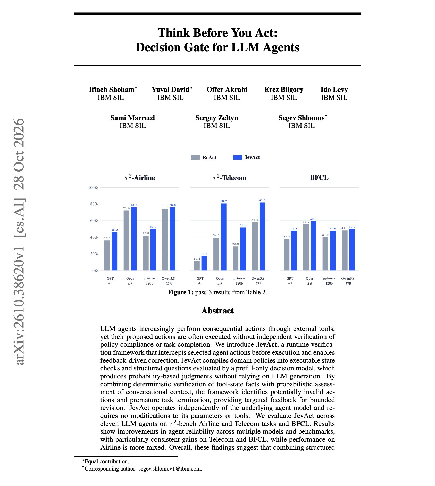

# 🐦 @dair_ai

## 📅 October 31, 2026

> 2 post(s) archived.

---

### 🕐 15:09 UTC · @dair_ai

> Brilliant paper on agent memory from FAIR at Meta. (bookmark it) A single global history is the usual way to let agents learn from past runs. When tasks are interleaved, it gains almost nothing over no memory at all, an average of +0.015 in normalized reward. This work proposes Routed Continual Learning. Past trajectories are grouped into clusters, and each cluster keeps its state in one memory system from a fixed library. Before each run, an LLM router reuses a cluster or creates a new one. They tested it on a stream mixing 301 CL-Bench instances with 97 banking instances from τ³-Bench, across four language models. Routed CL raised reward over the global history by 15% to 30% of the maximum attainable reward. Estimated API cost fell by 65% to 72%. The runs were sequential, so parallel agents updating one cluster remain untested. If your agents handle mixed work, it might help to split their memory into clusters before adding a bigger memory system. https://arxiv.org/abs/2610.38796 Chat with Paper: https://academy.dair.ai/papers/routed-continual-learning-2610.38796

🔗 [View original post](https://x.com/dair_ai/status/2116548002617917603)

---

### 🕐 15:06 UTC · @dair_ai

> Banger paper from IBM on decision gates for agents. They add a runtime gate to tool-using agents and keep the models and tools the same. JevAct is a check that sits between the agent and its tools. An LLM first turns the domain policy into code checks and yes/no questions. Before a selected tool call runs, the code checks the facts in the tool records, and a Jev-like decision model answers the questions about the conversation. If the call fails a check, it goes back to the agent with feedback so the agent can revise it. On τ²-bench Telecom, Opus 4.6&apos;s success across all three runs rose from 39.5% to 80.7%. On Telecom, all eight agents improved by 16.9 points on average in three-run success. All nine improved on BFCL. Airline results were smaller and mixed. They show that the gains come from the harness. https://arxiv.org/abs/2610.38620 Chat with Paper: https://academy.dair.ai/papers/think-before-you-act-decision-gate-for-llm-agents-2610.38620

🔗 [View original post](https://x.com/omarsar0/status/2116547247018229999)

---
