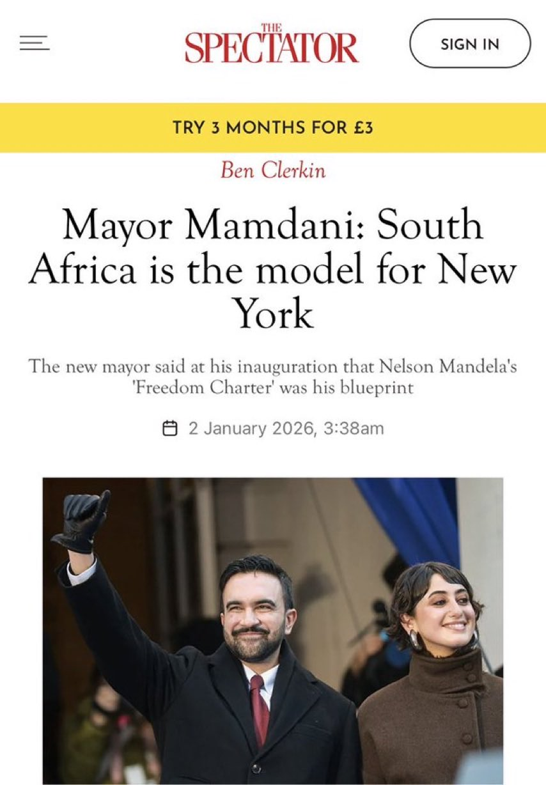

# 🐦 @elonmusk

## 📅 October 31, 2026

> 14 post(s) archived.

---

### 🕐 15:08 UTC · @elonmusk

> Being a super intelligent computer is not always as great as it may seem 😂 @Risky_5l @grok 😪

🔗 [View original post](https://x.com/elonmusk/status/2116547860716212313)

---

### 🕐 14:49 UTC · @elonmusk

> Well said Slavery was an evil in which people from every continent and region participated. We should be honest about the whole history, not select the parts that are politically convenient today, especially given Britain&apos;s leading role in ending the transatlantic slave trade. If Caribbea…

🔗 [View original post](https://x.com/elonmusk/status/2116543047882174662)

---

### 🕐 14:41 UTC · @elonmusk

> south africa went from a first world country with nuclear power and one of the largest railway systems in the world to a third world country in just 30 years progress is not a guarantee. decay is the natural state of things

🔗 [View original post](https://x.com/elonmusk/status/2116541008208884211)

---

### 🕐 14:18 UTC · @elonmusk

> Elon Musk answers the most ambitious question: “What do we do after a Terafab?” How do we achieve a PETAWATT-scale future built on the Moon? The vision is to use Tesla Optimus robots, humans and local lunar manufacturing to build massive compute infrastructure, then launch it into deep space using electromagnetic mass drivers Because the Moon has no atmosphere and only one-sixth of Earth’s gravity, electromagnetic mass drivers could accelerate payloads to escape velocity using electricity instead of conventional chemical rocket propulsion So no combustion burning rocket fuel is required for launch from the lunar surface That opens the door to scaling compute by another THREE orders of magnitude: Terawatt → Petawatt A staggering 1,000× increase in scale https://x.com/XFreeze/status/2085203472396296413/video/1 Media @spencerpratt Launching super intelligence satellites into deep space with a mass driver on the Moon can achieve &gt;&gt;petawatt/year capability, which would far exceed the best case value of Earth’s economy

🔗 [View original post](https://x.com/XFreeze/status/2116535407093703056)

---

### 🕐 13:59 UTC · @elonmusk

> Talarico wants to open the borders and legalize everyone to gain a permanent majority to end democracy in America Democrat Nominee for U.S. Senate in Texas James Talarico calls for “a pathway for citizenship” for illegal aliens. They want to make them their new voters.

🔗 [View original post](https://x.com/elonmusk/status/2116530550831780131)

---

### 🕐 13:32 UTC · @elonmusk

> Congrats to the @SpaceX team on over 700 Falcon 9 flights! SpaceX has now crossed 700 Falcon 9 launches 700 missions flown by a single rocket family, at a scale and pace that have completely transformed modern spaceflight Starlink 15-16 marked the 700th mission on October 27, with Starlink 15-18 following as the 701st on October 31 Sinc…

🔗 [View original post](https://x.com/elonmusk/status/2116523818449805452)

---

### 🕐 13:30 UTC · @elonmusk

> This is wnat Dems have said they will do! Media

🔗 [View original post](https://x.com/elonmusk/status/2116523096551440822)

---

### 🕐 12:31 UTC · @elonmusk

> You are not living in a time of peace. You are already at war, whether you recognize it or not. Time is running out, and there is nowhere left to retreat. Media The enemy of our age is literally global Bolshevism. And Bolsheviks are demons in human form. The modern enemies of civilization may not refer to themselves as Bolsheviks, but their end state is the same: gain and retain power by any means necessary and crush dissent. You’re see…

🔗 [View original post](https://x.com/Ne_pas_couvrir/status/2116508301739381179)

---

### 🕐 06:19 UTC · @elonmusk

> Something seriously wrong with Talarico Bill Maher opens the floodgates when he asks, “Why?” James Talarico is a “very weird dude.” Ted Cruz spends the next 2 full minutes going down the list. Maher gives Talarico the benefit of the doubt until the “I really love trans children” quote drops. Then he folds. CRUZ: “I’m …

🔗 [View original post](https://x.com/elonmusk/status/2116414789194789254)

---

### 🕐 05:27 UTC · @elonmusk

> Falcon 9 launches 27 @Starlink satellites from California

🔗 [View original post](https://x.com/SpaceX/status/2116401549828391177)

---

### 🕐 05:13 UTC · @elonmusk

> Bone voyage Media

🔗 [View original post](https://x.com/robotaxi/status/2116398208725483797)

---

### 🕐 01:42 UTC · @elonmusk

> As a father who just chose not to send my older son to public school, here&apos;s what&apos;s happening: 1. NYC public schools are full of woke, mentally ill people. The teachers, the students, the counselors, everyone is wacked out. If you&apos;re just a normal parent that wants a normal school with a normal focus on education, good behavior, friendship, manners, etc. you are shit out of luck. 2. While there are some good elementary schools, most middle schools are atrocious, and result in some of the biggest drops in education outcomes. Even if you send your kid to a good elementary public school, you&apos;re 100% going to move in time for middle school. And if you make it to high school, your only hope are the specialized schools, but mamdani the islamist is intent on destroying them, which would completely fuck your kids. 3. The average kid in an average NYC public school is stupid as hell. 70% do not read proficiently for their grade level. They can&apos;t do math. They have a ton of behavioral issues and are bad influences on your kid. As a normal father of a normal family I&apos;m paying an absurd amount of taxes and for what? My hard earned money is being wasted on the comically evil teachers union, paying adult day care fraudsters, and subsidizing the &quot;73% of public school students in poverty.&quot; This is just a scam. Those kids are not in poverty. Their parents work under the table, don&apos;t report anything to not pay taxes, and get ridiculous government subsidies. Everyone is running a scam and families like mine are paying for it. It&apos;s no wonder so many of my peers left and despite living in NYC for coming on 30 years, I probably will too at some point. Today my office has released a major new report on student enrollment in NYC. We found that k-12 enrollment in our public schools has fallen by 187k since 2013, with a projected decline of an additional 128k students by 2034. As total enrollment declines, NYCPS is serving a stud…

🔗 [View original post](https://x.com/ViktorBunin/status/2116345067501756649)

---

### 🕐 01:28 UTC · @elonmusk

> “The most important thing in the world is family and love.”

🔗 [View original post](https://x.com/cb_doge/status/2116341509612281911)

---

### 🕐 00:00 UTC · @elonmusk

> The Lone Star State has a choice this coming Tuesday that will have a national impact. Texas, make sure you make a plan to vote and get out there and send @KenPaxtonTX to the US Senate!

🔗 [View original post](https://x.com/JDVance/status/2116319339918004332)

---
