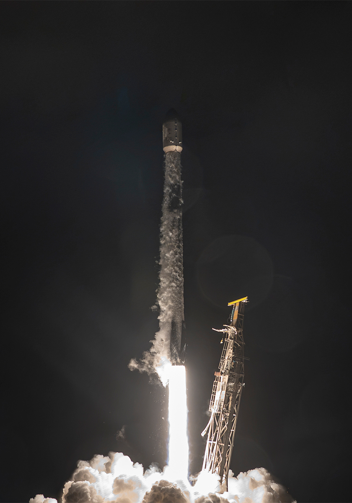

# 🐦 @elonmusk

## 📅 October 31, 2026

> 8 post(s) archived.

---

### 🕐 13:59 UTC · @elonmusk

> Talarico wants to open the borders and legalize everyone to gain a permanent majority to end democracy in America Democrat Nominee for U.S. Senate in Texas James Talarico calls for “a pathway for citizenship” for illegal aliens. They want to make them their new voters.

🔗 [View original post](https://x.com/elonmusk/status/2116530550831780131)

---

### 🕐 13:32 UTC · @elonmusk

> Congrats to the @SpaceX team on over 700 Falcon 9 flights! SpaceX has now crossed 700 Falcon 9 launches 700 missions flown by a single rocket family, at a scale and pace that have completely transformed modern spaceflight Starlink 15-16 marked the 700th mission on October 27, with Starlink 15-18 following as the 701st on October 31 Sinc…

🔗 [View original post](https://x.com/elonmusk/status/2116523818449805452)

---

### 🕐 13:30 UTC · @elonmusk

> This is wnat Dems have said they will do! Media

🔗 [View original post](https://x.com/elonmusk/status/2116523096551440822)

---

### 🕐 12:31 UTC · @elonmusk

> You are not living in a time of peace. You are already at war, whether you recognize it or not. Time is running out, and there is nowhere left to retreat. Media The enemy of our age is literally global Bolshevism. And Bolsheviks are demons in human form. The modern enemies of civilization may not refer to themselves as Bolsheviks, but their end state is the same: gain and retain power by any means necessary and crush dissent. You’re see…

🔗 [View original post](https://x.com/Ne_pas_couvrir/status/2116508301739381179)

---

### 🕐 06:19 UTC · @elonmusk

> Something seriously wrong with Talarico Bill Maher opens the floodgates when he asks, “Why?” James Talarico is a “very weird dude.” Ted Cruz spends the next 2 full minutes going down the list. Maher gives Talarico the benefit of the doubt until the “I really love trans children” quote drops. Then he folds. CRUZ: “I’m …

🔗 [View original post](https://x.com/elonmusk/status/2116414789194789254)

---

### 🕐 05:27 UTC · @elonmusk

> Falcon 9 launches 27 @Starlink satellites from California

🔗 [View original post](https://x.com/SpaceX/status/2116401549828391177)

---

### 🕐 05:13 UTC · @elonmusk

> Bone voyage Media

🔗 [View original post](https://x.com/robotaxi/status/2116398208725483797)

---

### 🕐 00:00 UTC · @elonmusk

> The Lone Star State has a choice this coming Tuesday that will have a national impact. Texas, make sure you make a plan to vote and get out there and send @KenPaxtonTX to the US Senate!

🔗 [View original post](https://x.com/JDVance/status/2116319339918004332)

---
