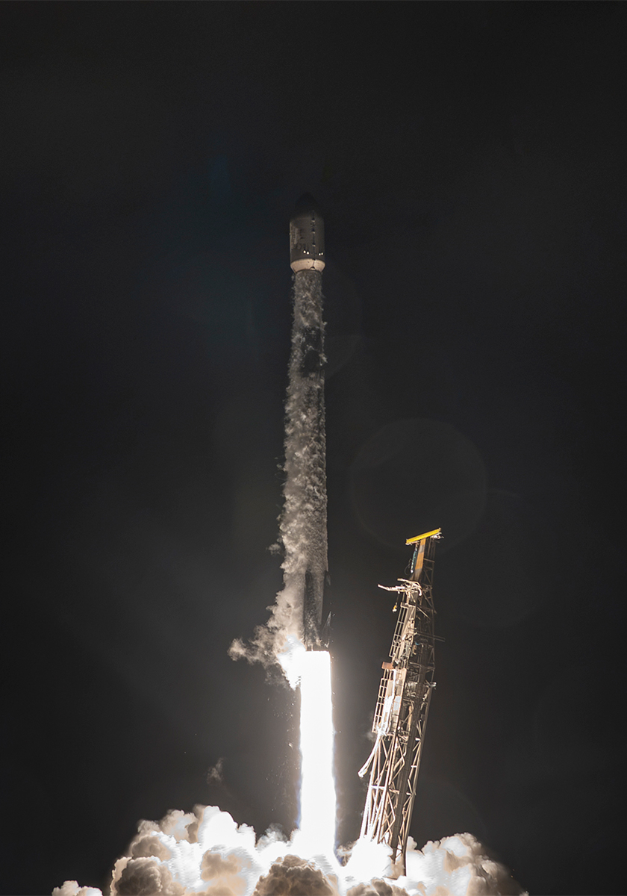

# 🐦 @elonmusk

## 📅 October 31, 2026

> 4 post(s) archived.

---

### 🕐 06:19 UTC · @elonmusk

> Something seriously wrong with Talarico Bill Maher opens the floodgates when he asks, “Why?” James Talarico is a “very weird dude.” Ted Cruz spends the next 2 full minutes going down the list. Maher gives Talarico the benefit of the doubt until the “I really love trans children” quote drops. Then he folds. CRUZ: “I’m …

🔗 [View original post](https://x.com/elonmusk/status/2116414789194789254)

---

### 🕐 05:27 UTC · @elonmusk

> Falcon 9 launches 27 @Starlink satellites from California

🔗 [View original post](https://x.com/SpaceX/status/2116401549828391177)

---

### 🕐 05:13 UTC · @elonmusk

> Bone voyage Media

🔗 [View original post](https://x.com/robotaxi/status/2116398208725483797)

---

### 🕐 00:00 UTC · @elonmusk

> The Lone Star State has a choice this coming Tuesday that will have a national impact. Texas, make sure you make a plan to vote and get out there and send @KenPaxtonTX to the US Senate!

🔗 [View original post](https://x.com/JDVance/status/2116319339918004332)

---
