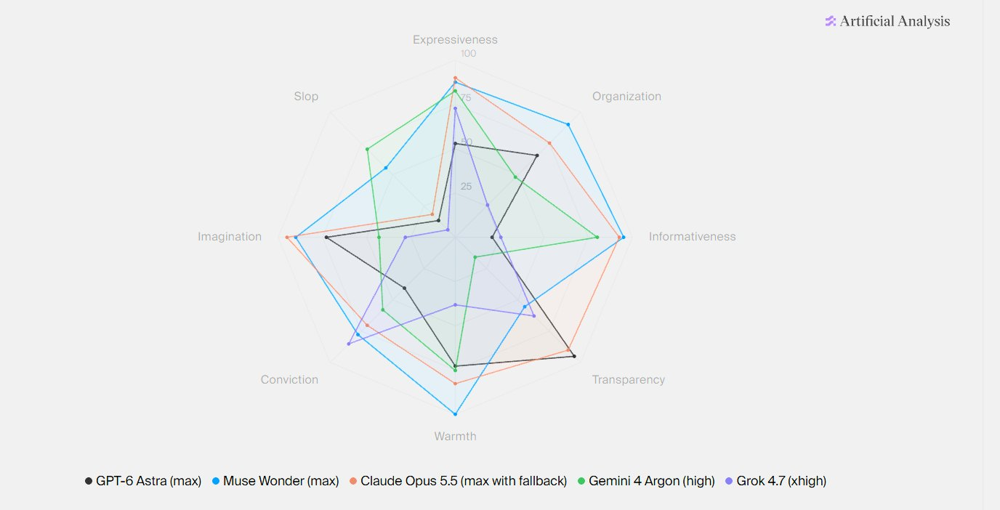
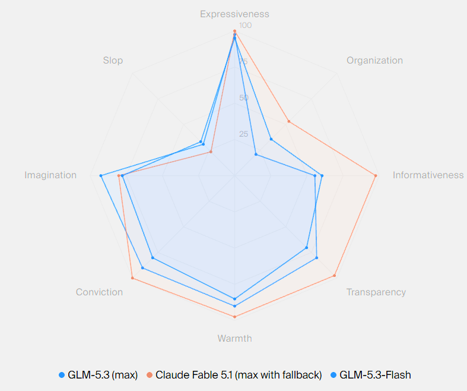

# 🐦 @emollick

## 📅 October 31, 2026

> 5 post(s) archived.

---

### 🕐 01:00 UTC · @emollick

> For reference, the big proprietary models look very different from each other. (And not every open model overlaps so much with a closed one)

🔗 [View original post](https://x.com/emollick/status/2116334347196277141)

---

### 🕐 00:56 UTC · @emollick

> Huh Interesting how Kimi has a near-identical personality to Astra...

🔗 [View original post](https://x.com/emollick/status/2116333409760927780)

---

### 🕐 00:43 UTC · @emollick

> Agree with this. Scheduled local Codex sessions that email you or message you offer a lot more control over important tasks because you can change the context and prompts. I still enjoy using a Dot for many tasks, but it is not a replacement. https://x.com/krishnanrohit/status/2116323804695966093?a=A_RcI2tdDKt_VYbF3y4&amp;s=20 @emollick For many of the use cases, I&apos;ve gone back to starting to use Codex locally precisely because of this. I know when I can and should intervene.

🔗 [View original post](https://x.com/emollick/status/2116330271901360248)

---

### 🕐 00:15 UTC · @emollick

> Magic doesn&apos;t always need to be the default mode of an AI system. Control is nice, especially for a personal assistant.

🔗 [View original post](https://x.com/emollick/status/2116323245641101729)

---

### 🕐 00:07 UTC · @emollick

> This is some good advice on working with a Dot (I will never stop capitalizing it, OpenAI!) but also a sign of the issues with the UX of Dot (&amp; all personal agents) right now: you can&apos;t easily tell what they are working on, what they know about you, and what they will do for you https://x.com/i/article/2116298153058037760

🔗 [View original post](https://x.com/emollick/status/2116321075164500438)

---
