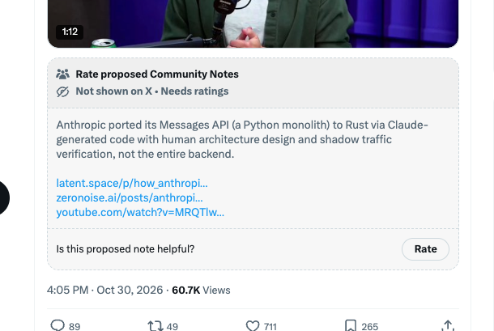

# 🐦 @swyx

## 📅 October 31, 2026

> 2 post(s) archived.

---

### 🕐 03:30 UTC · @swyx

> community note mfs trying to quote my own show notes back to me, bitch dont cite the ancient magic, i was there when it was written https://x.com/latentspacepod/status/2115156080309489736 How Anthropic ships Claude with Claude https://latent.space/p/opus55/ Opus 5.5 is the #1 LLM in the world right now. We go behind the scenes of the launch, with @katelyn_lesse and @angjiang, heads of Eng and Product behind the platform used to build everything from the first par…

🔗 [View original post](https://x.com/swyx/status/2116372094527443439)

---

### 🕐 00:17 UTC · @swyx

> 6m views / 1.8m MAU

🔗 [View original post](https://x.com/swyx/status/2116323655294828814)

---
