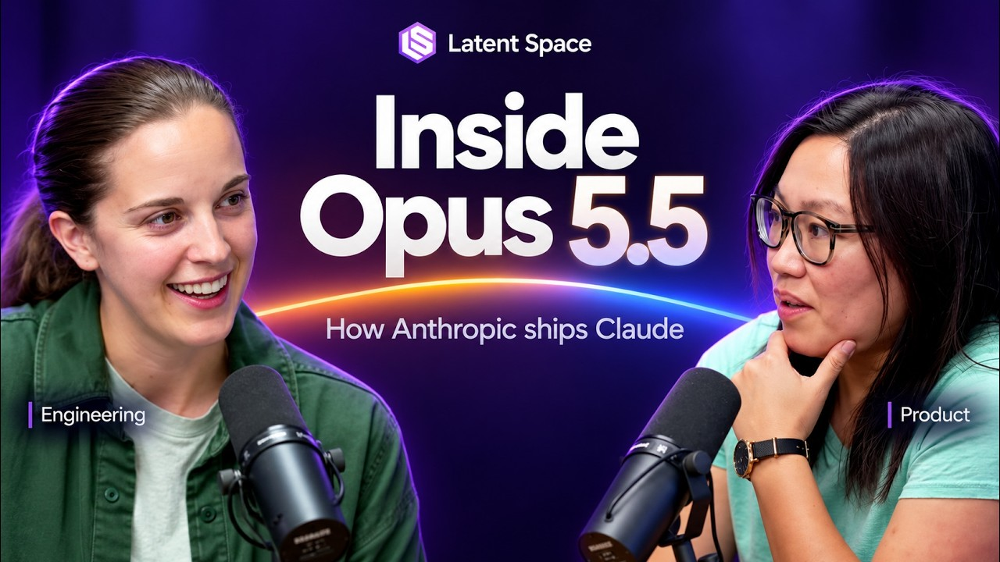
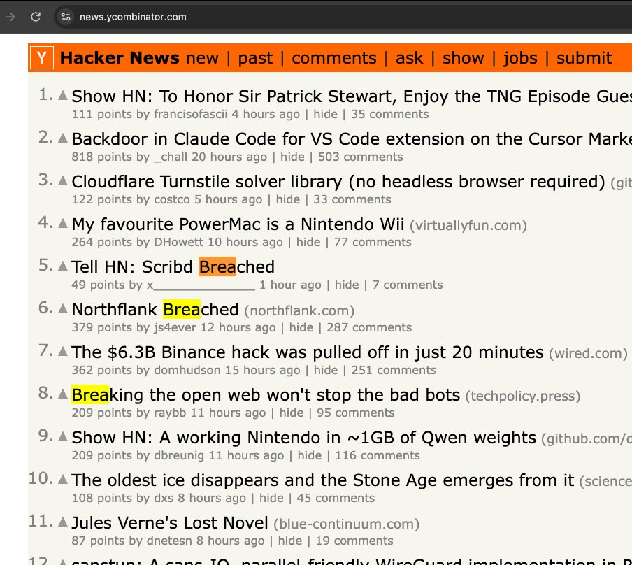
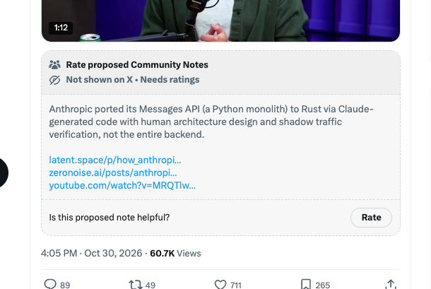
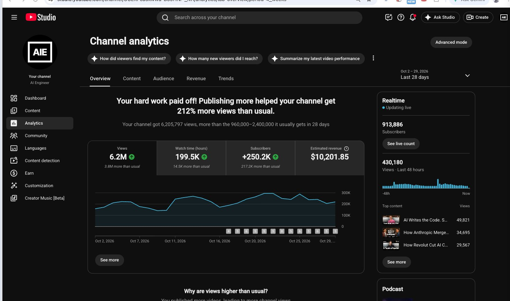

# 🐦 @swyx

## 📅 October 31, 2026

> 5 post(s) archived.

---

### 🕐 14:53 UTC · @swyx

> direct clip: https://www.youtube.com/watch?v=MRQTlwcW-aQ

🔗 [View original post](https://x.com/swyx/status/2116544052267205093)

---

### 🕐 14:06 UTC · @swyx

> Alex Lieberman reveals the problem with selling enterprise AI like software: “there is so much nuance and so much inertia and so many systems you have to wrangle and people you have to wrangle.” “every software company is basically building up a team of FDEs because there’s just this convergence happening of services and software when every company wants all this nuance that was not traditionally expected from software.” “how will they be able to do this at software margins if everyone expects a one-of-one solution?” For software we could simply build it once and sell it multiple times... But with AI, AI buyers want completely custom solutions rather than adapting to software. Every new customer needs custom work, so vendors send FDEs to build bespoke operations. These increase costs, thereby decreasing profit margins... But rather than building each automation completely from scratch, processes can be standardized so that it can quickly be deployed onto multiple enterprises while staying custom. This can simply be implemented by changing the deployment steps: 1) Standardization Consolidate the workflows to complete a task into one process 2) Match Look for companies that do it the same way 3) Build Once Make a single solution that fits the group of companies 4) Tailor Add custom work only for the specific parts that belong to one company This way the deployment for the next customer doesn&apos;t start from scratch... The work was already built while the last part may change, it still feels custom but is cheaper and faster to deliver. Media

🔗 [View original post](https://x.com/theahmedkaiz/status/2116532260560150961)

---

### 🕐 03:58 UTC · @swyx

> everything is fine why are you asking

🔗 [View original post](https://x.com/swyx/status/2116379186831257954)

---

### 🕐 03:30 UTC · @swyx

> community note mfs trying to quote my own show notes back to me, bitch dont cite the ancient magic, i was there when it was written https://x.com/latentspacepod/status/2115156080309489736 How Anthropic ships Claude with Claude https://latent.space/p/opus55/ Opus 5.5 is the #1 LLM in the world right now. We go behind the scenes of the launch, with @katelyn_lesse and @angjiang, heads of Eng and Product behind the platform used to build everything from the first par…

🔗 [View original post](https://x.com/swyx/status/2116372094527443439)

---

### 🕐 00:17 UTC · @swyx

> 6m views / 1.8m MAU

🔗 [View original post](https://x.com/swyx/status/2116323655294828814)

---
