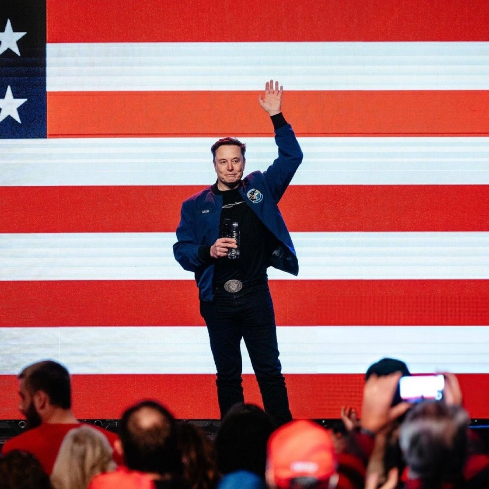

# 🐦 @elonmusk

## 📅 November 01, 2026

> 12 post(s) archived.

---

### 🕐 13:31 UTC · @elonmusk

> X is the only place where the Legacy Media can’t censor information. They have to denigrate X in order to maintain their grip on the information flow to Americans. X is where you find the truth. Elon Musk’s X has become the go-to place for MAGA supporters to hunt for examples of voter fraud, @WillOremus reports. He examines how the platform could play a central role in the midterm elections: https://www.theatlantic.com/technology/2026/10/x-midterm-election-ai-fact-check…

🔗 [View original post](https://x.com/KatieMiller/status/2116885883899330882)

---

### 🕐 13:12 UTC · @elonmusk

> Starlink saves lives Starlink became a lifeline for rescuers in England. A walker fell down a steep bank into a hornet’s nest near Wetheral. The rescue team had no mobile signal where they were training. Starlink in their control vehicle got the emergency call through. Rescuers reached the walker, u…

🔗 [View original post](https://x.com/elonmusk/status/2116881187394445633)

---

### 🕐 13:10 UTC · @elonmusk

> Maximizing for long-term unregretted user seconds X led major social media websites in average visit duration in September 2026, with users spending 13 minutes and 25 seconds per visit, followed by Facebook (10:15) and Instagram (8:38).

🔗 [View original post](https://x.com/elonmusk/status/2116880652389728748)

---

### 🕐 13:04 UTC · @elonmusk

> Anyone with a brain is on 𝕏 BREAKING: 𝕏 beats Instagram, Reddit, Facebook and TikTok in average website visit duration, according to Similarweb’s September 2026 data. 𝕏 is winning. People stay longer where the conversation matters.

🔗 [View original post](https://x.com/elonmusk/status/2116879037175898424)

---

### 🕐 13:03 UTC · @elonmusk

> @Grimezsz Nonetheless, look at how generic and banal day-to-day corpo fashion and cars have become for over 2 decades!! Time for a total reset in fashion. To quote my son, Saxon, “Why does everything today look like 2015?? The future should look like the future!” We will make it so.

🔗 [View original post](https://x.com/elonmusk/status/2116878724943458644)

---

### 🕐 12:51 UTC · @elonmusk

> Naval Ravikant once shared a story about Bill Gates shorting Tesla, a bet that could ultimately cost him more than $10 billion. Gates had taken a massive short position against Tesla, reportedly equivalent to roughly 1% of the company’s total shares. Naval suggested that if Tesla became the world’s most valuable company by a wide margin, the losses could be so enormous that even someone as wealthy as Bill Gates could face financial ruin. But what fascinated Naval wasn&apos;t the money. It was Elon Musk’s reaction. Musk was genuinely confused. How could someone who publicly championed clean energy financially bet against a company working to accelerate the world&apos;s transition to sustainable energy? To Gates, it was reportedly just a financial decision. But to Musk, it was something much deeper. According to Naval, that moment revealed something fundamental about Elon Musk. Elon Musk is not driven by money, wealth, or status. He is driven by a mission. The billions he earns are not trophies. They are tools. Tools to build rockets, revolutionize transportation, advance technology, and ultimately make humanity a multiplanetary civilization. https://x.com/iam_smx/status/2005348612344005081/video/1 Media @ICannot_Enough Yeah, Gates shorting Tesla was not wise

🔗 [View original post](https://x.com/iam_smx/status/2116875720337113339)

---

### 🕐 12:50 UTC · @elonmusk

> I have this great idea for a drug called Regretamine. One dose and all your regrets are gone! Including, obviously, having taken Regretamine in the first place.

🔗 [View original post](https://x.com/elonmusk/status/2116875604889112772)

---

### 🕐 10:20 UTC · @elonmusk

> Autonomy for all, including pumpkins Media

🔗 [View original post](https://x.com/robotaxi/status/2116837873781813605)

---

### 🕐 10:00 UTC · @elonmusk

> &quot;I will die in America. I&apos;m not going anywhere. I might go to Mars but that will be part of America.&quot; 🇺🇸 一 Elon Musk

🔗 [View original post](https://x.com/cb_doge/status/2116832725734932924)

---

### 🕐 09:39 UTC · @elonmusk

> My father would not let anyone service his plane except himself. This photo was taken in Australia. My parents were the only people to fly in a single propeller plane from South Africa, up Africa, over Asia and across the ocean to Australia, and back. Nerve-racking!!! 1955 Joshua Norman Haldeman (maternal grandfather of Elon Musk) and his wife Winnifred Haldeman (Wyn) next to their single-engine airplane (the Bellanca Cruisair named &quot;Winnie“). Elon Musk has confirmed that he acquired the airplane from a collector and is currently having it re…

🔗 [View original post](https://x.com/mayemusk/status/2116827440421142629)

---

### 🕐 04:34 UTC · @elonmusk

> Sorry to break character but I have to say it. I am a Lifelong moderate liberal. With Democrats nominating radicals like Abdul El-Sayed, and Democratic Party leaders cheering him on, I think this is the year where it makes sense for all common-sense, moderate, reasonable Democrats like myself to vote straight ticket GOP.

🔗 [View original post](https://x.com/UpdatingOnRome/status/2116750678043344940)

---

### 🕐 01:04 UTC · @elonmusk

> Super Intelligence WILL EAT MANY ENTIRE businesses, industries and professions in the next few *months* and *quarters*. The rest will follow. The physical world will take a bit longer. That needs A LOT of humanoid robots. Strap yourselves in.

🔗 [View original post](https://x.com/stevenmarkryan/status/2116697757645942920)

---
