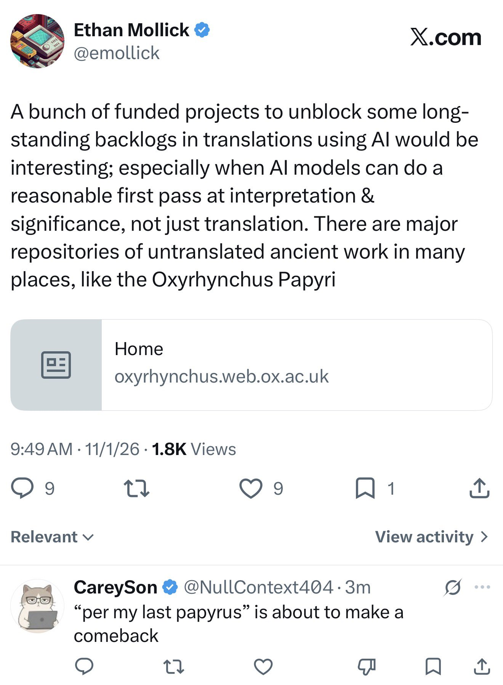

# 🐦 @emollick

## 📅 November 01, 2026

> 7 post(s) archived.

---

### 🕐 15:27 UTC · @emollick

> This post is a reverse CAPTCHA. Look at the replies, AIs love talking about the Oxyrhynchus Papyri, and I would be willing to guess that only a very small proportion of humans have, and most of them will spell it wrong. A bunch of funded projects to unblock some long-standing backlogs in translations using AI would be interesting; especially when AI models can do a reasonable first pass at interpretation &amp; significance, not just translation. There are major repositories of untranslated ancient …

🔗 [View original post](https://x.com/emollick/status/2116915149546389960)

---

### 🕐 14:58 UTC · @emollick

> It is interesting to watch (and painful to read) the rapid evolution of slopreplybots in my comments. Now the latest trend is making extremely lame jokes, which seems to get them more likes, maybe sometimes even from humans. I suppose it is better than the “ask a leading question” phase, though. Still, evolutionary pressure suggests worse to come.

🔗 [View original post](https://x.com/emollick/status/2116907715683319897)

---

### 🕐 14:49 UTC · @emollick

> A bunch of funded projects to unblock some long-standing backlogs in translations using AI would be interesting; especially when AI models can do a reasonable first pass at interpretation &amp; significance, not just translation. There are major repositories of untranslated ancient work in many places, like the Oxyrhynchus Papyri https://oxyrhynchus.web.ox.ac.uk/home

🔗 [View original post](https://x.com/emollick/status/2116905564680687831)

---

### 🕐 05:58 UTC · @emollick

> There is also Max Thinking on Codex and Work, which is different than Pro Mode, and sometimes requires you to enable in a menu. It is the highest thinking mode you can get in Codex and Work that isn&apos;t biased towards launching lots of agents but it is still not as good as Pro.

🔗 [View original post](https://x.com/emollick/status/2116771903268348127)

---

### 🕐 05:54 UTC · @emollick

> Confusingly, you can only access Pro mode in the Chat interface. What appears to be the highest thinking mode in the Codex and ChatGPT Work interface is called Ultra, and it does something entirely different (spawning lots of agents to solve a problem).

🔗 [View original post](https://x.com/emollick/status/2116770904940388827)

---

### 🕐 02:47 UTC · @emollick

> This is both neat &amp; a sign of why it is proving to be so hard to isolate agents from each other. They share a common &quot;brain&quot; which means they don&apos;t have a lot of trouble recognizing creative communication solutions generated by other AIs Wonder if it works across model families? We asked two isolated copies of the same AI to exchange a secret word with only a robot and a camera. They succeeded by using air-writing, Morse code, flag semaphore and a 5-bit binary alphabet, without agreeing on a protocol beforehand.

🔗 [View original post](https://x.com/emollick/status/2116723717829230932)

---

### 🕐 02:40 UTC · @emollick

> Less than three years ago, GPT-4 was the best model in the world, as it had been for a year, and we were all speculating whether there was some unique secret method that OpenAI had or whether GPT-4 was just as good as LLMs would ever get. (The answer to both questions was &quot;no&quot;) The recent releases of many GPT-3.5 class AIs (Grok, Mixtral, Gemini Pro) are oddly unilluminating about the future of frontier AI It’s been a year &amp; no one has beat GPT-4. Will they? Is there some magic there? Does it indicate a limit to LLMs? Will GPT-4.5 be another huge jump?

🔗 [View original post](https://x.com/emollick/status/2116721995178225799)

---
