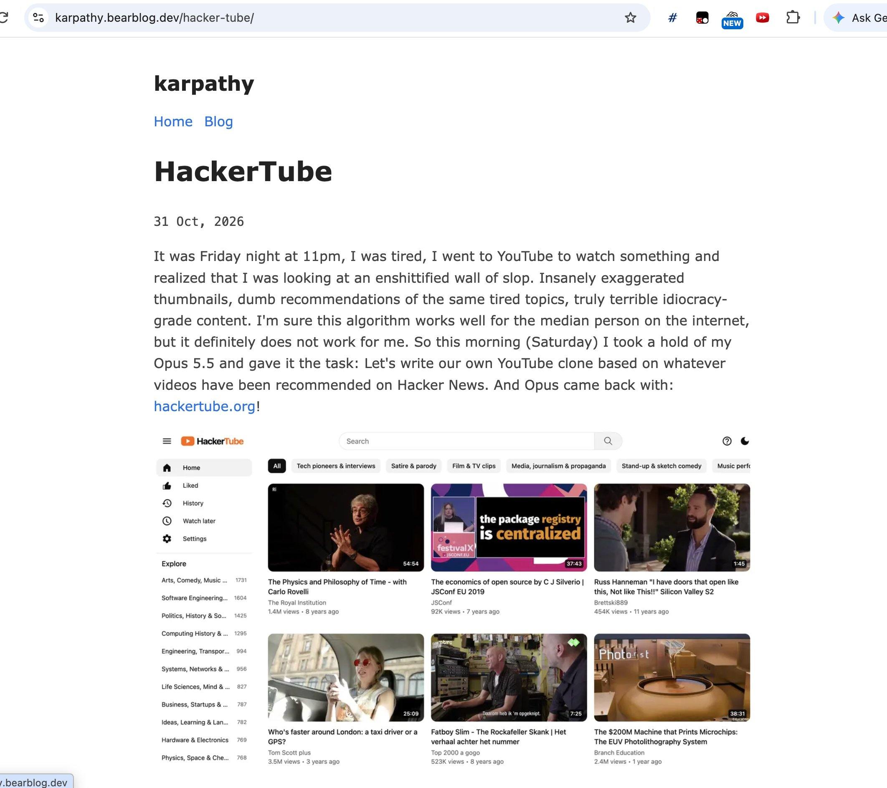

# 🐦 @swyx

## 📅 November 01, 2026

> 2 post(s) archived.

---

### 🕐 06:39 UTC · @swyx

> @karpathy https://hackertube.org/ url

🔗 [View original post](https://x.com/swyx/status/2116782055665402157)

---

### 🕐 06:03 UTC · @swyx

> btw @karpathy uses medium on opus 5.5 on his latest project (Hackertube launched today). overall i think having strong opinions on effort levels is like the tabs vs spaces of our time. just tweak to taste. altho mine is definitely superior to yours. join me all the way on the light side guys low effort + critique loop &gt; superultramaxhighwhatever (for the throughput-constrained; see swyxio/skills/babysit-runs)

🔗 [View original post](https://x.com/swyx/status/2116773135668404286)

---
