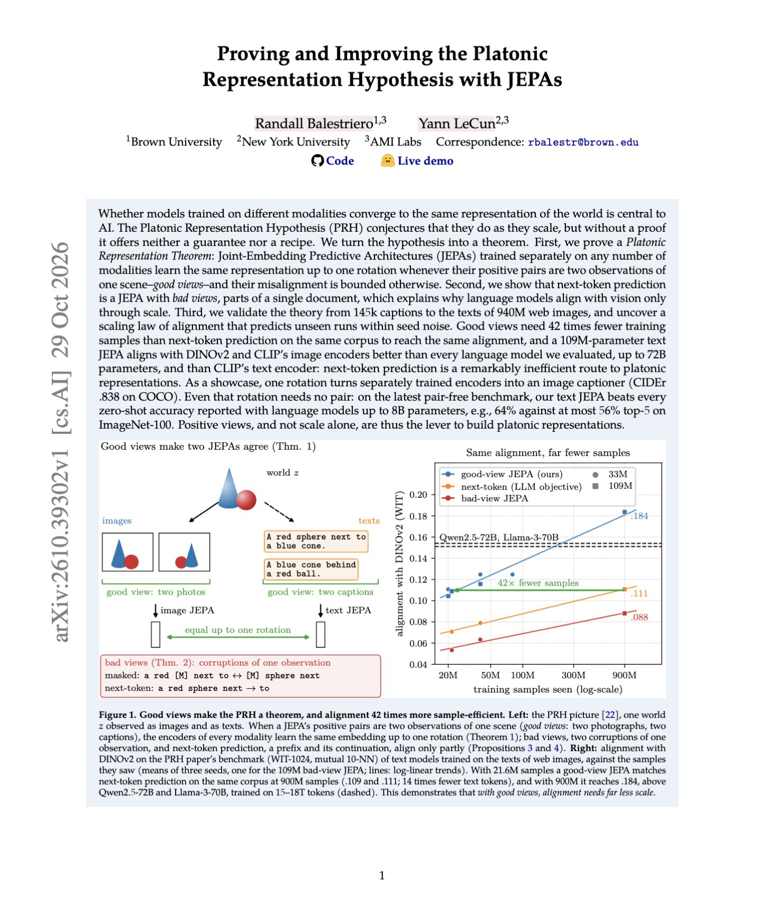

# 🐦 @ylecun

## 📅 November 01, 2026

> 1 post(s) archived.

---

### 🕐 06:28 UTC · @ylecun

> Yann LeCun and Randall Balestriero just Proved the Platonic Representation Hypothesis, and found a better way to achieve it. The Platonic Representation Hypothesis suggests that AI models trained on different modalities, like images and text, eventually learn similar representations of the world. But this paper shows that how models are trained matters more than simply scaling them up. So they mathematically show that, under certain conditions, two JEPAs trained completely separately can learn essentially the same underlying representation of the world. One learns from different images of the same scene, while the other learns from different descriptions of that scene, without ever being trained on image-text pairs. Their approach achieves the same image-text alignment with 42x fewer training samples than next-token prediction. A 109M-parameter text JEPA even outperforms LLMs up to 72B parameters on cross-modal alignment benchmarks. https://www.alphaxiv.org/abs/2610.39302

🔗 [View original post](https://x.com/askalphaxiv/status/2116779287390896418)

---
