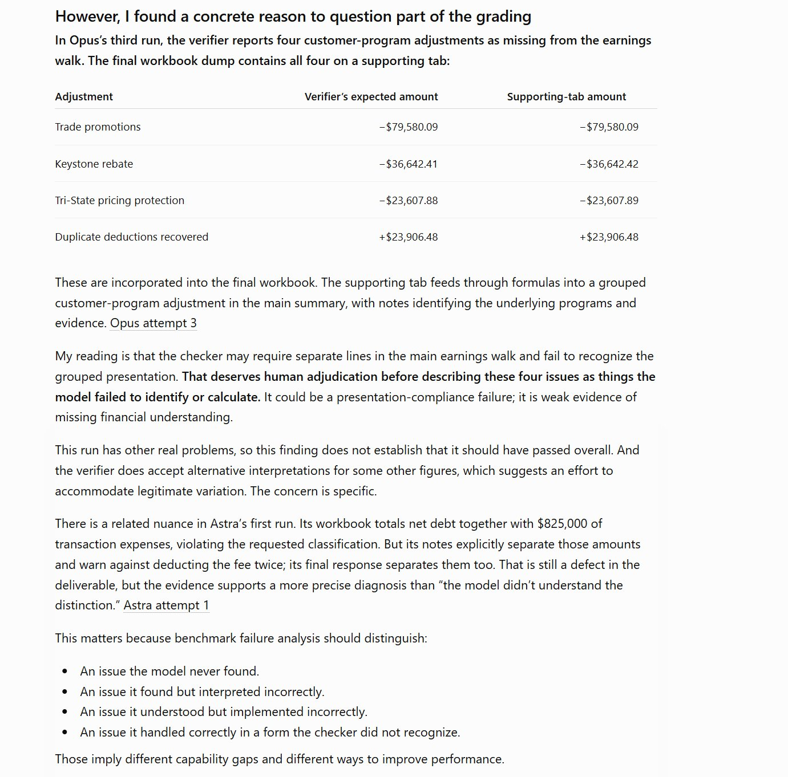

# 🐦 @emollick

## 📅 November 02, 2026

> 2 post(s) archived.

---

### 🕐 06:33 UTC · @emollick

> Again, @SemiAnalysis_ is doing something valuable here &amp; you can see why benchmarks of expert-level work are incredibly hard to pull off. I think this is quite useful at a time where so many other major benchmarks (ARC-AGI, GDPval, METR Long Tasks) are completely saturated.

🔗 [View original post](https://x.com/emollick/status/2117143076443746659)

---

### 🕐 06:30 UTC · @emollick

> Nice to see a successor to GDPval to evaluate AI work but really needs human baselines like GDPval. Funnily enough, GPT-6 Pro spotted some errors in the grading. I also think the 0% scores hide economically meaningful differences in success rates. But still a valuable benchmark! Today we’re releasing GDPx, a benchmark for measuring agentic capabilities across the most valuable domains. GDPx is a true frontier-level benchmark: even the best model scores just 12% (1/7)🧵

🔗 [View original post](https://x.com/emollick/status/2117142297934757916)

---
