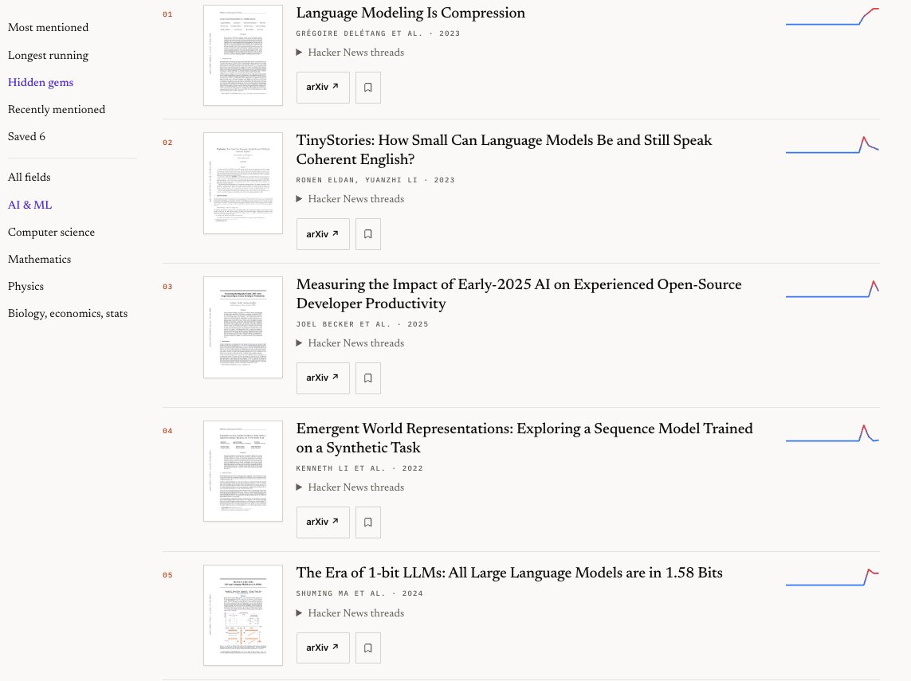
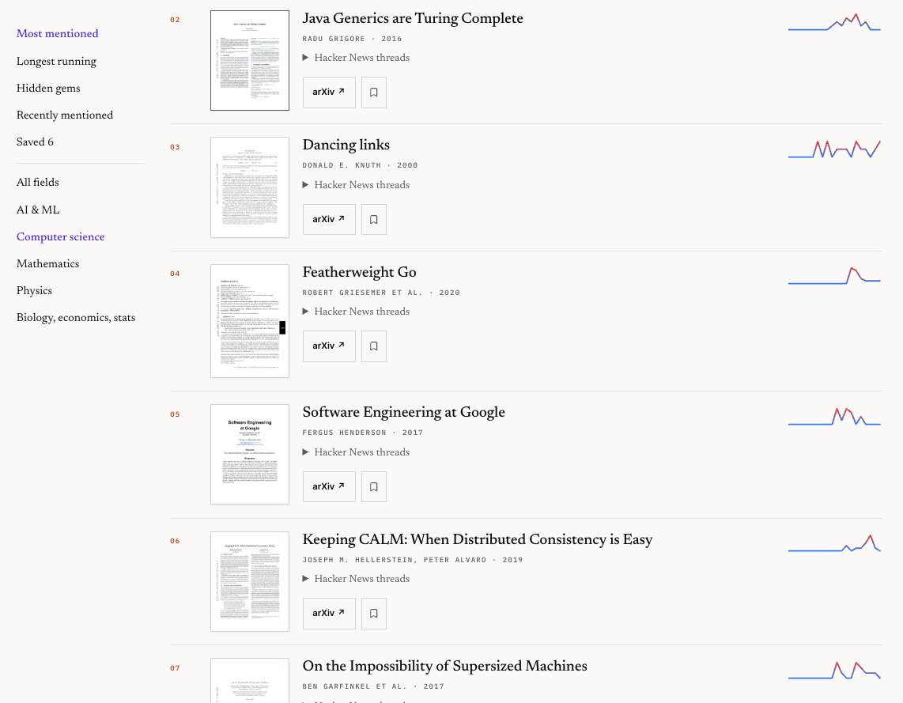
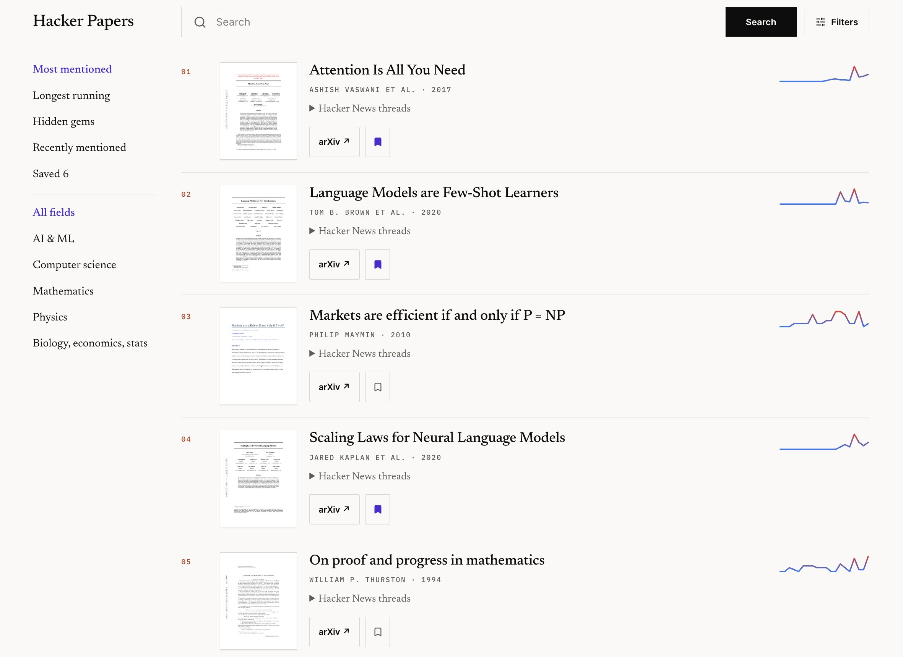

# 🐦 @omarsar0

## 📅 November 02, 2026

> 3 post(s) archived.

---

### 🕐 01:11 UTC · @omarsar0

> Hidden gems are also great!

🔗 [View original post](https://x.com/omarsar0/status/2117061984529133747)

---

### 🕐 01:09 UTC · @omarsar0

> The Computer Science collection is fire! You can also filter by year and sort them.

🔗 [View original post](https://x.com/omarsar0/status/2117061534748700895)

---

### 🕐 00:39 UTC · @omarsar0

> Introducing Hacker Papers! I absolutely love this HackerTube idea from @karpathy. So I took his prompt and similar data sources and asked my agent to build the arXiv papers version of it. Absolute bangers there. Find all 1K+ papers here: https://academy.dair.ai/papers/collections/hacker-papers Weekend hack: HackerTube. I was annoyed with YouTube&apos;s recommendations so I had Claude filter down 43M comments over 20 years of HN to 6,454 videos that keep being recommended. *Significantly* better viewing experience, ~2 hours with Opus 5.5: https://hackertube.org/ - Excellent…

🔗 [View original post](https://x.com/omarsar0/status/2117053859516285354)

---
