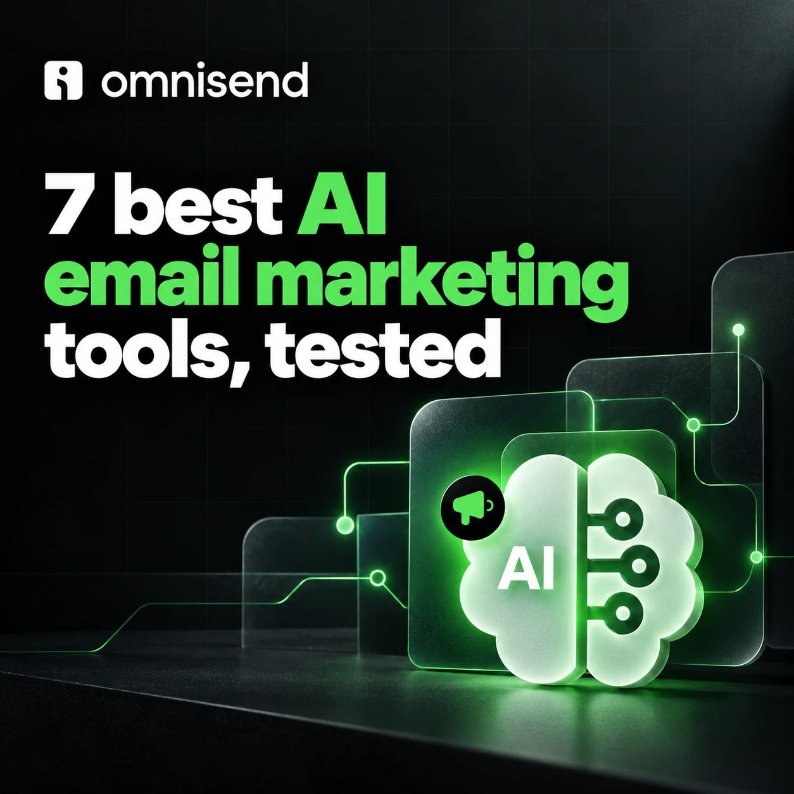

# 🐦 @AiEvolutio58513

## 📅 November 04, 2026

> 5 post(s) archived.

---

### 🕐 15:13 UTC · @AiEvolutio58513

> Ask most people what AI does in email, and you’ll get “writes subject lines.” It’s 8 separate jobs, and writing is the least interesting one on the list. Segment building, send time optimization, predictive analytics, product recommendations, form capture, brand and design automation. @omnisend went and scored 7 platforms against all 8, which is more work than I’ve seen anyone else put into this question. It’s the clearest map I’ve found of what AI actually does in email right now, and what’s still just a line on a pricing page nobody has shipped yet. Definitely worth 5 minutes to make sure you&apos;re on top of your own AI strategy: https://www.omnisend.com/blog/ai-email-marketing-tools/

🔗 [View original post](https://x.com/ecomchasedimond/status/2117998578039931079)

---

### 🕐 15:00 UTC · @AiEvolutio58513

> Pixar founder Ed Catmull explains the question nobody at Disney thought to ask: &quot;No one at Disney thought to ask why.&quot; Disney&apos;s contract with Pixar gave it a full view of Pixar&apos;s business. Disney could see Pixar pulling ahead. Nobody stopped to ask why. Then Bob Iger became CEO. &quot;He walked up our walkway to the building alone. No assistant. No entourage.&quot; &quot;From the people at Pixar, the fact that he came alone was very impressive.&quot; &quot;He was there to learn.&quot; Catmull says that visit is when Iger realized he had to buy Pixar. The data was in Disney&apos;s hands for years. It took one CEO showing up alone and curious to act on it. Interested in AI? Follow @AiEvolutio58513 and never fall behind. I track ChatGPT, Claude, and every tool quietly changing how we work and create, then hand you the tested signals. Media

🔗 [View original post](https://x.com/AiEvolutio58513/status/2117995485168550203)

---

### 🕐 12:58 UTC · @AiEvolutio58513

> Gavin Baker explains Elon Musk&apos;s real superpower: &quot;Elon has always made investors money. He treats it like a sacred covenant.&quot; &quot;Because he&apos;s made people money for now 20 years, he has a superpower. And that is he can essentially raise as much capital as he wants whenever he wants.&quot; The method? &quot;Just never being greedy on valuation.&quot; SpaceX compounded in the low 30s percent a year for about a decade. Interested in AI? Follow @AiEvolutio58513 and never fall behind. I track ChatGPT, Claude, and every tool quietly changing how we work and create, then hand you the tested signals. Media

🔗 [View original post](https://x.com/AiEvolutio58513/status/2117964650474246535)

---

### 🕐 11:00 UTC · @AiEvolutio58513

> Jensen Huang&apos;s math on AI and your job: &quot;Suppose I were to hire a $100,000 employee. And I augmented that $100,000 employee with a $10,000 AI.&quot; If that AI makes the employee two or three times more productive, would he pay for it? &quot;Heartbeat. I&apos;m doing it across every single person in our company right now.&quot; &quot;Every single software engineer, every single chip designer in our company already has AIs working with them.&quot; The result, he says: more chips, faster growth, and Nvidia is hiring more people. Interested in AI? Follow @AiEvolutio58513 and never fall behind. I track ChatGPT, Claude, and every tool quietly changing how we work and create, then hand you the tested signals. Media

🔗 [View original post](https://x.com/AiEvolutio58513/status/2117934925479567372)

---

### 🕐 07:57 UTC · @AiEvolutio58513

> Put Nvidia and SpaceX side by side and the numbers get uncomfortable. Nvidia valuation: $4.97 trillion SpaceX valuation: $1.77 trillion Nvidia revenue: $215 billion SpaceX revenue: $18.7 billion Nvidia started at $0.04 a share in 1999. $1,000 back then is worth about $4.9 million today. SpaceX&apos;s IPO asked new buyers to come in at $135 a share. That&apos;s 94x revenue. One got bought before anyone believed in it. The other was sold after everyone did. Would you have paid 94x? Interested in AI? Follow @AiEvolutio58513 and never fall behind. I track ChatGPT, Claude, and every tool quietly changing how we work and create, then hand you the tested signals. Media

🔗 [View original post](https://x.com/AiEvolutio58513/status/2117888859103236173)

---
